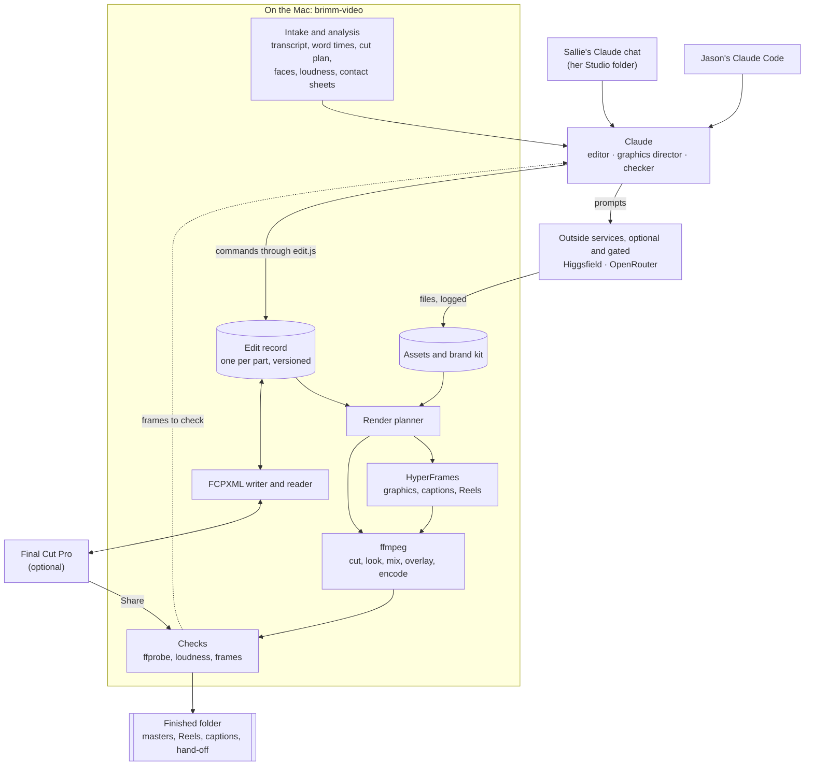
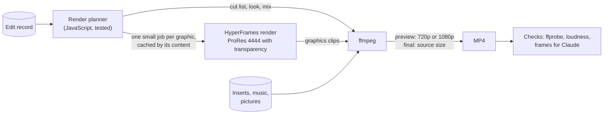
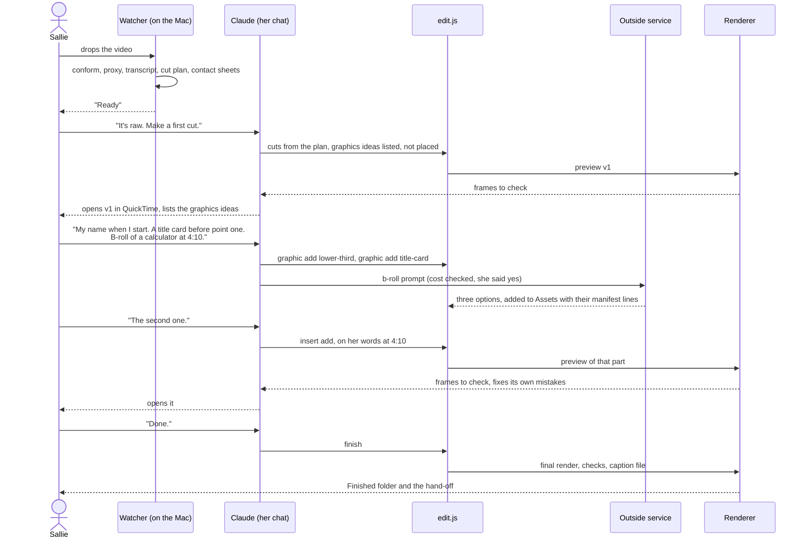
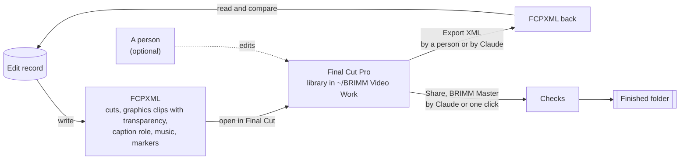

# Claude video editing: system architecture

- **Date:** 2026-10-26.
- **Status:** a design Jason has said yes to, on 2026-10-26, with the half-day render test (H0) as its gate. Nothing in it is built, installed or turned on yet. Section 11 records his answers, and the one item still open: buying Sinthya.
- **What it is:** one design for editing The BRIMM's videos by talking to Claude, graphics included. Outside services may be used. Nobody has to edit in Final Cut Pro. Final Cut stays available: Claude can send an edit to it, read back what a person changed there, and use it to export finished files.
- **How it was made:** a fresh design. It was not bound by the research handoff of 2026-10-26 or by the design of 2026-10-22. It does keep this repo's rules from `CLAUDE.md`. Facts about outside tools were checked on 2026-10-26; "Sources" at the end says how.

## 1. What it has to do

1. Sallie edits by chat. She says what she wants and watches the result. She never opens a timeline.
2. It adds graphics: her name, titles, quote, list and number cards, the logo, end cards, captions on Reels, charts, pictures, and b-roll that was filmed or generated.
3. It makes finished files: the main video (wide), Reels (upright), caption files and the hand-off for BRIMM Ops.
4. Final Cut is optional. It can be one step in the process, used by Claude or by a person, and nothing needs it.
5. It keeps this repo's rules:
   - It drafts. It never posts or publishes.
   - Private client and group sessions stay on the Mac.
   - Nothing is installed without Jason's yes.

## 2. The idea in one picture

Claude makes the editing decisions. Deterministic tools do the work. Between them sits one **edit record** for each part of a video (the main video, each Reel). Claude only ever changes the edit record. Renders, Final Cut files and finished files are all made from it. So a chat edit, a Final Cut edit and an undo all change the same thing.



## 3. Design rules

1. **The edit record is the only truth.** Renders and Final Cut files are made from it and can be thrown away. A person's work in Final Cut comes back into it (section 7).
2. **Claude decides, tools do.** Claude never draws pixels or runs an encoder by hand. It calls `edit.js` commands with words and numbers. That keeps Sallie's folder lock as it is: her session runs `edit.js` and nothing else.
3. **Graphics are made from a brand kit, written as code.** Each graphic is a HyperFrames component (HTML, CSS and animation) with the brand's colours and typefaces built in. Claude fills in the words and settings, and does not design from scratch each time (4.5).
4. **Times hang on words.** A graphic, a b-roll insert or a music cue is tied to the words it goes with, not to a second. A later cut moves it with its words. If its words are cut, it says so ("cut now").
5. **Every change is seen before it is final.** A preview is rendered, Claude checks its frames, and Sallie watches. Only "done" makes the full-quality files.
6. **Outside services get as little as possible.** By default they get a prompt Claude wrote, never footage. A video meant for posting may go to one named tool after a yes for that video (Jason, 2026-10-26). Each service has a list of what it may receive (4.6). A client or group session never goes to any of them.
7. **Drafts only.** No tool in the system can post or publish. Those tools are denied in the settings (section 8).

## 4. The parts

### 4.1 Intake and analysis (on the Mac, no outside service)

On a drop, the watcher (today's launch agent) does the work that needs no judgement:

- **Probe and conform.** Reads the file's facts. Makes a constant-frame-rate working copy when the source is variable, as phone and Zoom files often are. Makes a small proxy for quick previews.
- **Transcript with word times.** As today (whisper.cpp), or another engine chosen later.
- **The cut plan.** Retakes, false starts and long pauses, as today (`cuts.js`).
- **Pictures for Claude.** Claude cannot watch video, but it can look at still frames. So intake makes contact sheets: a grid of frames for every shot, and frames either side of every planned cut. Faces are found as today (`faces.swift`) so that upright crops and graphics keep clear of her face.
- **Sound.** Loudness, silences, and where music could duck under speech.

### 4.2 The edit record

One JSON file per part, versioned. Today's episode record already holds much of it (cuts, layers, spellings, the preset). The edit record is that record grown into a whole timeline. In outline:

```json
{
  "part": "main",
  "version": 7,
  "frame": { "width": 3840, "height": 2160, "fps": "30/1" },
  "source": "raw.mp4",
  "privacy": "public-bound",
  "cuts": [{ "keep": ["w0012", "w0418"], "why": "retake at 1:52 removed" }],
  "graphics": [
    { "id": "g1", "component": "lower-third", "words": ["w0020", "w0034"],
      "params": { "name": "Sallie Ogden", "role": "Founder, The BRIMM" } },
    { "id": "g2", "component": "title-card", "before": "w0102",
      "length": 2.5, "params": { "title": "Three pricing mistakes" } }
  ],
  "inserts": [
    { "id": "b1", "asset": "gen/calculator-0412.mp4", "words": ["w0880", "w0901"],
      "mode": "cutaway", "audio": "keep-voice" }
  ],
  "audio": [{ "id": "m1", "asset": "music/bed-calm.m4a", "level": -20, "duck": true }],
  "look": "natural",
  "captions": { "drawn": false, "file": true },
  "history": "versions/"
}
```

- `w0012` and the like are word ids from the transcript. Times are worked out at render time, on the newest version's clock.
- Every change is a new version with who made it (Claude, Sallie by chat, or a hand edit in Final Cut) and why. "Go back to version 5" is just a pointer.
- A Reel is a part of its own with its own record, made from words of the main video.

### 4.3 Claude's jobs

| Job | What it reads | What it writes |
|---|---|---|
| **Editor** | the transcript, the cut plan, contact sheets | cuts, order, where a Reel starts and ends |
| **Graphics director** | the words, the brand kit's list of components, contact sheets (where her face is) | graphics with their words and settings, ideas for b-roll and pictures |
| **Prompt writer** | what Sallie asked for, the brand notes | prompts for pictures and b-roll, which go to outside services |
| **Checker** | frames taken from each render: every graphic's first and last frame, the frames either side of each cut, each insert | "looks right", or a fix it makes itself (a title that hides her face, a typo, a card that runs into a cut, text outside an upright frame's safe area), before Sallie sees the render |

- **Where it runs:** Claude Code on the Mac. That is Sallie's chat in the Claude app, in her Studio folder, or Jason's terminal. The skill `brimm-edit` teaches it the commands. HyperFrames' own Claude Code skills teach the component format, and are used by Jason when building the brand kit, not in her folder.
- **Which model:** the strongest model for editing and graphics decisions. A cheaper one for routine reads, such as checking frames.

### 4.4 The renderer (path A: no Final Cut)

This is the default path. It makes every preview and every finished file with no person in Final Cut.



**The main video.**

- **The cut.** ffmpeg cuts the source as the record says.
- **The look.** A colour look as a LUT file (ffmpeg's `lut3d`). Natural, Bright, Warm and Moody come from the preset research.
- **The sound.** Voice levelled to about -14 LUFS, music ducked under speech.
- **The encode.** The Mac's hardware encoder (VideoToolbox).
- **Graphics.** Each graphic is rendered by HyperFrames as a short clip with a transparent background (ProRes 4444 `.mov`). ffmpeg lays it over the picture at its time (`overlay`).
- **Why not run the whole hour through HyperFrames?** HyperFrames draws every frame in a headless browser. That suits a 60-second Reel, not an hour of 4K. So the long video stays in ffmpeg. Only the few seconds that carry a graphic are drawn.
- This does not need `drawtext` or `libass`, which Homebrew's ffmpeg lost in January 2026 (project records).

**Reels.** One HyperFrames composition per Reel:

- the cut stretches of the source, cut first by ffmpeg into a working file so the browser does not decode 4K HEVC;
- the upright crop following her face (crop keyframes from `faces.swift`);
- word-timed animated captions in the chosen style (Plain, Boxed, Bold, Signature);
- the Reel's title, any graphics, and the end card.

HyperFrames renders it straight to MP4. Captions and graphics then move in step with the words, which is what a Reel's look depends on.

**Two qualities.**

- **"Show me"** renders a preview: 720p or 1080p, from the proxy where it can. "Show me that part" renders about 30 seconds around the last change.
- **"Done"** renders at the source's size: H.264 High, BT.709, AAC 48 kHz (the delivery spec of the preset research). It also writes a caption file made from the words and their final times.

**Caching.** A graphic's clip is named by a hash of its component, its settings, the brand kit's version and the frame size. Moving a graphic, or re-cutting around it, re-renders nothing but the ffmpeg pass.

**Checks before anyone sees it.**

- ffprobe: size, frame rate, colour tags, length.
- Loudness.
- No black or frozen frames at the joins.
- Then Claude's frame check (4.3).

### 4.5 The graphics system

The brand kit is a HyperFrames project kept in the repo (`tool/brand/`, once built). It holds:

- **Tokens**, in `brand.css`:
  - colours: navy `#1F2D42`, sand `#C1AD97`, mist `#E8E3DA`, and the rest of the brand guide;
  - typefaces: Sweet Sans Pro through Adobe Fonts (Jason, 2026-10-26), used as a font installed on the Mac, so H0 checks that the renderer's Chrome can see it; Sinthya from its font file with `@font-face`, once bought;
  - spacing and safe areas: Meta's upright safe zone of top 14%, bottom 35% and sides 6% (preset research).
- **Motion presets.** A few short entrances and exits, the same everywhere, so every graphic moves like the brand.
- **Components.** Each is a small HTML composition with a list of settings that Claude fills in:

| Component | Settings Claude fills in | Used on |
|---|---|---|
| `lower-third` | name, role | main, Reels |
| `title-card` | title, kicker | main |
| `chapter-card` | number, title | main |
| `quote-card` | quote, who said it | main, Reels |
| `list-card` | 2 to 5 lines, revealed one by one on their words | main, Reels |
| `stat-card` | number, label, what the number counts | main, Reels |
| `picture` | a picture (Canva, generated or her own), frame, slow push-in | main, Reels |
| `chart` | a few numbers, chart type | main |
| `logo-bug` | which logo, corner | main |
| `end-card` | next video, call to watch | main, Reels |
| `captions` | style, from the word times | Reels only (the main video carries a caption file, not drawn captions) |

**One-off graphics.** When Sallie asks for something no component covers ("a timeline of my three businesses"), Claude writes a new composition in the same format. HyperFrames' `check` and `snapshot` commands test it, and Claude looks at its frames. If it is worth keeping, Jason adds it to the kit.

**What a person can still do by hand.**

- HyperFrames has its own preview editor, for nudging a graphic.
- In Final Cut, a graphic arrives as a clip on its own role. It can be moved or trimmed there. Its words are changed by asking Claude.

### 4.6 Outside services

Each service has a role, a list of what it may receive, and guards. The privacy classes are explained in section 8.

| Service | Used for | What it receives | Allowed for | Guards |
|---|---|---|---|---|
| **HyperFrames** (local, open source, Apache-2.0) | every graphic, Reel compositions, beat finding for music cuts, background removal (on the Mac, with no upload) | nothing: it renders on the Mac | every kind | version pinned; telemetry turned off; `publish`, `cloud`, `lambda` and `cloudrun` denied, since they upload the project |
| **Higgsfield** (connector, account credits) | the one source of generated b-roll: from a prompt or a still (models such as Kling, Seedance, Veo); animating a still; video upscaling (Topaz or ByteDance); reframing to upright (60 s at most) | a prompt; for the tools that work on footage, the clip itself | prompts: any kind but a session. Footage: public-bound videos only, after a yes for that video | Higgsfield says it uses uploaded content to improve its models (its own post, from 2026-08-27), so footage is never sent by default. The smallest paid plan, bought when H6 starts (Jason, 2026-10-26). Sallie's folder may call only its generation, cost-check and job-status tools. A cost check (`get_cost`) before every paid job. A daily credit budget. Its publishing and website tools denied (section 8) |
| **OpenRouter** (API key, in the Keychain) | pictures (one zero-retention model and provider, pinned, as designed on 2026-10-25). Pictures only for now (Jason, 2026-10-26). Later, each on its own yes after H3: b-roll through its video API (Veo 3.1, Seedance, Wan, Sora 2 Pro, Kling; some listed as alpha), and "eyes": a Gemini model watching a small proxy, to judge energy or find visual moments | a prompt; for "eyes", a low-resolution proxy | prompts: any kind but a session. "Eyes": public-bound videos only, after a yes | the key's own guardrail (model and provider allowlists, zero retention, daily budget). The key is read by `edit.js` from the Keychain, never by Claude |
| **A music library** (one subscription; her outside editor's, if they use one) | music beds: Sallie picks 5 to 10 tracks into `Assets/Music/`, and Claude places them and lowers them under her voice (Jason, 2026-10-26) | nothing: a person downloads the tracks | any kind | check that its licence covers YouTube, Instagram and LinkedIn for a business before subscribing |
| **OpusClip** (connected now) | clip ideas from a published video's YouTube link | a public link | published videos only | posting tools denied, as today |
| **Canva** | Sallie's own pictures, dropped into `Assets/` | nothing from the system | — | — |
| **Claude** (Anthropic) | every decision | transcripts, contact sheets, frames | as today: a session's words only when she asks for its teachings, with training off | — |

**No generated people who could pass as real, and never a generated Sallie, face or voice** (Jason, 2026-10-26). B-roll shows objects, places and abstract scenes.

**Every generated or bought asset gets a manifest line** (Jason, 2026-10-26): service, model, prompt, cost, date, licence, and whether it is realistic synthetic media. The hand-off carries that last flag, so Sallie knows when YouTube's disclosure question should be answered yes. (Disclosure applies to realistic altered or synthetic content. Check YouTube's own help page before relying on this.)

**Generation is always a choice.** Claude makes two or three options, shows their stills or a contact sheet, and Sallie picks one. Nothing generated goes into a finished file without being in a preview she watched.

## 5. How a video moves through it

A raw video with retakes, from drop to finished files:



What Sallie says, and what happens:

| She says | Claude runs (through `edit.js`) | Made by |
|---|---|---|
| "Make a first cut" | cuts from the plan | ffmpeg |
| "Put my name up when I start" | `graphic add lower-third` on her first words | HyperFrames, then ffmpeg |
| "A card that says 'Three pricing mistakes' before the first one" | `graphic add title-card` | HyperFrames |
| "Show the three steps as I say them" | `graphic add list-card`, each line on its words | HyperFrames |
| "A picture of a messy desk while I talk about overwhelm" | `picture make` (prompt), then the `picture` component | OpenRouter, then HyperFrames |
| "B-roll of a calculator at 4:10" | `broll make`: cost first, options, she picks | Higgsfield |
| "Cut the bit about my sister" | `cut remove` on those words | edit record |
| "Make it moody" | `look moody` | ffmpeg |
| "Quiet music under it" | `music add`, ducked under her voice | ffmpeg |
| "Make Reel 2 with bold captions" | `reel make 2 --captions bold` | HyperFrames |
| "Undo that" / "Go back to version 5" | history | edit record |
| "Open it in Final Cut" | push | Final Cut (section 7) |
| "I changed it in Final Cut" | pull back | Final Cut (section 7) |
| "Export it from Final Cut" | Share by Claude | Final Cut (section 7) |
| "Done" | `finish`: final render, checks, hand-off | ffmpeg, HyperFrames |

## 6. Where things run

- **The watcher** (launch agent `com.thebrimm.unedited`) does intake and long renders as detached jobs. It may call `claude -p` for readings. It never uses computer use, which does not work in `-p` mode.
- **Sallie's chat** runs in her Studio folder. It is locked to `edit.js`, plus the Higgsfield connector with an allowlist of its tools. The 2026-10-22 requirements already say her lock "can admit a connector later". Higgsfield returns a link. `edit.js asset add` downloads the file into `Assets/` and writes its manifest line, since Claude cannot write files in her folder.
- **Jason's sessions** build and test the system. They are the first place Claude drives Final Cut (section 7).
- **Each Mac renders its own.** The Mac Studio (M1 Max, 32 GB) takes the heavy finals. Sallie's laptop (M4, 16 GB) renders previews; it may also render finals once the render test says how long they take. HyperFrames could render in the cloud, but that uploads the project, so it stays denied.

## 7. Final Cut Pro: optional, three ways in

FCPXML is how Claude edits in Final Cut. It is a file Claude writes and reads, not clicks on a timeline. Clicking is kept for the steps that Final Cut only offers on screen.



**Push.** The FCPXML writer (today's `fcpxml.js`) gains:

- graphics as their rendered clips with transparency, on a role of brimm-video's own;
- captions on a caption role;
- music on an audio role;
- a marker for each of Claude's decisions.

It is opened with `open -a "Final Cut Pro"` into the library in `~/BRIMM Video Work`, as today.

**Pull back.** After a person edits in Final Cut:

1. File > Export XML gives a new FCPXML. A person can do it, or Claude can (below).
2. The reader compares it with what was pushed.
3. Each difference becomes a new version of the edit record, marked "hand edit in Final Cut". For example, a trim of 0.4 s at cut 14, or a graphic moved.
4. Anything the record cannot express, such as a Final Cut effect it does not know, marks that part "finish in Final Cut". Its final file then comes from Final Cut's Share, not the renderer, so the hand work is never lost.

**Export from Final Cut.** Three ways, in the order proposed:

1. **Claude, with computer use.** Claude Code's computer use can open apps, click and see the screen on macOS. Jason allowed Claude to drive Final Cut's screen on 2026-10-26, in his sessions first.
   - **Limits** (Claude Code docs):
     - it is a research preview;
     - it needs a Pro or Max plan;
     - it works only in an interactive session, never with `-p`;
     - one session at a time;
     - each app is approved per session;
     - it takes over the screen while it works, and Esc stops it.
   - **What Claude does:** selects the project, runs File > Share with a saved "BRIMM Master" destination that writes into the Finished folder, waits for the file, then runs the checks.
   - **It can also apply Final Cut-only tools,** such as Voice Isolation, Enhance Light and Color, or Beat Detection, where FCPXML cannot carry them. Which ones FCPXML can carry is to be checked one by one.
2. **One click by a person:** Share with the same destination. Claude picks up the file and checks it, as the `From Final Cut` folder works today.
3. **CommandPost** (open source, MIT), which can batch-export from Final Cut. Its `cmdpost` command runs Lua from the terminal. Its batch export still drives Final Cut's screen. Whether a script can start it is not confirmed. Test only.

**When to use Final Cut at all.** When a person wants their hands on it. When a Final Cut-only tool would make it better. Or as a second way to export if the renderer has a problem. Otherwise path A is shorter, needs nothing on screen, and runs while the Mac is used for other things.

## 8. Guardrails

**Privacy classes**, set on every video at intake from the kind Sallie answers:

| Class | Which videos | Claude | Outside services |
|---|---|---|---|
| `session` | client and group sessions | words only when she asks for teachings, training off | none, ever |
| `private` | anything she marks private | yes | prompts only |
| `public-bound` | episodes, Reels, raw videos meant for posting | yes | prompts; footage only to a named tool after a yes for that video |

`edit.js` checks the class before any command that sends something out, and logs every send (service, what, cost), never its content.

**Settings: denied tools.** In her folder's settings, and in Jason's, as a hook and as permission rules:

- **Higgsfield:**
  - publishing: every `tiktok_*` tool, `publish_project`, `unpublish_project` and the project publication tools (`*_project_publication*`);
  - websites: every tool with `website` in its name;
  - also `participate_in_contest` and `cancel_trial_auto_renewal`.
- **OpusClip:** `opusclip_schedule_publish` and `opusclip_create_post_task` (its posting tools stay denied, as the 2026-10-22 requirements say).
- **HyperFrames:** `publish`, `cloud`, `lambda`, `cloudrun`, `feedback`.

**Money.**

- Each paid job is priced first: Higgsfield's `get_cost`, or OpenRouter's model price.
- Above a set amount, Sallie is asked.
- Daily budgets are set at each service, so a mistake cannot run up a bill.

**Licences.**

- Every asset's licence is in its manifest line.
- **Sweet Sans Pro** comes through Adobe Fonts (Jason, 2026-10-26), whose page for it lists video and broadcast use. It needs a Creative Cloud plan with Adobe Fonts, signed in on each Mac that edits or renders. Adobe Fonts gives no font file, so H0 checks that the renderer can use the installed font.
- **Sinthya** is not on Adobe Fonts. It is sold by Sronstudio on Creative Market ($25 a seat, two seats), and its licence does not name video: ask its maker to confirm video use before buying. Varela stands in until then.

## 9. What stays from today's tool, and what changes

| Today | In this design |
|---|---|
| Transcript, word times, cut plan, faces (`unedited.js`, `cuts.js`, `faces.swift`) | kept as intake |
| The episode record, layers (`layers.js`), recuts (`recut.js`), versions and clocks (`timeline.js`, `clock.js`) | grow into the edit record; word anchors already exist (`--at-words`) |
| The planned Swift drawer and ffmpeg overlay (2026-10-22 design, phases R0 and V1) | replaced by HyperFrames clips and the same ffmpeg overlay. The ffmpeg half and the R0 test stay |
| Text cards only (Jason, 2026-10-22) | the brand kit's components, then pictures and b-roll, each by a decision of Jason's |
| `fcpxml.js` push, push guard, `finish` with the Final Cut Share | kept; gains graphics clips, pull back, and export by Claude |
| Sallie's folder lock, guard hook, gate on sessions | kept; gains one connector with an allowlist, and the denied tools above |
| OpenRouter for pictures, pinned to zero retention (2026-10-25) | kept as designed; video and "eyes" added only on a yes |

## 10. Build order

Each step is a pull request with failing tests first, as the repo's rules say. No test calls a real outside service, `claude`, HyperFrames' renderer or Final Cut. Stand-ins answer for them.

| Step | What | Done when |
|---|---|---|
| **H0. Render test** (by hand, scratch folder, never a watched one; Mac Studio only, Jason 2026-10-26) | Install HyperFrames in a scratch folder: version pinned, telemetry off, its Claude skills skipped. Render a lower third and a title card as transparent ProRes, with Sweet Sans Pro from Adobe Fonts. Lay them over a test recording with ffmpeg. Render one 60-second Reel as a full composition. | Jason judges the frames: navy still navy, Sweet Sans Pro drawn and not a stand-in, timing to the frame. Times measured on the Mac Studio. The same test on Sallie's laptop once H0 passes, when Jason says yes to installing it there |
| **H1. Edit record and render planner** | The record's format, the move from today's record, and the planner that turns a record into ffmpeg and HyperFrames jobs (pure JavaScript) | planner output matches the FCPXML writer frame for frame on fixtures |
| **H2. Brand kit** | tokens, motion presets, the first components (`lower-third`, `title-card`, `list-card`, `logo-bug`, `end-card`) with their settings lists | stored reference frames match on both Macs |
| **H3. Path A** | `render` (preview, that part), `finish` (final), the checks, Claude's frame check | a test recording goes from drop to Finished with no Final Cut |
| **H4. Reels** | Reel composition, crops from faces, the four caption styles | Jason's test Reel judged by eye |
| **H5. Final Cut bridge** | graphics clips in FCPXML, pull back and compare | a hand edit in Final Cut comes back as a version |
| **H6. Outside media** | `picture make` (OpenRouter, as designed), then `broll make` (Higgsfield, on its smallest paid plan), the asset manifest and its synthetic-media flag, budgets, the denied tools | stand-in services in tests; one real job of each on Jason's key |
| **H7. Claude exports from Final Cut** | the computer-use export, in Jason's sessions first | three exports in a row with no help |
| **H8. Optional extras** | "eyes", music and sound effects | each on its own yes |

**Risks and unknowns.**

- **HyperFrames moves fast.** It is at version 0.8.206, released 2026-10-26, with several releases a day. Pin a version, and upgrade only on purpose after the reference-frame test.
- **Colour.** Graphics are drawn in sRGB and the video is BT.709. The overlay must convert with the right matrix, or the navy shifts. H0 checks it.
- **Speed on the laptop.** A headless browser plus the encoder on 16 GB. Measured by H0's repeat on the laptop.
- **Adobe Fonts and the renderer.** Adobe Fonts gives no font file. If HyperFrames' Chrome cannot see the installed font, the fallback is to buy Sweet Sans Pro's files after all, for the renderer.
- **Computer use.** It is a research preview. A Final Cut update can move a menu, and it takes over the screen while it runs. Keep the one-click Share as the fallback.
- **Generated b-roll.** It can look fake next to a real person on a business show. Prefer objects, places and abstract shots over generated people. Label it in the manifest.
- **Pages not opened.** openrouter.ai and higgsfield.ai could not be opened from this session. Their lines in this document come from search summaries of their pages. Check them before H6.

## 11. Jason's decisions

All answered on 2026-10-26, except buying Sinthya (7). Numbers 3 and 6 in his words ("two earlier rules can change"); the rest picked on answer cards after a walk-through of each.

1. **The architecture itself: yes, with H0 as the gate.** One edit record as the truth, HyperFrames for graphics, and path A as the default. If H0 fails (colour, font, timing or speed), the Swift drawer of 2026-10-22 comes back. Each phase is still its own pull request.
2. **Installing HyperFrames: on the Mac Studio, for H0.** In a scratch folder, with the version pinned, telemetry off and its Claude skills skipped. Sallie's laptop only after H0 passes, and with Jason's yes then.
3. **Footage leaving the Mac: yes, as proposed.** The 2026-10-22 rule ("no video or sound leaves the Mac") stays the default. The one exception: a public-bound video may be sent to one named tool after a yes for that video, for example a Higgsfield upscale or OpenRouter "eyes". A client or group session never leaves the Mac.
4. **Higgsfield: the smallest paid plan, bought when H6 starts.** It is the one source of generated b-roll. Its training terms are acceptable for prompts. Sallie's folder may call only its generation, cost-check and job-status tools. Background removal is done on the Mac by HyperFrames instead.
5. **OpenRouter: pictures only for now.** Video generation and "eyes" are looked at again after H3, each on its own yes.
6. **Claude driving Final Cut's screen: yes, as proposed.** It replaces the no of 2026-10-22. It is an option for exporting and for Final Cut-only tools. It runs in Jason's sessions first, and is never needed on Sallie's path.
7. **Typefaces: Sweet Sans Pro through Adobe Fonts.** H0 checks that the renderer can use it. **Still open: Sinthya**, which is not on Adobe Fonts. The proposal is two seats on Creative Market ($50), once its maker confirms video use.
8. **Music: a library subscription, with Sallie picking the tracks.** Her outside editor's library, if they use one. Its licence is checked for YouTube, Instagram and LinkedIn first.
9. **Labelling: yes, and no fake people.** A synthetic-media flag on every asset and a line in the hand-off. No generated people who could pass as real, and never a generated Sallie, face or voice.

## Sources

All read on 2026-10-26. A vendor's page is its own claim, not a measurement.

- **HyperFrames:** the repository [heygen-com/hyperframes](https://github.com/heygen-com/hyperframes), read at commit 9ebc1f8 (2026-10-26), and its docs in that commit:
  - `docs/guides/rendering.mdx`: MP4, MOV (ProRes 4444 with transparency) and WebM (with transparency); `--quality`; `--fps`; Docker;
  - `docs/packages/cli.mdx`: `init`, `transcribe`, `timeline`, `check`, `snapshot`, `beats`, `publish`, `cloud`, `lambda`, `telemetry`;
  - `docs/guides/mcp.mdx`: a hosted connector, in beta;
  - `docs/changelog.mdx`: v0.8.206, 2026-10-26.
  - Licence: Apache-2.0. Needs Node 22 or later and FFmpeg (README).
- **Claude Code computer use:** [code.claude.com/docs/en/computer-use](https://code.claude.com/docs/en/computer-use), read directly. It says: macOS; Pro or Max; interactive only, not `-p`; approved per app; one session at a time.
- **Higgsfield:**
  - **its tools:** the descriptions of the Higgsfield connector attached to this session (`reframe` at most 60 s; `upscale_video` by Topaz or ByteDance; `remove_background` for video; `video_analysis_create`; `generate_video`; `shorts_studio_create` at 720p only; the publishing and website tools listed in section 8);
  - **the connector itself:** [Higgsfield help: what is Higgsfield MCP](https://higgsfield.ai/creator-hub/help-center/mcp-cli/what-is-higgsfield-mcp), from a search summary. It is OAuth, and MCP jobs use plan credits;
  - **its terms:** [Updates to Higgsfield's Terms of Use and Privacy Policy](https://higgsfield.ai/blog/terms-of-use-privacy-policy-update), from a search summary. Content is used to improve its models, from 2026-08-27.
- **OpenRouter:**
  - [Video generation](https://openrouter.ai/blog/video-generation) (2026-04-15) and the [video models collection](https://openrouter.ai/collections/video-models), from search summaries. They give the `/api/v1/videos` endpoint (submit, then poll), the models, and alpha status on some model pages;
  - [Video inputs](https://openrouter.ai/docs/guides/overview/multimodal/videos), from a search summary: `video_url`; Gemini on AI Studio takes YouTube links only, and on Vertex base64 only.
- **Final Cut Pro:** [release notes](https://support.apple.com/102825), from a search summary: 12.0 of 2026-01-28 with FCPXML 1.14 and Beat Detection; 12.3 with Generate Captions; 12.4 of 2026-09-29.
- **CommandPost:** [command line tool](https://commandpost.fcp.cafe/scripting/command-line-interface/) and [batch export](https://commandpost.fcp.cafe/final-cut-pro/batch-export-active-timeline/), from search summaries.
- **YouTube disclosure of synthetic media:** secondary coverage only, for example [this summary](https://minimatters.com/youtube-altered-or-synthetic-content-disclosure/). Check YouTube's own help page.
- **ElevenLabs music licensing:** secondary coverage only, and it disagrees on which plans allow commercial use. One reason a music library was chosen instead.
- **For the answers in section 11** (read 2026-10-26):
  - **HyperFrames' docs** at the same commit: `packages/cli.mdx` (`telemetry`, on until turned off with `HYPERFRAMES_NO_TELEMETRY=1`; `browser`, which downloads and caches its Chrome; `init --skip-skills`) and `guides/remove-background.mdx` (the basic cut-out runs on the computer, with no upload).
  - **Higgsfield's prices:** [a competitor's summary](https://creatify.ai/blog/higgsfield-pricing-(2026)-plans-and-what-you-ll-actually-pay), from a search summary: Starter about $19 a month billed yearly, commercial use on paid plans, monthly credits that expire. Check Higgsfield's own page at H6.
  - **Sweet Sans Pro on Adobe Fonts:** [its page](https://fonts.adobe.com/fonts/sweet-sans-pro), from a search summary; MVB's other Adobe Fonts pages list video and broadcast use.
  - **Sinthya:** [Sronstudio on Creative Market](https://creativemarket.com/Sronstudio/3897399-Sinthya-Casual-Script-Font); no Adobe Fonts listing found. The preset research (`docs/research/2026-10-13-video-presets/brand-guide.md`) has its licence and price.
- **This repo:**
  - `docs/requirements.md`: the workflows of 2026-10-22 and Jason's answers;
  - `docs/superpowers/specs/2026-10-22-brimm-video-light-import-and-fork-design.md`: section 4, rendering;
  - `docs/research/2026-10-13-video-presets/`: brand, safe zones, delivery spec;
  - the headers of `tool/layers.js`, `tool/styles.js`, `tool/timeline.js` and `tool/fcpxml.js`.
