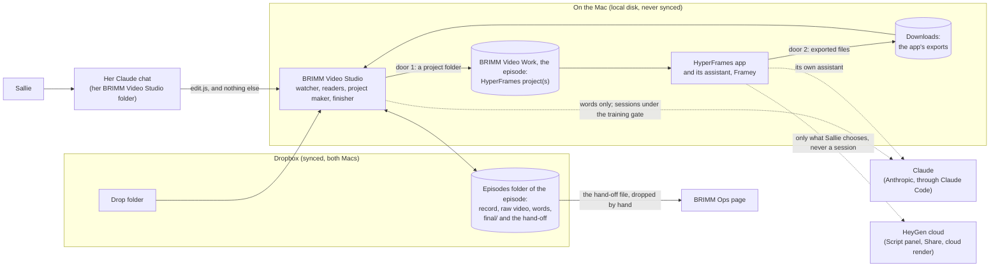
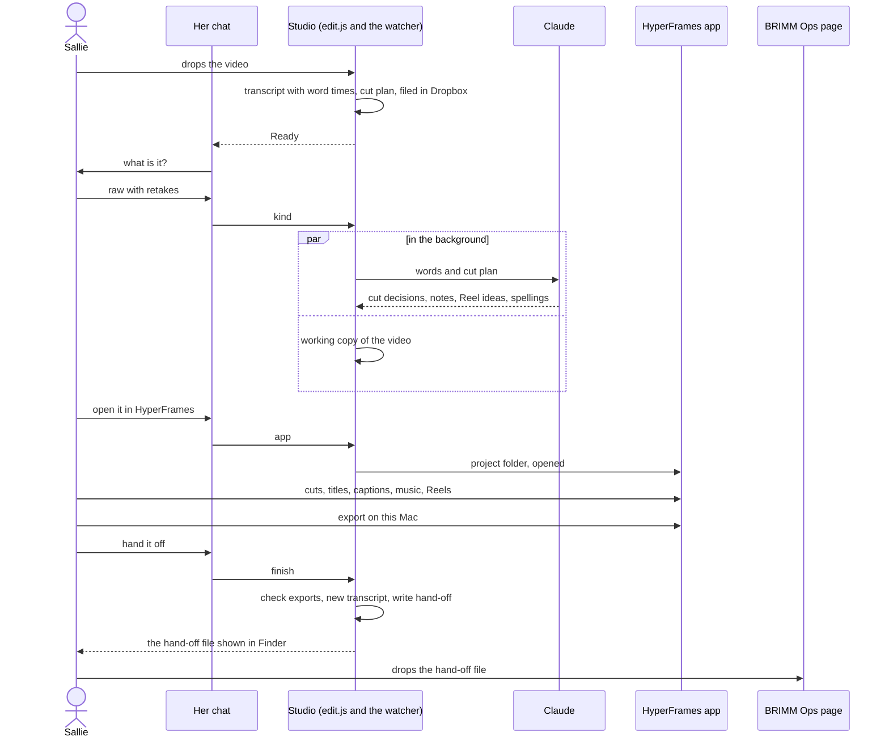
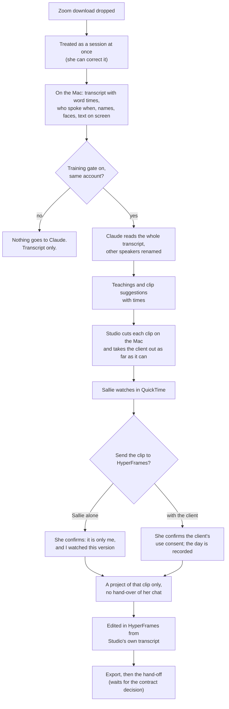

# BRIMM Video Studio: the architecture and the workflows

- **Date:** begun 2026-10-27, in the evening, and finished after midnight on 2026-10-28.
- **Status:** a proposal, for Jason's yes. Plan PRs 1 to 4, PR 5 (#13, Reel projects, 4.3), PR 6 (#11, what was done in HyperFrames and its versions), PR 7 (#14, exports and `finish` from HyperFrames), PR 8 (#17, the words on the picture and the suggestions), PR 9 (#16, Reels of a finished video), PR 10 (#15, the guide's HyperFrames stages) and PR 15 (#12, free) are merged, with the notes changes (#7), the word-times fix (#8), the HDR working copy (#9) and the by-hand rule (#10); main is b136091. Nothing else in it is built on main, and nothing in it is installed or turned on.
- **It rests on:**
  - the design accepted on 2026-10-27, `2026-10-27-brimm-video-with-the-hyperframes-app.md` (until it is merged, on the branch `claude/zealous-bell-esuqck` of brimm-video, or `claude/design-2026-10-27` of brimm-video-studio);
  - Jason's decisions in `docs/requirements.md`;
  - the full handoff, `docs/handoffs/2026-10-27-brimm-video-studio-full-handoff.md`;
  - the code of `main` at c666508;
  - the HyperFrames command line, version 0.8.208, read and run in a scratch folder on a Linux machine: no Mac, no app, install scripts off, telemetry off. "Sources" at the end says exactly what was read.
- **It does not reopen** a decision of the accepted design. Where a fact in the code or in the command line makes a sentence of that design unworkable as worded, "Findings" says so and proposes a rule that keeps its intent.
- **Only A0 could answer, and now has (2026-10-28):** what the app's Script panel does with `transcript.json`; where the app puts its exports and what it names them; where "make Reel 2" puts the new project (in a folder of the app's own, outside `~/BRIMM Video Work`, with a copy of the whole recording, which is why Studio makes every Reel, 4.3); whether the app's assistant keeps a project's rules. Each is settled where it is used (5.6, 5.9, 8.1), and says where the fact comes from: **A0**, Jason's test of the app and what it left in the projects, or **the docs**, the app's own at hyperframes.heygen.com, read on 2026-10-28. Section 15 lists what A0 added and what each item answered.
- **Companion:** the build plan, `docs/superpowers/plans/2026-10-27-brimm-video-studio-build-plan.md`: the pull requests in order, the failing tests of the first ones, the roll-out, and the baseline of the test suite.

**Words used here.** Two ideas have near names, so they are kept apart:

- The **hand-off** is the file BRIMM Ops takes (`*.brimm-ops.json`).
- A **handover** is the HyperFrames command line's word for passing a Claude Code conversation to the app. It is not the hand-off.

Also: a **project** is a HyperFrames project folder. The **working copy** is the constant-frame-rate copy of a video that a project holds. An **export** is a video file the app saves. **The app** is HyperFrames (`HyperFrames.app`); its assistant is called Framey. **Studio** is BRIMM Video Studio, the application this work builds, in the repo `brimm-video-studio`.

---

## 1. In one page

**The idea.** The app edits. Studio does everything around the editing: it takes the video in, reads it, makes the app's project, takes the exports back, and writes BRIMM Ops its file. Studio and the app meet in two places only.

1. **Door 1, a project folder.** Studio writes it on the Mac's own disk and opens it in the app. It holds the working copy, the transcript with word times, Studio's suggestions, the brand and BRIMM's rules. It holds nothing else.
2. **Door 2, exported video files.** The app saves them. Studio finds them, checks them, transcribes them again on the Mac, and writes the hand-off from them.

Nothing else crosses: no shared database, no plug-in, nothing that depends on the app's insides. Where Studio reads a file the app keeps (`.hyperframes/app-history.jsonl`), it only reads it, and does without it when it is not there. **BRIMM Ops sees no difference:** the hand-off is the same file, written by the same code, under the same tests.



**What changes for Sallie.** She drops and answers the card as today. Then she says "open it in HyperFrames", edits there by talking to the app, exports on this Mac, and says "hand it off" in her chat. She drops the hand-off on the BRIMM Ops page as today. She never opens Final Cut, a timeline, a terminal or a command.

**What was found** (section 2): thirteen things in the code and the command line that change how the design is built, though not what it does. The ones that matter most:

- The handoff's list of modules to retire is wrong for five of them, and `edit.js`'s kept commands use others: kept code still imports them (F1).
- Her folder can run `edit.js` and nothing else, so "run `npx hyperframes open` from her chat" has to go through `edit.js` (F2).
- **Opening a project can hand her whole chat to the app**, and the same switch is how a chat that has seen a session's words would reach it (F3).
- `hyperframes init` makes a project that loads code from a CDN and carries a `publish` script, so Studio writes its own (F4).
- The command line has 43 commands, and A0's deny list names 6 of them (F6).
- The v2 hand-off cannot carry a session clip that has no client agreement (F10).

**What is asked of Jason** (section 14): ten decisions, each with a recommendation. None of them blocks starting.

**What can start now.** Only documents until Jason makes the `brimm-video-studio` repo (handoff section 6). Then, with no wait for A0: the pinned-toolchain module, the project's file set, and the working-copy arguments (plan, PR 1 to 3). They are pure code with fixtures, and no test runs the app.

---

## 2. Findings from the code and the app

Each says what was seen, where, and what the architecture does about it.

### F1. Five modules the handoff retires are still used by kept code

**Seen.** The import graph of `tool/*.js` at c666508. First, what other modules import:

| Module | Who still imports it | Symbols |
|---|---|---|
| `clock.js` | `handoff-v2.js` (the contract), `reels.js` | `keptWords`, `lengthOf`, `timelineAt` |
| `reframe.js` | `finish.js`, `notes.js`, `reading.js`, `readings.js`, `reels.js`, `unedited.js` | Reel rules (`REEL_MIN`, `REEL_MAX`, `fitReel`, `stretchesOf`, `storyParts`, `clipNames`, `STORY_MAX`); Story cutting (`storyCuts`, and `clipArgs`, which wraps `verticalArgs`); face-based crops and stills (`cropFor`, `cropsFor`, `stillsArgs`, `needsReframe`). Only `uprightQuality` has no user outside its tests |
| `timeline.js` | `reading.js` | `timelineFor` |
| `recut.js` | `finish.js` | `cutPhrases`, in `expectedWords` (the first-words check) |
| `projects.js` | `unedited.js`, and `timeline.js` | `mainProject` |
| `reels.js` (changed, not retired) | `finish.js`, `reading.js`, `unedited.js` | `REELS_FILE`, `readReels`, `reelsFile`, `reelEntries`, `mergeCandidates`, `reelCandidates`, and the preview functions |

Second, **`edit.js` is a kept module too,** and its kept commands use modules the waves delete:

- `timeline.js`: `newestOf` (in `episodes` and `open`), `newestIsRender` (in `guide`), `clockFor` (in `reels`);
- `layers.js`: `presetOf` (in `spell`);
- `parts.js`: `partsOf`, `lookFor` and `kindOf` (in `finish`), `unkeptParts` (in `freeLibrary`, which no command reaches);
- `portable.js`: `mediaIn` (in `freeLibrary`), `localMedia`, `retitle`, `withImportOptions`;
- `reels.js`: `REEL_FRAME`, `reelsText`, `uncropped`, `notMadeWords`.

The shared test helper `tests/phase4.js`, which nine test files use (some of them for kept commands), imports `mainProject`, `relativeMedia`, `reelCandidates` and `previewPath`.

`captions.js` is imported only by `layers.js`. `layers.js`, `pictures.js`, `styles.js` and `reel.js` are imported only by `edit.js` and `timeline.js`.

**So.** `clock.js` is kept whole: it is small, pure, tested, and the contract module imports it. `reframe.js` mostly stays, because the Reel rules, Story cutting and face-based crops are all used by kept code; only what the full import's upright version used alone goes. `reels.js` is split, so that the candidates file stays and the previews and Final Cut project retire. `timeline.js` and `projects.js` go together, only after `reading.js`, `unedited.js` and the kept commands of `edit.js` stop using them. `recut.js` goes when `finish.js`'s first-words check and `edit.js`'s `cut` command do. Retiring is therefore not only deleting files: it is also rewriting the kept commands that use them. Section 10 has the table and the order.

### F2. Her folder can run `edit.js` and nothing else

**Seen.** `tool/studio/CLAUDE.md`: "Everything is done through brimm-video's commands. Do not … run any other program." The skill says "Run brimm-video's commands, and only these", and under the strict lock the guard hook answers yes to `edit.js` and no to everything else (`tool/studio.js`, `tool/studio/guard.mjs`). The design's section 2 says `npx hyperframes open` is "run from her chat's session".

**So.** Her chat cannot run the command line. A new `edit.js` command, `app`, runs the pinned command line itself, by absolute path, with a fixed argument list and a scrubbed environment (5.6). Her lock does not change, and the allowlist the handoff says "gains `npx hyperframes open` and `catch-up`" gains nothing: the commands are inside `edit.js`.

### F3. Opening a project can hand the whole chat to the app

**Seen.** In the command line's own code (`dist/chunk-43MW4SY7.js`, `dist/catch-up-*.js`):

- `open` reads `CLAUDE_CODE_SESSION_ID` from its environment. When it is there, `open` writes `.hyperframes/agent-handoff.json` (`{engine, sessionId}`) into the project and a "seen" mark under `~/.hyperframes/catch-up/`. The app then "picks up this Claude Code conversation".
- When it is not there, nothing is written, and `catch-up` answers "wasn't handed to the desktop app from here, so there's nothing to catch up on".
- On a Mac, `open` runs `open -b dev.hyperframes.desktop <folder>`. If the app is missing it answers `{opened: false, reason: "not-installed", downloadUrl}` and exits 1.
- `CLAUDE_CODE_SESSION_ID` is also what `tool/held.js` uses as a chat's id, to know which chats have been shown a session's words.
- `open` also reads `CODEX_THREAD_ID` and `GROK_SESSION_ID` for other agents. The scrubbed environment of 5.6 carries none of the three unless the handover is allowed.

**So.** A handover is a privacy decision, not a convenience. A chat that has been shown a session's words must never hand over, or those words would be the app's assistant's context, which breaks "nothing of a session goes to HyperFrames by default". The rule (5.6): the handover is off by default; when switched on it happens only from a chat `chatHeld` does not hold, and never for a session clip. A0 shows whether the handover adds anything (15). The project's files carry what the app's assistant needs either way. What happened in the app is read from `.hyperframes/app-history.jsonl`, which needs no handover: the command line's code reads it as a plain list, one turn per line (`{at, engine, asked, did, files}`, each text cut to 2,000 characters).

### F4. `hyperframes init` makes a project BRIMM would have to repair

**Seen.** A project made by `init --video` (0.8.208) has:

- an `index.html` that loads GSAP from `https://cdn.jsdelivr.net/npm/gsap@3.14.2/dist/gsap.min.js`, so every preview and render fetches code from the network;
- a `publish` script in `package.json`;
- a `hyperframes.json` whose `registry` is `https://raw.githubusercontent.com/heygen-com/hyperframes/main/registry`, a moving branch that `add` and `catalog` read;
- a 109-line `CLAUDE.md`, and an identical `AGENTS.md`, that send the agent to `npx hyperframes skills update` and to `publish`;
- a copy of the video made inside the project (`recording.mp4` at its root), converted to H.264 only when its codec is not one a browser plays and `--keep-original` is not given.

**So.** Studio writes the project's files itself, from a template it owns: GSAP vendored with a checksum, no `publish` script, no registry on a moving branch if the app accepts that (A0b), a link so that `npx hyperframes` runs the pinned version offline (5.3), and BRIMM's rules first in the agent's notes (5.4). A golden fixture of the pinned command line's own `init` output is kept in the tests, so that a change of pin shows what moved.

### F5. `transcript.json` is a plain list

**Seen.** `hyperframes transcribe <word-per-cue.srt> --dir <project>` writes:

```json
[
  { "text": "Hello",     "start": 0,    "end": 0.42, "id": "w0" },
  { "text": "everyone,", "start": 0.42, "end": 0.8,  "id": "w1" }
]
```

Ids are `w0`, `w1` and so on; punctuation stays in `text`.

**So.** Studio writes this file directly from its own word list, with the episode's spellings applied, and uses the same ids in `brimm/cut-suggestions.json` and `brimm/reel-suggestions.json`. No `transcribe` call, no speech recognition inside a project, and nothing for the app to send anywhere to get the words.

### F6. The command line has 43 commands; A0's deny list names 6

**Seen.** `hyperframes --help` (0.8.208) lists 43. A0's `settings.json` denies six of them, `publish`, `cloud`, `lambda`, `cloudrun`, `auth` and `feedback`, and the script `npm run publish`. Not named, and not harmless:

- `tts` writes speech from text with a local model: a generated voice;
- `capture` fetches a website;
- `add` and `catalog` install third-party blocks from the registry branch;
- `skills`, `models` and `browser` download;
- `upgrade` rewrites the version pin;
- `present` shares a slide deck with an audience.

**So.** Every command is classified in code as one the agent may run, one only `edit.js` runs, or one denied. Section 5.5 has the table: 20, 2 and 21. A test fails when the pinned command line has a command nobody classified, so a new pin cannot slip a command in. A deny rule is a prefix match and can be sidestepped (`npx -y …`, `node …/hyperframes.mjs …`), so it is a second line: the first is that the project has no credentials and no `publish` script, and A0 checks the rest.

### F7. `history` is a trial

**Seen.** The command line's own skill (`dist/skills/hyperframes-cli/SKILL.md`) marks the block on `history` "history (trial): remove this block together with the command".

**So.** The design's versions rest on a feature its maker may remove. Nothing in `finish` or the hand-off depends on it. Studio reads `history --json` to answer "what changed", and says so plainly if the command is gone. The version pin protects against a surprise, and a change of pin re-runs the fixtures (11).

### F8. The app is called HyperFrames

**Seen.** The command line looks for the bundle `dev.hyperframes.desktop` (and a Canary build) and the app `HyperFrames.app`, prints "the HyperFrames desktop app", and calls the assistant "Framey". "Studio" is the name of the download page (`hyperframes.studio/studio`: this document had `hyperframes.dev/studio` until the docs were read on 2026-10-28), and the command line also uses it for its browser preview ("Start the studio for previewing compositions").

**So.** The name clash the handoff leaves open (Sallie's folder `~/BRIMM Video Studio` against "HyperFrames Studio") goes away if everything Sallie reads says "HyperFrames", never "Studio". Her folder keeps its name (D10).

### F9. A Final Cut finish never gave a raw video its Reel suggestions, and the way to give them exists

**Seen.** `finishNow` in `tool/finish.js`: the hand-off "holds no Reel suggestions: their times are on the raw video's clock, which a Final Cut finish does not know". `inMain` in `tool/handoff.js` already finds a Reel's words in a finished main video by votes of clock offsets between the two, and is tested.

**So.** B2 first keeps parity: no suggestions for a raw video. B2b then places each unmade suggestion in the exported video with `inMain`, from its words: no new matching algorithm, though `inMain` answers with a start and an end only, so a few lines of glue make the rest of a suggestion (8.6). `suggestionsOnClock` and the clock stay for the contract's sake and are not needed for this.

### F10. The v2 hand-off cannot carry a session clip that has no client agreement

**Seen.** `handoffFaultV2` in `tool/handoff-v2.js`: a session's Reel must hold `clientAgreed`, "the day the agreement was noted, never who", and `fromSuggestion` must be `null`. The accepted design allows a "Sallie alone" clip to go to the app with no agreement to note.

**So.** A Sallie-alone clip can be cut, edited and exported, but its hand-off cannot be written under today's contract. Options, in D5: record the day she confirmed "alone" in `clientAgreed` (works today, says something untrue), extend the contract with brimm-operations (right, needs both repos in step), or write no hand-off for such a clip yet (safe). Until Jason picks, no session clip's hand-off is written.

### F11. Sallie's laptop is not on the light import, and Zoom downloads are held at the drop

**Seen.** README: "Sallie's laptop is not switched yet". `tool/filing.js` holds a Zoom download in the drop folder with "Zoom downloads are taken from a later version. Put this one in BRIMM VIDEO Transfer." `tool/kinds.js` gives a Zoom name no guess and the card offers a session, never assumes one.

**So.** Everything here stands on the light import, so her laptop is switched first (`docs/setup/sallies-laptop.md`, "Switching her laptop"). "A Zoom download is a session at the drop" (decision 10) needs what the 2026-10-22 design called phase Z, which therefore becomes part of S1.

### F12. A project cannot live in Dropbox, so a take-over needs a snapshot

**Seen.** The rule: projects live in `~/BRIMM Video Work`, never in Dropbox or a watched folder. `release` hands an episode to the other Mac through Dropbox. The app's history sits in `~/.cache/hyperframes/history/<id>/` on each Mac.

**So.** `release` also writes the project's text files (compositions, `brimm/`, the notes) into the episode as a snapshot, and a take-over rebuilds the project from it, making the working copy again from the raw video. App history does not travel, and Sallie is told so. Section 7.

### F13. Adding the project to the record is a new layout

**Seen.** `tool/episode.js`: `RECORD_VERSION = 3`; a record is written at a higher layout only once it holds a field of it, and a Mac that knows a lower layout refuses it, never changing it.

**So.** The `app` field is layout 4. Both Macs must run the same Studio before the first project is made. The existing `behind` check already tells Sallie when her Mac is behind.

---

## 3. The shape

### 3.1 The parts

| Part | What it is | Modules | Door |
|---|---|---|---|
| Watcher | The launch agent that imports every drop | `unedited.js`, `filing.js`, `importing.js`, `dropbox.js`, `progress.js`: kept | |
| Records | An episode's folder and record in Dropbox | `episode.js` (gains layout 4), `names.js`, `versions.js`, `settings.js`: kept | |
| Readers | Claude's reading of a video once Sallie says what it is | `readings.js`, `reading.js`, `notes.js`: kept, changed | |
| Project maker | The working copy, the project folder, opening the app | `hyperframes.js`, `project.js`, `workcopy.js`, `app.js`: new | 1 |
| Finisher | Takes exports, checks them, transcribes them, writes the hand-off | `exports.js`: new; `finish.js`: changed; `final-transcript.js`, `handoff.js`, `handoff-v2.js`: kept | 2 |
| Sessions | Gated reading, clip suggestions, clips | `sessions.js`, `teachings.js`, `gate.js`, `dialog.js`, `held.js`: kept, changed; `clips.js`: new | 1, for a clip |
| Her chat | Her folder, its lock, its skill | `studio.js`, `studio/` (the guard hook is `studio/guard.mjs`), `edit.js` (slimmed), and the lock's own modules `open-lock.js`, `loosened.js`, `held.js`, `scan.js`, `chain.js`, `never.js`, `places.js`, `fetchable.js`, `receipts.js`, `reveal.js`, `sandboxed.js`: kept, changed where this document says | |
| BRIMM Ops contract | The hand-off, the shared copies, the guide | `handoff.js`, `handoff-v2.js`, `shared/`, `guide.js`, `guide-note.js`: unchanged in what they promise | out |

New commands live in their own module (`app.js`, `clips.js`), not in `edit.js`, which is already 5,900 lines. `edit.js` only wires them.

### 3.2 Where things live

| What | Where | Why |
|---|---|---|
| The raw video, its record, words, `final/`, the hand-off | Dropbox, `Episodes/<episode>/` | Both Macs and BRIMM Ops see them |
| The working copy and the project | `~/BRIMM Video Work/<episode folder>/`, on the Mac's own disk | The app writes a project all day: never in Dropbox or a watched folder (rule) |
| The pinned command line | `~/BRIMM Video Work/.toolchain/hyperframes-0.8.208/` | One copy per Mac, run by absolute path |
| The app's exports | `~/Downloads` (the app's default, a link into Dropbox on the Mac Studio; the Export dialog has a folder dropdown, and each export's own record says where it went: 8.1) | Studio takes copies, and after the late check removes the original from Downloads only if it is unchanged since it was taken |
| The app's history | Inside the project (`.hyperframes/`) and `~/.cache/hyperframes/history/<id>/` | The app's. Studio reads and never writes |
| A project's snapshot for the other Mac | `Episodes/<episode>/app-snapshot/<time>/<project name>/` | A project's files without its video, renders or the app's history, and its assets while they are small (7.3); written by `release`, which also copies the newest exports to `edit/from-hyperframes/`; its assets are only what the app was given, and Studio's fonts and logos always go |

### 3.3 What each outside party may see

| Content | Raw video, finished video, iPhone clip (meant for posting) | Client or group session |
|---|---|---|
| The video and its sound, in Dropbox and on the Mac | Yes | Yes |
| The same, in the HyperFrames app on the Mac | Yes | Only a clip, and only after Sallie's confirmation |
| The audio, sent to HeyGen by the app's Script panel | Yes (decision 4) | Never, until HeyGen confirms the training opt-out (decision 6) |
| Sharing through the app | Invited people only (decision 7). The app's default is anyone in her HeyGen workspace with the link, and they can comment; "Only people you invite" has to be picked each time, and Share makes an export if there is none (the docs, 2026-10-28; 5.9) | Never, until HeyGen confirms |
| Rendering in the cloud | Never. The app offers Cloud only when a HeyGen API key is saved in it, so none is saved. A cloud export lands in Downloads and looks the same as a local one, so Studio cannot tell it apart (the docs, 2026-10-28; 8.1) | Never |
| Words with times, to Claude through Claude Code | Yes: the transcript and cut plan | The whole transcript with other speakers renamed, only on an account whose training setting is off (the gate) |
| Words, to the app's assistant (Claude Code inside the app) | Yes, in the project | A clip's words only, in a project of that clip |
| Higgsfield, OpenRouter, Zoom's AI features | Prompts only; footage after a yes for that video | Never |
| BRIMM Ops | The final transcript and the Reels' words | Principles with no client names, never the transcript; a clip's words only once D5 is decided |

The controls Studio does not have are the app's own buttons: Share, Render in the cloud, the Script panel, HeyGen's avatars and voices. Studio cannot disable them. It names them in the project's notes, in a line when a project is opened, and in the guide, and A0 looks for settings that turn them off (5.9).

---

## 4. The workflows

Written to the accepted design (its sections 3 to 6). Here each step also says which part of Studio does it, so that the build plan can follow.

### 4.1 A raw video with retakes (the OBSBOT)



| # | Who | What happens | Studio's part |
|---|---|---|---|
| 1 | Sallie | Drops the video in her drop folder | Unchanged |
| 2 | The watcher | The light import: sound read, transcript with word times, cut plan, the video filed in `Episodes/` by the Dropbox rule, a label, "Ready" | Unchanged (`unedited.js`, `filing.js`) |
| 3 | Sallie, in her chat | Answers the card: "Raw with retakes" | Unchanged (`kind`) |
| 4 | Studio, in the background | Two detached jobs: Claude reads the words and the cut plan (cut decisions, notes, Reel suggestions, spelling offers); and the working copy is made (if the video is on this Mac, this Mac is set up for the app, and the episode has no main project in use) | `reading.js` changed: no rough cut, no Final Cut file. `workcopy.js` new |
| 5 | Sallie | Reads what Claude found; answers the spellings card | Unchanged |
| 6 | Sallie | "Open it in HyperFrames" | `app "<episode>"`, new |
| 7 | Studio | Claims the episode for this Mac, brings its files over if they are online-only, asks for the working copy if it is not made, writes the project, opens the app, and says in plain words that it is open. The bring and the copy are detached runs, so `app` does not wait for them: it says what is being made, and tells her to say "open `<name>` in HyperFrames" again when it is done ("how far is it?" shows how far it has got), since a command has two minutes in the Code tab | `app.js`: today's claim and bring from `open`, then `project.js` and `hyperframes.js` |
| 8 | Sallie and Framey, in the app | Cuts (the Script panel's suggestions, and Studio's in `brimm/cut-suggestions.json`), a name, a title card, music, captions, graphics. Each request is an entry in the project's history | Not Studio's |
| 9 | Sallie, in her chat | "What did I do in HyperFrames?" | `app "<episode>" what-happened` reads the last megabyte of `.hyperframes/app-history.jsonl` and says the newest 10 requests in plain words, newest first, under the day they happened (4.6). It claims nothing and writes nothing |
| 10 | Sallie | A Reel: says "Open Reel 2 in HyperFrames" (or "make Reel 2") in her chat. If she asks the app for one, its assistant tells her to say that in her chat: the app never makes a Reel as a project of its own (4.3) | `app "<episode>" reel 2` makes a Reel project from suggestion 2 and opens it |
| 11 | Sallie, in the app | Exports on This Mac: the main video (1080p), each Reel 9:16 | Not Studio's |
| 12 | Sallie, in her chat | "Hand it off" | `finish "<episode>"` (section 8), which also says the words it found on the main video's picture and asks if they are right (8.5) |
| 13 | Sallie | Drops the hand-off on the BRIMM Ops page; the guide gives her each step | Unchanged |
| 14 | Sallie | "I'm done with it for now" | `release` writes the project snapshot and lets go of the claim |

### 4.2 An iPhone clip, 1 to 5 minutes

The same, with these differences:

- **The card:** "iPhone clip". The tool's guess for an upright or short video is already "clip" (`guessKind`).
- **The reading** asks only for spellings and one line on what the clip is. No cut decisions, no Reels.
- **The working copy** keeps the clip's own shape (usually 9:16), makes the frame rate constant, and converts HDR to standard colour (5.7). The project is made at that shape.
- **The notes** say: tighten it; captions only when she asks, in the BRIMM style; a title card and an end card on request.
- **The hand-off** is kind "short video": `main` only, no `reels`. BRIMM Ops writes its post text.
- **The hand-off waits for the export, which is a change.** Today an answered iPhone clip counts as "not edited in Final Cut" (`hasFinalCut` in `edit.js`): once its spelling card is answered, `saveSpellings` writes its hand-off at once from the import's captions (`handoffOwed`, `importHandoff`, then `finishFinished`'s short-video branch), and `finish` and `push` refuse it ("an iPhone clip is not edited here"). In Studio an iPhone clip is edited in the app, so none of that may write a hand-off from the unedited clip: `handoffOwed` stops owing it, `finish` takes a short video and its export, and `finishFinished`'s short-video branch is used only for a clip she hands off as it is. If she has not opened it in HyperFrames, `finish` asks once: "Hand it off as it is, or open it in HyperFrames first?" (on a Mac whose settings have the app off, every offer of HyperFrames is left out of these words, and the question is only "Hand <name> off as it is?"). A Mac that hands off version 1 still hands off a clip she opened in HyperFrames and exported, as a version 1 short-video hand-off (`main` alone, as a Final Cut finish of a short video wrote it): only handing it off as it is waits for version 2, and the words say so beside the way that works now. Left as it is, the old behaviour would hand off the unedited clip before the app edit, and again on every later spelling.
- **One clip, one project.** "Put these three together" (the design's section 4) would make one video of three episodes, with no single id for the hand-off. It waits (D8).

### 4.3 A finished video from her editor, and Reels from it

- **No app for the hand-off.** As today: drop, card "Finished by your editor", Claude's Reel suggestions and spelling offers, and the hand-off is written when the spelling card is answered, from the import's captions (`finishFinished`). No working copy, no project: `app "<episode>"` for a finished video says "`<name>` was finished by your editor, so it has no HyperFrames project: a finished video is not edited in HyperFrames." and stops.
- **A Reel she wants** goes to the app as a project of its own: `app "<episode>" reel 2`. **Studio makes every Reel** (Jason's ruling, 2026-10-28). A0 found that the app, asked for a Reel, makes it as a project of its own in `~/.hyperframes-studio/<name>/`, outside `~/BRIMM Video Work`, with a copy of the whole recording in its `assets/`: Studio could not find such a project's export for the hand-off, and a second copy of a recording is one nothing keeps track of. So every project's notes (5.4) tell the app's agent never to make a Reel as a new project itself, and, when she asks it for one, to tell her to say "Open Reel 2 in HyperFrames" in her Claude chat. If it is wrong, the cost is a line in the notes, and a way to adopt the app's own Reels later.
  - Studio cuts that suggestion's stretch out of the original as filed, from the suggestion's first moment to its last, into the Reel project's working file, by a detached run (`workcopy --reel 2`) with the working copy's lock, chain and checks (5.7), and writes the project, and opens it. Nothing is cut inside the stretch: the pauses and retakes the cut plan cuts stay, and cutting them is the app's. The Reel's words are its own, on its own clock from 0. The upright crop is the app's job; Studio offers the face positions it already finds in the Reel's video (`brimm/face-track.json`, only when the finder found a face).
  - `app … reel N` also marks the candidate picked, in the same write that records the project, which is what `reel pick` did, and `reel pick` is gone: `reel drop N` stays as the way to drop one (6.1).
- **After the export,** `finish "<episode>" reels` writes the next revision of the hand-off under the same id, with the new Reels added and `main` as it was (section 8.7; plan PR 9). It adds to the hand-off the spellings card wrote (`finishFinished`, from the import's captions) and never writes the first one: until the spellings are answered it says so. A raw video's Reels go with its main video (`finish "<episode>"`), and a short video has none.
- **OpusClip** is unchanged: it takes the episode's YouTube link, and Studio uploads nothing.

### 4.4 A client or group session (Zoom)

The rules are the design's section 5, word for word. This is how they are built, in three steps that can ship apart.



**S1. At the drop: a session, read.**

1. **A Zoom download is a session.** `kinds.js` already names a download (`isZoomName`, `zoomTimeOf`). The change: it is answered as a session with the mark not cleared (so the gate applies at once), the card is skipped, and `filing.js` stops holding it ("taken from a later version"). She corrects it with today's `kind … --again --clear-session`, which needs her click on a dialog. A download is several files (the recording, the sound alone, Zoom's transcript, its chat and caption text), and the import takes one video per episode today, so taking them together is new work: they are grouped into one episode by the time Zoom puts in their names. `zoomTimeOf` gives that time only for `GMT…_Recording` names; for `audio…` and `video…` files it gives the whole file name, and it knows nothing of a loose `.vtt` or `closed_caption.txt` at the drop (`meetingTranscripts` reads the file list of an episode that already exists). Whether the files arrive loose or in a folder is the first fixture of S1, from a real download of Jason's own made-up call.
2. **Analysed on the Mac first,** with no outside service: the words with times (whisper, as for every video); who spoke when, from Zoom's transcript names or each participant's sound file; the names Studio can see (`visibleNames`); faces in sampled stills (`faces.swift`); and text on screen, because Zoom shows names on tiles (Apple's on-device Vision, added to the Swift side).
3. **Claude reads it** in the same run, under the gate (`teachingsWhy`, `accountWhy`): the whole transcript with every other speaker renamed (`replaceSpeakers`). It writes the teachings as today, and **clip suggestions**: a start and an end on the recording's clock, the point, a working title, and whether the clip is Sallie alone or with the client. Names are taken out of the new fields as they are of principles (`checkNames`).
4. **Her folder turns off** `/feedback` and the transcript-share survey (`DISABLE_FEEDBACK_COMMAND=1`, `CLAUDE_CODE_DISABLE_FEEDBACK_SURVEY=1`), written into her folder's settings by `studio.js`.
5. **In her chat:** the teachings as today; the clips as a list. Printing a clip's point is printing a session's words, so `held.js` marks the chat as before.

**S2. Clips.**

6. `clips "<label>" make` cuts each suggested clip on the Mac into the episode's `clips/` and makes a version with the client taken out as far as it can: spoken client names muted by their word times and shown as `[client]` in captions; names on screen blurred where Vision finds them; the picture from Zoom's active-speaker file, never the gallery; a clip where another face still shows is marked "shows someone else". It writes what it took out beside the clip.
7. `clips "<label>" show 3` opens it in QuickTime Player (`reveal.js`).
8. `clips "<label>" send 3` asks for the confirmation, in a macOS dialog only she can click (`dialog.js`): for a clip that is her alone, that she watched this version and it is only her; for a clip with the client, the client's "use" consent, which records the day and never who. A clip marked "shows someone else" needs a third, plain confirmation. The consent is written to the record (`{clip, basis, day}`) and is never sent anywhere.
9. **The project** holds that clip and its words only: the clip file, a `transcript.json` made on the Mac from the clip (names muted), a neutral name (`Session clip 3 3fa9c1`), session notes, and settings that also deny `WebFetch` and `WebSearch`. It is opened **without a handover**, and with three lines in the answer: no Share, no Render in the cloud, no transcription in the Script panel, until Jason records that HeyGen has confirmed its training opt-out (a setting like the training gate's).
10. **Retention.** `clips "<label>" done 3` removes the project, the app's history folder for it (`~/.cache/hyperframes/history/<id>/`, found from `.hyperframes/history-id`), the "seen" mark, and the export copy Studio took. The export in Downloads goes only if it is unchanged since Studio took it (the rule `finish` already follows for Final Cut's folder).

**S3. A clip in the hand-off.** Waits for D5 (F10).

### 4.5 The hand-off to BRIMM Ops

Section 8. In short: Studio takes the exports, transcribes them again on the Mac, and writes version 2 of the hand-off with the code and tests it has today. The guide's BRIMM Ops steps (`taken`, `kit`, `posted`, `live`, `cascade` for an episode; `taken`, `posttext`, `posted` for an iPhone clip; `taken`, `checked` for a session) do not change. The guide gains three states before them, so that Sallie is told where a video is in HyperFrames (plan, PR 10), and its Final Cut stages go for an episode going the HyperFrames way; and a fourth, for the Reels of a finished video:

- **Making the video for HyperFrames.** While this Mac's working copy run is at work on the episode and no main project is here. It says how long is left when the progress panel's run says, else how long the step usually takes, by the speed `progress.js` learned for "Making the video for HyperFrames" times the recording's length, else no time; and to say "open it in HyperFrames" when it is done. It needs nothing of hers, so `guide wait` and `guide … tell` wait while a video is at it. Once the video is made, or when none is being made, the step is "Say "open it in HyperFrames" to edit it there."
- **In HyperFrames.** The main project is here and the app opened it, and it has no export that began after its last change. It gives the time of her last request there, the last turn of `.hyperframes/app-history.jsonl` told as `what-happened` tells it ("today at 3:41 pm"), and says that she exports on This Mac, as MP4, and then says "hand it off".
- **Exported, waiting for the hand-off.** The main project has an export that began after its last change, found as `finish` finds it (8.1), and no hand-off is written yet: "You have exported it from HyperFrames. Say "hand it off" to write its hand-off." A Downloads folder this Mac will not let be read is no export seen.
- **Reels exported, waiting for the hand-off** (a finished video; plan PR 16). The video's hand-off is written, and a Reel project of it on this Mac (not kept for an earlier kind, not of a Reel she dropped) has an export that `finish "<episode>" reels` would take now, found as that command finds it (8.1 and 8.7, for the Reel projects alone), or two that began in one minute, which it asks the final one of, and the hand-off does not hold it: "You have exported Reel 2 from HyperFrames. Say "hand off the Reels" to add it to the hand-off." Two or more are named together: "You have exported Reel 1 and Reel 3 from HyperFrames. Say "hand off the Reels" to add them to the hand-off." It is none: a Reel open and not exported, one already in the hand-off (the export the last finish took, or none left; a Reel exported again is not), an export older than the project's last change, and a Downloads folder this Mac will not let be read. A Reel project that is not on this Mac is not looked at either, though that command would take its export from Downloads or from what the other Mac released: as for the main video (PR 10), Downloads is read only for a project that is here, and `app` says what is on the other Mac. Nor where that command would go no further and a look that costs no other read can tell: another run is at work on the episode (a bring, a read or an ask; a finish at work is the stage below), the other Mac has the episode open, the chain of the video's versions has a gap, Dropbox undid this Mac's last change to the record, the hand-off on file cannot be added to, or the record lacks the Reel. Two refusals are not looked for, since they cost a read of the hand-offs of the video's other versions: a hand-off that went to the page under another id, and a Reel number another version of the video gave under the same id (8.7). That command says each in its own words, ending "Ask Jason", and the guide goes on saying the stage until Jason has settled it. While a finish runs it is that finish's stage, "Its finish is running. The panel shows how far it is.", since that command refuses another beside it. It comes before the BRIMM Ops page's steps and before done, whether every step is noted or the hand-off is older than 60 days, and after her word that the video is finished: that stands, as it does for every other stage of brimm-video's, since what nothing noted can skip is a conflict, her answer, a version held as a session and a session after all's withdrawal. A video the gate holds has none of it (6.2).

These come after the reading, the spellings card and a raw video's name, and before the BRIMM Ops page's steps, which a written hand-off brings. The guide picks the way as `finish` does, by the record (4.1 step 11, plan PR 7), so that it never sends a video where `finish` will not take it: a raw video with a main project in use, and one never pushed to Final Cut that has none, on a Mac set up for the app or with a Reel's project (on any Mac), go the **HyperFrames way** and are never sent to Final Cut; an iPhone clip goes it once the app has opened its project, and before that has its own step (4.2). A raw video pushed to Final Cut with no project in use, or never pushed on a Mac whose settings have the app off with no Reel's project either, goes the **Final Cut way**, and keeps its stages (`show`, `finish` and `finish-again`) and the facts only they use (`shownInFinalCut`, `shownSinceFinish`, and `newestIsRender` for them) until retirement wave 4 (section 10): Final Cut stays optional until the waves, each on Jason's yes. `READING_STEPS` keeps "Making the rough cut" until wave 2 stops the reading making one.

### 4.6 Versions, and "what changed"

- **The app's history is the version list** (design section 3.5). Studio does not keep versions. The app keeps two lists, and Studio's own code writes neither (a listing does write, by the command line's own doing: see "A listing is not read-only", below):
  - `.hyperframes/app-history.jsonl`, in the project, which the app writes with no handover (A0, item 1): one line for each request, `{at, engine, asked, did, files}`: what she typed, what the app's assistant answered (up to 2,000 characters each, in markdown), and the files it changed. `app "<episode>" what-happened` tells it (4.1 step 9).
  - the store `history` lists, `~/.cache/hyperframes/history/<id>/`. This is the version list.
- `app "<episode>" versions` runs the pinned `history --json --limit 20 --dir <project>` and says each entry in plain words. **What an entry carries** (the command line's own code, a run of it on 2026-10-28, and A0 with the real app): `id`, `who: {kind, name}`, `label`, `startedAt`, `endedAt`, `files` (paths from the project), `undone` and `pinned`. `who.kind` is `agent` (the app's assistant, called Framey), `person` (`You`: what she does by hand in the app) or `outside` (a change the app did not make: the brand kit arriving, a transcript saved; A0 counted 17 entries in the command line's list against 13 in the app's own, the others being these). **The label is whatever the app writes**: her request to the assistant, often headed by the name of the file she attached; `Imported media` for what she did by hand; `Changed outside the app`; `Undid: …` for an undo. It is not a name the assistant chose, since the project's notes no longer ask it to record versions (the app records every change on its own). So "when, who, the label" is `endedAt`, `who.kind` and `label`, and a line also says whether the entry was undone or is kept (`pinned`) and which files it changed, by name: "4:42 pm: bring the title card back (HyperFrames; undone; changed index.html)". Entries are told newest first, under the day they happened. The label, like what `what-happened` quotes of her and of the app, is told as a line of hers has it (`plainText`): on one line; without markdown's marks (bold, slant and code); a link as its words and a bare address left out; a path as its file's name; any other slash as a space; every `--word` token left out whole, and any other run of hyphens made one; and cut at 200 characters at a word. That is all it takes out of what was said: a single-dash option, or the name of a program other than the five below, stays. A text that holds the name of one of five programs (`npx`, `npm`, `node`, `edit.js`, `hyperframes.mjs`) cannot be made plain and is left out whole, and a label so left out is told as "a change". So what is told holds no slash, no `--word` and none of those five names.
- "Go back to before the music" is said to the app's assistant, which runs `history restore`; Studio never changes history.
- **A listing is not read-only.** Studio's code only reads, but the command line, when it lists, does write, as it does for any agent that runs `history` (seen on 2026-10-28 with a made-up project and with the real 0.8.208). When the app does not hold the project, it takes the history up itself and files what changed outside the app since as an entry of its own, "Changed outside the app". It may also:
  - make `.hyperframes/history-id` and the store for a project that has none, which is why `versions` lists only a project the app (or the command line) has recorded;
  - recreate `.hyperframes/video-state.json` and its lock when they are missing;
  - write its store's `project.json` and `.last-prune`;
  - rewrite `history-id` for a folder that is a copy of a recorded project, which then has an id of its own;
  - once a day, prune the history stores of other projects whose folders have been gone for more than 14 days.

  All of this is the command line's own doing, in the app's folders (its store, and the project's `.hyperframes/`), and none of it touches the project's own files.
- `history` is a trial (F7). If it fails, Studio says "I can't list the versions right now; HyperFrames shows its history.", and nothing else depends on it.
- Versions do not cross Macs (F12). Both questions look at this Mac's project, claim nothing and write no record.

### 4.7 Two Macs

- **The claim** is today's: one Mac edits an episode at a time, in the record, read again after `CLAIM_WAIT_MS`.
- **The project is local.** `release` writes `Episodes/<episode>/app-snapshot/` (7.3: the project's files by the Dropbox rule, new names, never over a file, the record last) and copies the newest exports into the episode, as it carries Final Cut's Shares today. `app "<episode>" --take-over` on the other Mac (which does `open`'s claim and bring first, so Sallie only ever says "open it in HyperFrames") rebuilds the project from the snapshot when it has none of its own: its files with the times they had, so that the project's last change is the other Mac's (8.1 compares an export with it); `.claude/settings.json` made again from the pin's table (5.5); and `node_modules/.bin/hyperframes` a link into this Mac's own toolchain (5.3). The video is not in a snapshot: the working copy is asked for, as it is for a project `free` took the video from (5.6), and she is told to say it again; a Reel's video is made again the same way, by `workcopy --reel`, and must start where the project says the Reel starts. She is told that the app's history stays behind, on the Mac that made it. A plain `app` does the same once the other Mac has released the episode, and a Mac whose own folder is gone is given its project back from the snapshot, not a new one. A project made on a Mac that has not handed it over is refused in words that say to hand it over there (5.6). `open --take-over` claims and makes no project. A project here that is older than the newest snapshot, because the other Mac worked on it since, is neither opened nor handed over again: it says so. Setting that older folder aside and rebuilding from the newer snapshot is not built; Jason moves it away by hand until he decides how (plan PR 11, open items).
- **Exports** are found on the Mac that holds them. After a release, the other Mac finds what the first one copied into the episode.

### 4.8 Corrections

- **"It's actually finished" (or raw, or an iPhone clip).** Today's `kind … --again`. When it changes the kind, the main project that exists is kept, never deleted by Studio, and marked "kept for an earlier kind", in the record that changes the kind. Nothing on disk changes, and she is told so in one line. `app` makes a new main project the next time she asks, and does not offer it first. The new one is another folder, under the first name that no project of the record has: "main 2", then "main 3" and so on (5.1). Its `key` in the record stays "main"; the kept project keeps its own name, folder and entry.
- **A new version of a video** (`versions.js` fingerprint): a new revision of the episode, made at the drop, with its own project. The old one is untouched. A recording that changed under a project, with no new drop, is not a new version: `app` says that the recording has changed since the project was made, and opens the project as it was, with the recording it was made from. It makes no second project in place.
- **A spelling added later** is not pushed into an open project: the app may be editing it. It applies to the final transcripts at `finish`, and the chat tells her to ask the app's assistant to fix any caption already drawn.
- **Asking Claude again** (`ask`) rewrites `brimm/` only while the project has never been opened. After that it says so and changes nothing in the project.

---

## 5. The project (door 1)

### 5.1 Layout

```
~/BRIMM Video Work/
  .toolchain/hyperframes-0.8.208/        the pinned command line, one per Mac
  .runs/                                  a run's own folder (existing)
  <episode folder name>/                  one per episode, on this Mac only
    <project name>/                       the main video's project, e.g. "Pricing talk main 3fa9c1"
      index.html  meta.json  hyperframes.json  package.json
      transcript.json
      CLAUDE.md  AGENTS.md  .claude/settings.json
      media/recording.mp4                 the working copy
      node_modules/.bin/hyperframes       a link to the toolchain's (5.3)
      vendor/gsap.min.js  assets/fonts/  assets/logos/
      brimm/  facts.json  cut-suggestions.json  reel-suggestions.json  spellings.json  brand.md
      compositions/                       made by the app and its assistant
      .hyperframes/                       the app's own: history, app-history.jsonl
    <project name>/                       a Reel's, e.g. "Pricing talk reel 2 3fa9c1"
    <project name>/                       a session clip's, e.g. "Session clip 3 3fa9c1"
```

The project's folder name, its `meta.json` name and its title in the app are one name, built as `projectName` builds Final Cut's today (`<file-safe name> <part> <short id>`, without the version: versions are the app's). The app names an export after the project, so the record keeps the name and `finish` finds files by it, never by the episode's later name. The main video's later projects, which a correction of the kind makes (4.8), have the part "main 2", "main 3" and so on (`Pricing talk main 2 3fa9c1`): the first name that no project the record keeps has, so that a folder that is there, recorded or not, is never written over; one the record does not know, which a run that could not write its record left, is taken as the project it is. A session's projects are named from its label and a number, never from a file.

### 5.2 What goes in a project

| File | Made from | Notes |
|---|---|---|
| `index.html` | Studio's template | One `<video>` for the working copy; `data-width`, `data-height`, `data-duration` from the working copy's facts; GSAP from `vendor/` |
| `media/recording.mp4` | The raw video | 5.7. For a Reel: its stretch of the recording, cut by `workcopy --reel` (5.7) |
| `transcript.json` | The episode's words, with its spellings | F5. For a session clip: the clip's own words, names muted. For a Reel: the recording's words, placed by the cut plan's phrases as the main video's are (the plan cuts nothing), and of those the ones whose middle is inside its stretch (a word's end may be a few hundredths past the stretch's, where two phrases touch), on the stretch's own clock from 0 (`reelWords`), ids from `w0` |
| `meta.json`, `hyperframes.json`, `package.json` | Studio's template | `package.json` has the scripts `dev`, `check` and `render` (each runs `hyperframes <command>`), and no `publish` |
| `node_modules/.bin/hyperframes` | A link to the toolchain's `bin/hyperframes.mjs` | 5.3. Makes `npx hyperframes …` and `npm run …` run the pinned version with no network |
| `CLAUDE.md`, `AGENTS.md` | 5.4 | The same text in both |
| `.claude/settings.json` | 5.5 | Denied commands, and the environment |
| `brimm/facts.json` | The record | The kind, the name, the length, what the files are. For a Reel: `reel: { n, offset }`, where its stretch starts in the recording, in seconds |
| `brimm/cut-suggestions.json` | The cut plan, as Claude changed it | 5.8. The main video's only |
| `brimm/reel-suggestions.json` | `reels.json` | 5.8. The main video's only: not in a Reel, and not in a session clip |
| `brimm/face-track.json` | The face finder's stills of the Reel's video | A Reel's only, and only when the finder found a face: `{ version: 1, clock: "reel", every, about, stills: [{ at, faces }] }`, each `at` in seconds on the Reel's clock and each face a box as the finder gave it. The upright crop is the app's; this says where the speaker is |
| `brimm/spellings.json` | The house's spellings, then the episode's | So titles and captions are spelled as she says, and the company's name always as BRIMM. The house's are "brim", "Brim" and "BRIM" as BRIMM, since the app makes a transcript of its own that says "Brim". They come first, as `transcript.json` applies them: the name is Jason's rule, and it wins |
| `brimm/brand.md`, `assets/fonts/`, `assets/logos/` | The brand pack (`tool/brand/`) and the Assets folder in Dropbox | D4. Colours, type, rules; Josefin Sans in Light, Regular, Regular Italic and Medium, and Allison for an accent (open licences; Jason's of 2026-10-26 and 2026-10-28); the logos she chose, never a "with Sallie Holder" mark |
| `vendor/gsap.min.js` | `tool/vendor/` | The version `init` uses (3.14.2), with its checksum in the pin file |

Everything in a project is a file Studio chose to put there. The tests assert the whole file list for each kind, so nothing arrives by accident.

### 5.3 The pinned command line

- **Where:** `~/BRIMM Video Work/.toolchain/hyperframes-0.8.208/`, made by `npm install --prefix <that folder> --ignore-scripts --save-exact hyperframes@0.8.208`. Run as `node <that folder>/node_modules/hyperframes/bin/hyperframes.mjs <command>`. Never `npx`, which would run whatever `hyperframes` it finds first, including a planted `node_modules/.bin/hyperframes` in a project.
- **Each project reaches it by a link,** `node_modules/.bin/hyperframes` pointing at the toolchain's `bin/hyperframes.mjs`. The notes, the scripts and the assistant's habits all say `npx hyperframes …`; with the link, `npx` finds the pinned version first and never goes to the network for another. Tested here on Linux with npm offline: `npx hyperframes --version`, `npx --no-install hyperframes --version` and `npm run` all answered 0.8.208. Whether the app and its assistant accept a project like that is A0b's question (15, item 8). Studio itself never uses `npx`; it calls the toolchain by absolute path. A snapshot leaves the link out and a take-over makes it again for that Mac's own toolchain.
- **The pin** is `tool/hyperframes.pin.json`: the version, and the registry's integrity string for it (`sha512-a019TOERCx/qj9NtUc7D69gGPguXR97Vbs8CjUUq6KKS+FqlaUBob6CG2KT8ohHhHvHTc1K3mie2hyxZLqt+8w==` on 2026-10-27; 664 files, 23,243,606 bytes unpacked), and GSAP's version and checksum. The installer step checks the download against it. The string covers the `hyperframes` package alone: its dependencies float at install, since it ships no shrinkwrap (the plan's open items ask Jason about a lock file).
- **Installing it** is a step of `install.sh` (shown by `--print`, run only on Jason's yes, as for every install). After the toolchain, the command line's own `browser ensure` finds or fetches the Chrome it renders with: Chrome Headless Shell, from storage.googleapis.com, kept in `~/.cache/hyperframes/chrome`. If it cannot be had, the setup stops before the drop folder, the settings and the launch agent are touched. Then `doctor` runs: its words are shown for Jason and are not read, and it does not stop the setup. The installer's runs of the command line carry the same five `HYPERFRAMES_` variables as 5.6. H0 (the render test of 2026-10-26) already did this by hand on the Mac Studio. On a Mac whose settings turn the app on, `behind` looks at that folder as the installer's check does (the version installed, the integrity string npm's lock file keeps for it, the program), and says in one line, for Jason, when it is not the pin: none, another version, or the pinned version not as the pin has it. It runs and installs nothing.
- **Moving the pin** is a pull request: new version and integrity, the fixtures of the new `--help`, `init` and `--json` outputs, and the classification of any new command (5.5).

### 5.4 The notes for the agent

`CLAUDE.md` and `AGENTS.md` (same text), in this order:

1. **The BRIMM's rules for this project,** first, saying they come before everything below: A0's `brief.md`, plus the commands now denied (5.5), and:
   - the colours, Josefin Sans, the name on screen (Sallie Ogden);
   - a draft only; renders and exports on this Mac only; no Share with "anyone with the link"; no generated people, and never a generated Sallie, face or voice;
   - a wide main video has no captions drawn on it; Reels have captions, with the top 14% and the bottom 35% of an upright frame kept clear;
   - the words and their times are in `transcript.json`: use it, never transcribe again;
   - cut whole phrases at pauses, never inside a word;
   - never make a Reel as a new project: Studio makes every Reel (4.3). When she asks the agent for one, it tells her to say "Open Reel 2 in HyperFrames" in her Claude chat, with the number she wants. (The main video's and a Reel's notes say it. A short video's main project has no Reels, and `app … reel` answers that a short video has none, so its notes do not send her to "Open Reel 2 in HyperFrames", and do not point at suggestions it has none of; they have one line in place of that one, in the voice of a session clip's rules, below: never make a Reel or any other new project from this video, since a short video has no Reels, and say so. The rule matters as much there: asked for a Reel, the agent would make a project of its own, outside Studio's reach. A session clip's rules, below, forbid any new project from the clip);
   - when she asks what has changed, or to go back, `npx hyperframes history`. The notes do not have the agent wrap each request in `history begin` and `history end`: the app records every change on its own, and in A0 its assistant said so and skipped the line;
   - when she is done: export on This Mac, then say "hand it off" in her Claude chat.
2. **This project:** the kind, the name, what each file is; times are on the working copy's clock, which is the raw video's clock, so every time in `brimm/` is true here. A Reel's clock starts where its stretch does: the notes say how far into the episode's recording that is ("which starts at 5:12 (312.4 seconds) into the episode's recording"), and that the Reel is exported upright, 1080 by 1920, so a wide picture is made upright and cropped on the speaker, with `brimm/face-track.json` saying where the faces are when it is there.
3. **HyperFrames' own guidance,** the text the pinned package ships (`dist/templates/_shared/CLAUDE.md`), kept as a fixture, with these lines taken out: `skills update`, `publish`, `npm run publish`, and the links that send the agent to its documentation host; and, since PR 2, any that names a command the agent may not run (5.5), such as `catch-up`, `upgrade` or `init`, and the registry. A paragraph that says one goes whole; in a list or a block of code, its line goes.
4. **For a session clip, first of all:** it is a clip of a private client session; nothing goes anywhere; no Share, no cloud render, no Script panel transcription; no web; no new project made from it (a Reel or any other: a new project would hold a second copy of the clip outside Studio's care).

### 5.5 The command line's 43 commands, classified

| Class | Commands | Why |
|---|---|---|
| **The agent may run (20)** | `preview`, `render`, `lint`, `check`, `validate`, `inspect`, `keyframes`, `snapshot`, `info`, `compositions`, `timeline`, `history`, `docs`, `doctor`, `beats`, `audio`, `media-treatment`, `normalize-audio`, `grade-compare`, `compare` | Local: they read the project, draw frames, render on this Mac or measure sound. `history` includes `undo` and `restore`, because "go back to …" is something she can ask |
| **Only `edit.js` runs (2)** | `open`, `catch-up` | They are the handover's (5.6) |
| **Denied (21)** | `init`, `add`, `catalog`, `capture`, `present`, `publish`, `cloud`, `lambda`, `cloudrun`, `auth`, `feedback`, `telemetry`, `skills`, `models`, `browser`, `upgrade`, `benchmark`, `clean`, `transcribe`, `tts`, `remove-background` | Each uploads, publishes, signs in, fetches or installs from the network, generates a voice, changes the pin, or redoes what Studio did. `clean` is not scoped to one project: the command line's own code sweeps every known project's history and render leftovers, so neither the agent nor Studio runs it (retention deletes named paths instead, 7.4). `remove-background` waits for A0 to say it is wanted (its first use may download a model) |

The classification is data in `tool/hyperframes.js`. `.claude/settings.json` is made from it: for each command the agent may not run (the 21 denied, and the 2 that only `edit.js` runs, by absolute path and outside the project's settings), a `Bash(…:*)` rule for each way the project's scripts and the notes spell it (`npx hyperframes <c>`, `npx --yes hyperframes@0.8.208 <c>`, `hyperframes <c>`), and a rule for `npm run publish`, though the project has no such script. The same file sets `HYPERFRAMES_NO_TELEMETRY=1`, `HYPERFRAMES_SKIP_SKILLS=1`, `HYPERFRAMES_NO_UPDATE_CHECK=1`, `HYPERFRAMES_NO_AUTO_INSTALL=1`, `HYPERFRAMES_NO_OPTIONAL_INSTALL=1`, `DISABLE_FEEDBACK_COMMAND=1` and `CLAUDE_CODE_DISABLE_FEEDBACK_SURVEY=1`. The pinned version, by its own code, otherwise checks npm for a newer version, can install one in the background, and installs an optional package a feature needs. The three new variables stop each, since nothing is installed on a Mac without Jason's yes. They are also in the environment `app` runs the command line in (5.6) and in the installer's runs (5.3).

The same file blanks three more, `HEYGEN_API_KEY=""`, `HYPERFRAMES_API_KEY=""` and `HEYGEN_ACCESS_TOKEN=""`. The pinned version (`resolveCredential`) takes a HeyGen key or token from the first of them that is set, in that order, and then from its own file, `~/.heygen/credentials`; an empty value counts as unset. Whether the app hands its assistant one of them is not known, so a command the assistant runs finds none set. `app` needs no blanks: the environment it runs the command line in is a list of its own and carries no key (5.6).

A prefix rule can be sidestepped, so three things stand behind it: the project has no `publish` script and no credentials of its own; the notes say it in words; and A0 tries each (15). If A0 shows the app's assistant ignores the project's settings, the fallback is the app's own Settings, set by hand once per Mac, written in the guide.

### 5.6 Opening the app

```
node <toolchain>/node_modules/hyperframes/bin/hyperframes.mjs open <project folder> --json
```

- **Only a Mac set up for it.** `app` runs only where this Mac's settings turn it on (`node settings.js set --app hyperframes`; `--app off` turns it off again). It is off unless set. Otherwise `app` says "This Mac isn't set up for HyperFrames yet: ask Jason." and claims nothing.
- **The environment** is a list, not what Studio inherited: `PATH` (node's folder, `/usr/bin`, `/bin`), `HOME`, `LANG`, `HYPERFRAMES_NO_TELEMETRY=1`, `HYPERFRAMES_SKIP_SKILLS=1`, `HYPERFRAMES_NO_UPDATE_CHECK=1`, `HYPERFRAMES_NO_AUTO_INSTALL=1`, `HYPERFRAMES_NO_OPTIONAL_INSTALL=1` (the last three are explained in 5.5), and `CLAUDE_CODE_SESSION_ID` only when the handover is allowed. No key, no `ANTHROPIC_*`, no proxy setting. `app` runs the command line with a spawn of its own, since `run.js` takes no environment and is a copy from brimm-operations that does not change (8.8).
- **The handover is allowed only when all of these hold:** this Mac's setting `appHandover` is on (`--app-handover on`; off unless set); the id is a chat's (`SESSION_ID` in `scan.js`); `chatHeld` says the chat holds no session's words; the episode is not a session whose mark is not cleared (one whose mark was cleared is an ordinary video, 6.2) and not unanswered; the project is not a session clip. Otherwise the variable is left out, and the answer says why (the table below).
- **How `app` knows the chat is not held.** `app` runs inside the chat's own Bash call, so it has `CLAUDE_CODE_SESSION_ID`. It finds the chat's transcript with `transcriptOf` (exported from `loosened.js`) and the `claude` process above it as `markChat` does, and asks `chatHeld({ home, sessionId, transcriptPath, claude })`. `chatHeld` fails closed: with no readable transcript, on a Mac where any session has ever been marked, it answers "held". So when `app` cannot find the transcript the handover is refused, never guessed, and she is told that the chat could not be found.
- **What the handover does, by the docs and by A0.** The docs say a handed-over chat continues the conversation in the app (2026-10-28). A0 saw the app's chat **blank** after a handover from Terminal (step 4), and a **new conversation** when the project was opened from Terminal with no handover, where the app followed the project's own notes (A0 additions, parts 1 and 6). So the app works without the handover, and `appHandover` stays off by default (D3); that the docs and A0 disagree is one more reason.
- **Home.** `open` adds the project to the app's Home (the docs, 2026-10-28). On the Mac Studio the app keeps a link to each project it has opened, named for the project, in `~/.hyperframes-studio/`; the links point into `~/BRIMM Video Work` (seen after A0b). A project the app makes itself, such as a Reel asked of the app, is a real folder there under a name the app picks, with a copy of the whole original in its `assets/`, and it is **not in the record** (A0 additions, part 5). Studio never looks in that folder for a project: a Reel is made by `app … reel N`, and the project notes of plan PR 5 send her to her chat for Reels instead of asking the app. An export of a Reel the app made on its own is therefore matched to no project (8.1); she can name its file.
- **What comes back** (`--json`): `{project, opened, app, handedOver?}` on success; `{project, opened: false, reason, downloadUrl}` and exit 1 otherwise. The reasons and the words Sallie reads:

| `reason` | Words |
|---|---|
| (opened) | "It's open in HyperFrames." |
| (opened, her chat handed over) | "It's open in HyperFrames, and it picks up this conversation." |
| (opened, her chat wanted and not handed over) | "It's open in HyperFrames. It starts a new conversation." Then one line on why: "This chat has held a client or group session's words, so it stays here." (the chat holds a session's words), "This chat could not be found, so it stays here." (no chat of hers is found), or "This video's chat stays here." (the episode is a session or unanswered, or the project is a clip) |
| `not-installed` | "HyperFrames isn't installed on this Mac: ask Jason." |
| `open-failed` | "HyperFrames wouldn't open. Try once more; if it still won't, ask Jason." |
| `unsupported-platform`, `handoff-unavailable` | "HyperFrames can't be opened from here: ask Jason." (not expected on a Mac) |

Whenever the app opened, a last line names the buttons Studio cannot control (3.3, 5.9): "In HyperFrames, share only with people you invite, export on This Mac and never in the cloud, and use no HeyGen avatars or voices without Jason's yes." Nothing of them is said when it did not open.

- **Before it asks the app,** and after the gate and the check above, `app` may stop or have something to say. These are its words:

| When | Words |
|---|---|
| The pinned command line is not on this Mac | "HyperFrames' command line isn't on this Mac yet: ask Jason." Nothing is claimed |
| The main project in use was made on another Mac, is not on this one, and the record lists no snapshot of it | "The HyperFrames project for `<name>` is on `<Mac>`, and `<Mac>` has not handed it over yet. On `<Mac>`, say "I'm done with it for now", then say it again here. If that can't be done, ask Jason." while `<Mac>` holds the claim or nobody does; after a take-over, when `<Mac>`'s release would be refused: "`<Mac>` can't hand it over while this Mac has `<name>` open. Ask Jason." Nothing is claimed, brought or made, with or without `--take-over` |
| ... and the record lists a snapshot of it (or this Mac's own folder is gone, and one is listed) | After the claim and the files, the project is rebuilt from the snapshot (4.7, 7.3, plan PR 11): "The HyperFrames project for `<name>` is rebuilt on this Mac from what `<Mac>` handed over at `<time>`. What HyperFrames kept of its history stays on `<Mac>`." (`<Mac>` is the Mac that first listed the snapshot in the record's revisions, which is not always the Mac that released last; with "from the snapshot taken at `<time>`" and "stays behind" when this Mac took the snapshot, or the record names no Mac), and "Its assets (pictures, music and video) were too big to hand over, so they are not in it." when the snapshot holds the note that says so. A Reel's project is the same with "Reel 2 of `<name>`". The video follows as for a project `free` took it from, in the next rows. "The snapshot of the HyperFrames project for `<name>` is not whole on this Mac, so it wasn't rebuilt. Ask Jason." when a file the record lists is not here at its size, and "The HyperFrames project for `<name>` could not be rebuilt on this Mac. Ask Jason." when the folder cannot be made: nothing is left half made |
| The project is here, and is older than the newest snapshot (its marker names another) | "The HyperFrames project for `<name>` on this Mac is older than the one the other Mac handed over, so it isn't opened. Ask Jason." Decided before the claim: nothing is claimed, changed, opened or asked for, and the record is as it was |
| The project's folder is a session clip's on the volume, whatever the record calls it, or cannot be told from one | "The folder for `<name>` on this Mac is not as it was made, so it wasn't opened. Ask Jason." Decided before the claim, as above (PR 15's rule) |
| Claude's reading of the episode is still at work, and its project is not made yet | "Claude is still reading it. Say "open `<name>` in HyperFrames" again when it has finished; "how far is it?" shows how far it has got." Nothing is made, since the project is written from the reading and nothing writes it again later; the working copy is asked for if it is not there. A project made before is opened as usual |
| The recording has changed since the project was made | "The recording of `<name>` has changed since its HyperFrames project was made: the project is opened as it was, with the recording it was made from." It goes on and opens it |
| The project's video has been taken away (`free`, 7.4), and the working copy is not made | "The video for HyperFrames is being made. Say "open `<name>` in HyperFrames" again when it is done; "how far is it?" shows how far it has got." It has asked for the copy, unless one is being made. The project is still the one in use, so no second is made |
| ... and the working copy is made | It is renamed into `media/recording.mp4` when it is the width and height the project was made at (`brimm/facts.json`), its length to a second, and as large as its own facts say: "The video for `<name>` was made again, and it is in the project." The record's size for the copy is made true, and the app is opened as usual. A copy of another size or length is left where it is ("The video made again for `<name>` isn't the size or length of the one its HyperFrames project was made with, so it wasn't put back. Ask Jason."), and so is one that is not as large as its facts say, or cannot be moved ("The video for `<name>` was made again, but it could not be put back in its HyperFrames project. Ask Jason.") |
| ... and the recording has changed since the project was made, or the project says nothing readable of the recording it was made from | "The recording of `<name>` has changed since its HyperFrames project was made, and the video that project was made from has been taken away, so it can't be opened. Ask Jason." Nothing is opened or asked for. `free` takes nothing in that case, so this is a video taken away by hand |
| Part of a project folder the record does not list cannot be read | "The HyperFrames project for `<name>` is on this Mac, but part of it can't be read, so it wasn't opened. Ask Jason." Nothing is opened |
| The episode's words are not on this Mac | "The words of `<name>` are not on this Mac yet, so there is nothing for HyperFrames to start from. Ask Jason." Nothing is made or started |
| The working copy is not made | "The video for HyperFrames is being made. Say "open `<name>` in HyperFrames" again when it is done; "how far is it?" shows how far it has got." It has asked for the copy, unless one is being made, and it does not wait for it: a command has two minutes in the Code tab |

- **A project folder the record does not list.** A run that made the project and could not write the record leaves a folder at the project's name. The next `app` takes that folder as the project it is, and records it (state `made`, never opened, from the recording as it is now). It makes and starts nothing, and needs neither the episode's words nor a working copy. If part of the folder cannot be read, it says so (above) and opens nothing. A folder the record does list is its own, whatever it is kept for: a project kept for an earlier kind is never taken for the main one (4.8).
- **The record** gets the project and the time of each open. A project that was made is kept and recorded whether or not the app opened: a failed open adds no time to `opened`, and a project just made stays in state `made`.

### 5.7 The working copy

- **Made from** the raw video as filed (whole, checked), by ffmpeg, in the run's own folder first and then moved to `<episode folder>/working copy/<key>.mp4`, with its facts beside it, as a detached job with progress steps (`detached.js`, `progress.js`). "Checked" is the import's late check of its copies, which may put the video in again: the run waits for it as a raw reading does (`importHold`, looking again every minute for half an hour at most), showing "Waiting for the import to check its copies" among what is running, and a late check that found a problem (or an import that failed or stopped) ends the run with the reading's own words. It starts after `kind` when the video is on this Mac, this Mac's settings turn the app on, and the record `kind` wrote has no main project in use (a project kept for the earlier kind in the same answer is not in use, so a change of kind asks for a new copy); `kind` asks for it at once, and the run does the waiting. `app` asks for it if it is not there, says it is being made, and tells her to say "open `<name>` in HyperFrames" again when it is done ("how far is it?" shows how far it has got). It does not wait for it: a command has two minutes in the Code tab. It runs beside the reading, so it holds a lock of its own, `workcopy.lock`, beside the episode's `episode.lock`: `detached.js` keeps one lock for each episode, and under it the copy would wait for the reading (plan, PR 4). The project's writer renames it into `media/recording.mp4` as its last step (the same disk, so nothing is copied), which is why no project ever holds a half-written video.
- **Picture:** H.264 High, 8-bit 4:2:0, tagged BT.709; a constant frame rate; the longer side at most 1920. The rate is the source's when ffprobe's two rates (`r_frame_rate` and `avg_frame_rate`) agree, and 30 when they do not, which marks a variable-rate phone or Zoom file. That check is new code: `roughRate` returns the file's rate, or 30 when it has none, and does not test whether it is constant. 4K exports are a switch (`--4k` makes a 4K working copy) pending the answer to Q1.
- **Sound:** AAC, 48 kHz; the stream `soundStream` picks, so an iPhone's APAC track is handled as it is now.
- **HDR** is recognised from the picture's colour as `colourOf` reads it (BT.2020 primaries with an HLG or PQ transfer) and made standard colour by the Mac's own hardware, VideoToolbox, with ffmpeg's `scale_vt`. It was first built on `zscale` and `tonemap`, but the Mac Studio's Homebrew ffmpeg (9.0.2) has `tonemap`, `colorspace` and `scale_vt` and no `zscale`, so every HDR clip was refused there, and an iPhone records HDR by default: Jason chose VideoToolbox on 2026-10-28. The chain, in order:
  - ffmpeg decodes the clip with `-hwaccel videotoolbox` and keeps its frames on the hardware;
  - `fps` gives each picture its place on an even grid from 0, as for every copy;
  - `scale_vt` makes the picture the size it is stored at (the size it is shown, with the sides swapped for a quarter turn, since the turn comes after) and converts its colour to BT.709 primaries, transfer and matrix. It reads what it starts from off the picture's own tags, so one chain does HLG and PQ;
  - `hwdownload` brings the frames down in the format the hardware holds them in: `p010le` for the 10 bits an iPhone records, `nv12` for 8, from ffprobe's pixel format;
  - the picture is turned upright by hand, in software, by the rotation the clip is stored with (ffprobe's display matrix, counted clockwise: `transpose` for a quarter turn, two flips for a half). Hardware frames skip ffmpeg's own automatic turning, which a clip stored on its side or upside down relies on, so it is off (`-noautorotate`) and the stored note is set to nothing (`-display_rotation 0`): the picture is never turned twice, and the copy keeps no rotation;
  - `format=yuv420p` is last. The colour is made standard in 10 bits and ffmpeg's scaler drops it to 8 with an ordered dither, so a smooth wall or sky does not band, as it did not when `zscale` dithered by error diffusion. The file is tagged BT.709, as the frames are, which keeps that last step a plain drop in depth; without the tags ffmpeg converts the colour again, and does not dither.

  A Mac needs the `videotoolbox` hwaccel and the `scale_vt` filter for this, read from `ffmpeg -hwaccels` and `ffmpeg -filters` for an HDR clip alone. Without them an HDR clip is refused in words, never used as it is, and `install.sh --print` says whether this Mac's ffmpeg has both. A0's recording is not HDR, so the converter is checked by eye on a real iPhone clip (risk 3); the test that makes a made-up HLG clip into a working copy with the real ffmpeg (`workcopy-real.test.js`) runs only on a Mac that has both.
- **Under the watchdog.** ffmpeg runs under `runGuarded` (`guard.js`), the guard that exists because an ffmpeg once grew its memory without end: killed past 4 GB of memory (8 GB for a 4K copy) or past five minutes and twenty seconds for each second of video, limits set from measurements in plan PR 3. A Reel preview's 2 GB would be too tight for a 4K HDR copy. The rough cut itself runs unguarded today: only Reel previews have the guard.
- **Not cut.** Its clock is the raw video's clock, so every time Studio and Claude have given stays true in the project.
- **A Reel's video** (plan PR 5, 4.3). The same chain and checks, on a stretch of the recording as filed, from the suggestion's first moment to its last: ffmpeg is given the stretch's start before the input and its length before the output, so that picture and sound start together at 0 and the copy is as long as the stretch, whatever the source's frame rate. A run of its own makes it, `workcopy --now <folder> --reel <n>`, which holds the working copy's lock (one video of an episode is made at a time, so while one is being made, whichever, `app` starts none and says a video is being made already; and it writes no project while the run is still looking for the faces in the video it has put in place, which would move the video from under the finder, whose two programs are given three minutes each so that a hung finder does not hold the lock for good), runs under the same limits for the stretch's seconds, holds the end to the video's length, and keeps the copy as `working copy/reel-<n>-<key>.mp4`, with its facts, and the faces the finder found in it, beside it. An HDR recording's Reel is made standard with VideoToolbox and turned by the note the recording is stored with, as the working copy is: the stretch's start is an input option, and stands among the hardware's, last before the input, which a real ffmpeg on a made-up HLG clip shows lines the Reel up (`workcopy-real.test.js`); on a Mac without the decoder or the filter it is refused in the working copy's own words. The key is the raw file's size and time and the stretch's two ends, so a suggestion that moved is another video. It is cut from the recording and not from the working copy, because the working copy is moved into the main project, which the app may hold open, and a finished video has none. Nothing is cut inside the stretch: the Reel's clock starts at its first moment and runs on, and the pauses and retakes the cut plan cuts stay for the app to cut.
- **Idempotent:** keyed by the raw file's size and time, with a key of its own for a 4K copy. A new version of a video is a new revision with its own copy and project (4.8). A project that exists is never changed under the app: a recording that changed under it is said, and the project is opened as it was. The one thing that is put back is a video `free` took away, from a copy made again of the same recording (5.6).
- **Disk:** refused in words when less than twice the raw video's size is free.
- **Said.** `status` ("how far is it?") looks for the copy's run under the copy's own lock. While the copy is made it says "`<name>`: the video for HyperFrames is being made."; a result of it reads "`<name>`: making the video for HyperFrames ended … ago". The guide says it too, with how long is left (4.5).

### 5.8 What the app is given to start from

`brimm/cut-suggestions.json`, by word ids that match `transcript.json`:

```json
{ "version": 1, "clock": "recording",
  "suggestions": [
    { "n": 1, "from": "w120", "to": "w168", "start": 41.2, "end": 47.9,
      "kind": "retake", "why": "said again at 0:48, better", "by": "rules" } ] }
```

`brimm/reel-suggestions.json` has each candidate's stretches (seconds and word ids), its title, its first and last words, and why Claude picked it. The notes say: when she asks to clean up retakes, propose these first, by word ids, whole phrases at pauses. Whether the assistant does this is A0 step 5's neighbour (15, item 6). The app's own Script panel suggests cuts too; the two may differ, and that is fine.

### 5.9 What Studio cannot control

The app's buttons: Share, Render in the cloud, the Script panel's transcription, HeyGen avatars and voices, and whatever the app sends on its own. Studio's answers are three: the project's notes say what is allowed; `app` says it in a line when it opens a project (and three lines for a session clip); and A0 looked for settings that turn them off. A session clip's reminder stays until Jason records HeyGen's confirmation.

**What no app setting turns off,** as A0 and the docs leave it (2026-10-28). Studio cannot change any of them. It says the first in a line when it opens a project, and Jason asks HeyGen about the second (decision 6).

- **Share's default.** The default access is anyone in her HeyGen workspace with the link, and they can comment. "Only people you invite" has to be picked each time, in the dialog (the docs). Share also makes an export if there is none (the docs), so it can leave an export that she did not ask for as one. The notes and the line `app` says name it; nothing else can.
- **Transcription on open.** The app makes a transcript of every video it opens, whether or not the project has a `transcript.json`: A0 found one for each video in `.hyperframes/transcripts/`, made at the first open in the A0 project and again in the A0b sample, each by `scribe-v2` (A0). Scribe v2 is ElevenLabs' speech-to-text model, which runs in the cloud, so the sound most likely left the Mac each time; where it runs, and whether it uses credits, is for HeyGen to confirm (A0). The Script panel did read Studio's `transcript.json` for its script (A0 step 5), so the project's words are still Studio's, but the app's own transcript exists beside them, and the app's agent may cut from it (A0 additions, part 6). For a video meant for posting that is allowed (decision 4). For a session clip it is not, so a clip's project waits for the opt-out (decision 6); this is the largest reason to ask HeyGen for it.
- **The app's usage recording.** The docs give it no off switch. The command line's telemetry is off with `HYPERFRAMES_NO_TELEMETRY=1`, set in Studio's environment (5.5 and 5.6), or with `hyperframes telemetry disable`, which persists. Neither reaches the app's own recording, whatever it holds.

---

## 6. Her chat

### 6.1 Commands

`edit.js` has 32 commands today (`read` is a detached run's alone). In Studio, and counting the work that is not only deletion:

| Command | In Studio |
|---|---|
| `episodes`, `guide`, `kind`, `leave`, `which`, `read`, `status`, `retry`, `name`, `ask`, `release`, `behind`, `resolve`, `spell`, `bring` | Kept. `kind` also starts the working copy, on a Mac set up for the app and for an episode with no main project in use; and when `--again` changes the kind, it marks the main project "kept for an earlier kind" (4.8). `release` writes the snapshot. `guide` gains states (4.5), a finished video's Reels among them, and stops using `newestIsRender` in wave 4, with its Final Cut stages, which a raw video on the Final Cut way keeps until then. `episodes` stops using `newestOf`. `spell` stops using `presetOf`. `behind`, on a Mac set up for the app, also says when the toolchain is not the pin: "HyperFrames' command line on this Mac is not the one Studio needs. Ask Jason to update it when it suits.", with a line for Jason in brackets that names the pin and what the Mac has (the plan has the words) |
| `open` | Claim and bring. The lines it prints about showing the timeline in Final Cut go. `app` does the same claim and bring first. A bring that `app` started ends by telling her to say "open `<name>` in HyperFrames"; `open`'s own words are unchanged |
| `finish` | From the app's exports (section 8). Accepts an iPhone clip (4.2). Reads the words on the main video's picture out of the project and asks if they are right (`--on-screen "<words>"` for each line she gives, `--no-on-screen`; 8.5), and puts the Reel suggestions that fall in a raw video's main video into its hand-off (8.6) (plan PR 8). `finish "<episode>" reels` hands off the Reels of a video her editor finished, as the next revision of the hand-off it has (8.7); the word counts only when another word comes before it. For a finished video that has Reel projects, `finish "<episode>"` says the hand-off is written already and sends her to "hand off the Reels"; the guide sends her there too, once a Reel is exported (4.5) |
| `title` | Kept and changed. Today `title <episode> reel N` refuses a Reel nobody made in Final Cut (`notMade`, `notMadeWords`), so it accepts a Reel that `app … reel N` made (plan PR 5). A Reel nobody made is still refused, with how to make it: on a Mac set up for the app, "Reel 3 isn't made yet. Say "open Reel 3 of `<name>` in HyperFrames" to make it."; on any other, `notMadeWords` |
| `reels` | The candidates as text, with no previews. It stops using `clockFor`, and stops ending with "cut it in OpusClip" (`notMadeWords`) for a candidate `app` can make: on a Mac set up for the app (plan PR 5) it ends with "To make it, say "open Reel 3 of `<name>` in HyperFrames"." (or "To make one, say "open Reel 1 of `<name>` in HyperFrames", with the number of the one you want."), and with nothing once she has dropped or made every suggestion (a Reel `app … reel N` made has a project in the record and is picked: it is not offered again); on a Mac not set up it ends as before |
| `show` | Kept. `show transcript` of a raw video follows the record: with a main HyperFrames project in use it prints `<stem>.transcript.txt`, the recording's own, whose times are the app timeline's (5.7); any other raw video keeps `<stem>.rough-cut.transcript.txt`, which the reading makes until retirement wave 2, and from then on prints the recording's own too |
| `teachings`, `principles`, `ideas` | `teachings` runs at the drop for a session (S1); the others are kept |
| `reel` | Reduced to `reel drop N`. `reel pick` becomes `app … reel N`, which also marks the candidate picked (`parts.js` and the hand-off read "picked" and "dropped"); `reel pick` is gone as of plan PR 5: it is the help and 2. The client's agreement moves to `clips … send` (until then it is `reel "<label>" <n> --client-agreed`, as before) |
| `free` | Built (plan, PR 15): `free "<episode>"` takes an episode's working copy and its projects' `renders/` away, and the `media/recording.mp4` of the main project in use alone, by named paths in `~/BRIMM Video Work` and nothing else (7.4). In no gate list (6.2), it takes no flag, writes no record and needs no setting. A Reel's video, and a kept project's, stay, and it says so in its last line (`app … reel N` can put a Reel's video back since plan PR 11, so `free` could take it: Jason's call). `free "<episode>" library`, a Final Cut library, still says it comes in a later version: `freeLibrary` and `unkeptParts` (and `mediaIn`, which only `freeLibrary` uses) stay unreachable until the Final Cut half retires (10, wave 4) |
| `push`, `logo`, `captions`, `text`, `graphic`, `preset`, `cut` | Retire, after the app path works (section 10). `push` and the Final Cut files it uses wait for Jason's call on Final Cut. Until then, for a Reel `app … reel N` made (a project in HyperFrames, with no timeline in Final Cut) `push` and the changes say so and send her back to HyperFrames, for a Reel not picked they say how it is picked now: by opening it, and for a Reel nobody has made, on a Mac set up for the app, how to make it, as `title` and `reels` do (plan PR 5) |
| **`app`** | New. `app "<episode>"` opens; `… reel N`; `… what-happened`; `… versions`; `--take-over`. The last two ask about this Mac's project (4.6): they claim nothing, bring nothing and write no record, and `--take-over` is not read for them |
| **`clips`** | New. `clips "<label>"` lists; `… make`; `… show N`; `… send N`; `… done N` |
| **`workcopy`** | New, and a detached run's alone, like `read` (`startDetached` runs `edit.js <command> --now <folder>`), in no help |

### 6.2 The gate, and what a new command needs

`gate.js` (`gateFor`) decides by the record: an answered video that is not a session, and a session whose mark has been cleared, may run every command. The lists matter only for a video not yet answered (`UNANSWERED`) and for a session not cleared (`SESSION`, and `SESSION_TAUGHT` once the training gate is on); a command in none of them is **refused** there. So a new command is safe by default, and `gate.test.js` does not fail for one that is in no list: it pins what each list lets through, and that a command in none is refused. Adding a command to a list is therefore a decision, never a way to make a test pass.

What a new command does need, or the suite fails:

- an entry in `ASKED` (`edit-gate.test.js`), so that the gate is tried on it;
- an entry in `TODAY_ASKED` and in `walkWords` (`edit-labels.test.js`), so that its output is checked for file names;
- a row in the README's command tables, when its usage is in `HELP` (`part-f-fixes.test.js`);
- if the skill runs it, a skill span that names it (`studio.test.js` only checks that every command the skill runs exists; the skill is a subset and never runs `read`, `bring` or `free`).

- **`app`** goes in no list. It runs for an answered raw video or iPhone clip. For a finished video it passes the gate and then says it has no project and stops (4.3). It is refused for a session in the gate's own words ("This is a client or group session: that is not done for one."), which is the rule that nothing of a session reaches the app by default. A session she has corrected (mark cleared) becomes an ordinary video, and `app` goes by its new kind. `app … what-happened` and `app … versions` go through the same gate, which decides by the command word, and say a finished video has no project in the same words.
- **`clips`** goes in `SESSION_TAUGHT`, so it runs for a session only once the training gate is on, and its `send` is narrowed by its words the way `reel` is (`reelWords`): a clip number, and the consent recorded for it. `agreedTo` (a Reel number and a day in `session.agreed`) is the model; clips get a list of their own so their numbers never meet a Reel idea's.
- **`finish … reels`** is `finish`, in the lists where it was: the gate decides by the command word and does not read `reels`. A session not cleared that teachings are on for is refused in `cannotFinish`'s words, and `finish` does not run the session's own finish for it (plan PR 9).
- **`guide`** goes in no list (it names no episode, `UNSCOPED`). Its Reels stage (4.5) reads a finished video's Reel projects and Downloads only for a video the gate lets through that has a hand-off written and a Reel project on this Mac: a video whose session mark is not cleared, whatever its kind, and a video held beside a session are told how to clear the mark, or that they are held, and nothing of their projects or Downloads is read (plan PR 10, review I2).
- **`workcopy`** goes in no list either. It is run only detached, like `read`, and is never started for a session (a session clip's project has its own clip file).
- A video one of whose other versions is a session not cleared is held (`heldGateFor`), so `app` is refused for it too, without any new code.

### 6.3 What she says

| She says | Run |
|---|---|
| "Open it in HyperFrames" / "Let's edit it" | `app "<episode>"` |
| "Make Reel 2" / "Open Reel 2 in HyperFrames" | `app "<episode>" reel 2` (the phrase the project's notes tell the app's agent to give her, 4.3) |
| "Drop 2" | `reel drop "<episode>" 2` |
| "What did I do in HyperFrames?" | `app "<episode>" what-happened` |
| "What versions are there?" | `app "<episode>" versions` |
| "Hand it off" / "Finish it" | `finish "<episode>"`, and its questions |
| "Hand off the Reels" / "Add the Reels to the hand-off" | `finish "<episode>" reels`, and its questions: for a video her editor finished, whose Reels she made in the app and exported (8.7) |
| "Show me clip 3" | `clips "<label>" show 3` |
| "Send clip 3 to HyperFrames" | `clips "<label>" send 3`, after telling her a dialog will open on her Mac |
| "I'm done with clip 3" | `clips "<label>" done 3` |
| "I'm done with it for now" | `release "<episode>"` |

Gone from the skill: every Final Cut row, "By hand in Final Cut, in this order", "The guard, before showing a timeline again" and the release question about Final Cut. Added: a short "In HyperFrames" section (how to export: This Mac, MP4, and then "hand it off"). The skill never shows her a command name, a path or a flag, and says "HyperFrames", never "Studio".

### 6.4 The tests that pin this

- `tests/edit-gate.test.js`: every command that names an episode has an `ASKED` entry, and the gate is tried on it. `tests/gate.test.js` pins the lists themselves.
- `tests/edit-labels.test.js`: every command is in `TODAY_ASKED` and in `walkWords`.
- `tests/part-f-fixes.test.js`: every command whose usage the help gives has a README row.
- `tests/studio.test.js`: every command the skill runs exists in `COMMAND_NAMES`.
- The skill's sentences, in `SKILL.md` and its twin `SKILL-open.md`, are read by `studio.test.js`, `studio-open.test.js`, `studio-ready.test.js`, `edit-show.test.js`, `edit-graphic-ideas.test.js`, `behind-open.test.js`, `guard-open.test.js` and `receipts.test.js`.
- The arguments `read` is started with are pinned in `edit-kind.test.js` and `edit-corrections.test.js`.

They fail on purpose when a command or a sentence changes without the others, so each PR that adds or changes a command updates them in the same commit.

---

## 7. The record, and two Macs

### 7.1 Layout 4

A record gains `app` once a project is made (F13). It holds numbers, names, states and times, never a session's words. A record of layout 4 is a switched record still: the three checks of the switch's layout (`gateOf` and `findEpisode` in `edit.js`, `--from-plan` in `unedited.js`) take layout 3 or later (`ofTheSwitch`).

```json
"app": {
  "toolchain": "0.8.208",
  "projects": [
    { "key": "main", "name": "Pricing talk main 3fa9c1", "madeAt": "2026-10-27T15:42:00-04:00", "on": "Sallie's laptop",
      "from": { "file": "raw.mp4", "bytes": 3300000000, "modified": "2026-10-27T09:12:00-04:00" },
      "workingCopy": { "bytes": 2100000000, "seconds": 2412.6, "fps": "30/1" },
      "opened": ["2026-10-27T15:43:10-04:00"], "handover": false,
      "fromSuggestion": null, "state": "opened" } ]
}
```

- `key` is `main`, `reel N` or `clip N`, the keys `parts.js` uses today for `main` and `reel N`.
- `from` is what the working copy was made from: the raw file's name, size and modified time (5.7). If the file is different now, `app` says so and opens the project as it was (4.8).
- `workingCopy.fps` is a number, as `workcopy.js` writes it in its facts, or a fraction written n/d, as the example has it.
- `state`: `made`, `opened`, `exported`, `finished`, or `kept for an earlier kind`.
- A Reel project's `fromSuggestion` is the suggestion's number, or `null` for a Reel made from times she gave: the rule `fromSuggestionOf` already follows. `app … reel N` writes the project (`key` "reel N", `fromSuggestion` N, `workingCopy` the Reel's own video) and the candidate marked picked in one record write; a Reel from times she gave is not built (no command gives times).
- A session's clips: `clips: [{ n, state, consent: { basis: "alone" | "client", day } }]`. The consent is a basis and a day, never who. A clip's title and point stay in its file beside the teachings, under the gate.

### 7.2 The claim

Unchanged. `app` refuses while the other Mac holds the episode, in the words `open` uses, and `--take-over` works as it does.

### 7.3 The snapshot

`release` writes `Episodes/<episode>/app-snapshot/<time>/<project name>/` for each project of the record whose folder is on this Mac: the main project in use and each Reel project, a Reel she dropped included (opening it again picks it again), but not a session clip's and not one kept for an earlier kind (`tool/hand-over.js`, `tool/snapshot.js`; plan PR 11). It holds the project's files, and `assets/` while what the app was given is small (Studio's own `assets/fonts/` and `assets/logos/` always go). Not `media/` (the working copy, made again from the raw video), `node_modules/` (the link into the toolchain, made again for the other Mac's own), `renders/` or `snapshots/`, as the project's own top level has them; not a link; and not any name that starts with a dot, at any depth (`.hyperframes/`, `.claude/`, thumbnails and caches, `.DS_Store`), nor Finder's `Icon` file: Dropbox does not sync such names, the Final Cut copies leave them out for that reason (`filesUnder`, with the same list of names, `notSynced`), and a file the record lists that never arrives stops the other Mac's `open` for good. `.claude/settings.json` is a text file of the project all the same, so the rebuild makes it again from the pin's table (5.5), which is also the better source for a file of deny rules. `<time>` is UTC, `2026-10-29 19.20.41Z`, so that the names sort as the moments do whatever zone a Mac is in. Each file goes in by the Dropbox rule: cloned from the project, in a folder that is new, under a name that is new, never over a file, and the record is written last, with `expectRev`, and lists them; `released.files` is that list, so the other Mac's `open` waits for it as for any file the record lists, and a snapshot is whole exactly when the record lists it. HyperFrames must be quit first, so that what is copied is what was saved; a failure removes what the run made. The two newest snapshots that are whole are kept, and one newer than the newest of those is never dropped, since it is the other Mac's and still on its way: the record lists no other, and the others are removed once the record is written, file by file by the names the record gave them (each looked at where it stands and again just before it goes, no link followed), and a folder only when it is empty then. Which snapshot is newer is the record's own order of listing, never the clock that named it: a snapshot stands where its first file stands in the record's `files`, which a release appends to and nothing in the tool sorts, so a Mac whose clock is behind still makes the newest snapshot. A copy of a snapshot or an export that the other Mac made and Dropbox has not brought makes `release` wait ("Dropbox is still bringing what `<Mac>` handed over of `<name>`. Say it again when it is done. Nothing was handed over."); who made a copy is who first listed it in the record's own revisions (`record/0001.json` and on, each written by one Mac), and only a copy this Mac made is listed no more when Dropbox has taken it away. The limits are set from A0's one project, whose `assets/` held a 213 MB video the app had copied there beside 0.6 MB of fonts and brand kit, and whose other files weighed under 1 MB: `assets/` goes while what the app was given weighs at most 50 MB (over that none of that goes, Studio's own fonts and logos still do, a note in the snapshot, `assets/left-out.txt`, says so, and she is told), and a project of more than 100 MB of files is refused in words rather than half copied, with nothing handed over. `release` also copies the newest export of each project of this Mac into `edit/from-hyperframes/`, by the same rule, as it carries Final Cut's Shares today (8.1 reads it on the other Mac): only an export in Downloads, in the project, or named as the app names an export of that project, since a record in a project can be written by the app's agent and must never make another video on this Mac go into Dropbox. Each project folder keeps a dot-file, `.brimm-snapshot.json`, never in a snapshot, which names the snapshot the project was last rebuilt from or handed over as, and the Mac that made that snapshot. A project here whose marker names another snapshot than the newest the record lists of it is older, and is not handed over again, whatever the times of its files say (a deletion, a clock that is behind and a file dated in the future change nothing there); a project with no marker, made here and never handed over, is judged by the times of its files, its newest file more than 2 seconds older than the snapshot's. A rebuild gives a file dated after the moment of the rebuild that moment, so that one such file does not stand for the project's last change (8.1). A folder that is a session clip's on the volume, whatever the record calls it, is no project to hand over (PR 15's rule, as `free` has it).

### 7.4 Retention

- A **session clip** is removed whole by `clips … done N` (4.4, step 10), by deleting named paths: the project's folder, the app's history folder for it (found from `.hyperframes/history-id`) and the "seen" mark (named by the hash of the project's real path).
- Any other project stays until `free` takes its working copy and `renders/` away (plan, PR 15). Both can be made again, and the project's text files stay: but only the main project in use is put back, so `free` takes its `media/recording.mp4` and no other project's. `app … reel N` (plan PR 5) makes a Reel once, and since plan PR 11 puts its video back when it is not in the project (a rebuild from a snapshot leaves it out), as `app` does for the main project's; but `free` still leaves a Reel's video, which is Jason's call, and nothing opens a project kept for an earlier kind; so those projects keep their video, and only their `renders/` goes. `free "<episode>"` names its paths and finds none: the episode's folder of copies (`working copy/`); for each project of the record but a session clip's (a project kept for an earlier kind, and a Reel's) its `renders/`; and the `media/recording.mp4` of the main project in use (the first main project of the record not kept for an earlier kind, as `app` opens it). A session clip's folder is told from the others by what it is on the volume (device and number), not by how the record spells its name, since a volume that ignores case or the way an accent is written has many names for one folder. It looks at each path where it stands, and refuses the whole command if the work folder is not `BRIMM Video Work` in the real home, if a folder on the way is a link, or if a path is not a file or a folder as the writer made it; it looks again just before each path goes, and a video is removed without the option that goes into a folder. Before it takes anything it refuses: while the other Mac has the episode; while HyperFrames is running, or when that cannot be told (said in other words); while a run is at work on the episode; when a project's `renders/` holds a video and the episode is not handed off yet (a render the app's agent made lands there, and 8.1 takes such a file only with her yes); and when the video could not be made again (the recording is not in the episode, or has changed since a project was made from it, or the project says nothing readable of it: only `renders/` needs no recording). It writes no record. `app` finds a project's video gone, asks for the working copy, and puts it back (5.6): one project, never a second.
- Nobody runs the command line's `clean`: it is not scoped to one project (5.5).

---

## 8. The exports and the hand-off (door 2)

`finish "<episode>"` keeps its shape (`finishNow`): wait for the files to be whole, check their shape, transcribe them again, cut Story parts, copy into `final/` by the Dropbox rule with the hand-off last, write the record, show the hand-off in Finder, and at least 15 minutes after the last copy check the copies again. What changes is where the files come from.

### 8.1 Finding the exports

**What the app does.** Each fact says where it comes from: **A0**, Jason's test of 2026-10-28, with its notes and what it left in the projects; or **the docs**, the app's own at hyperframes.heygen.com, read on 2026-10-28.

- **Where an export goes.** `~/Downloads` (A0 step 11). The docs describe no other place. On the Mac Studio `~/Downloads` is a link into Dropbox, not a plain local folder (A0 step 11), so a file in it can also be a Dropbox placeholder. The Export dialog has a folder dropdown (A0 additions, part 1), so an export may go elsewhere, and the app remembers the folder it was given: the record below holds its identity (`folder`, as a device and an inode).
- **Its name** (the docs; A0, all three exports): the project's name, a space, `YYYY-MM-DD`, a space, `HH.mm`, then the ending, as in "BRIMM Video Explainer Reel 2026-10-28 15.20.mp4". The time is the Mac's local time, to the minute only, and it is **when the export began**: A0's three exports were named 15.16, 15.20 and 16.08, and their files were last written at 15:19, 15:22 and 16:11.
- **The choices** (the docs): the format, MP4 (the default), WebM or MOV; the quality, 1080p (the default), the project's size or 4K; the frame rate, 24 to 60, 30 by default.
- **The record each export leaves** (A0; the docs never mention it): `renders/<project>_<YYYY-MM-DD>_<HH-MM-SS>.meta.json` in the project. A0's first, with the names changed:

  ```json
  {"status":"complete","durationMs":198047,"exportedTo":"/Users/sallie/Downloads/Pricing talk main 3fa9c1 2026-10-28 15.16.mp4","folder":"16777229:696935805","fingerprint":"9af39f88…","settings":{"format":"mp4","fps":{"num":30,"den":1},"quality":"standard","crf":null,"resolution":"landscape","proresProfile":null}}
  ```

  Its name gives the start to the second, in local time. `exportedTo` says where the file went. The fingerprint is not the file's SHA-256 (A0's first export was checked against it), so it says nothing about whether a file is whole, and Studio does not use it. Beside it, `.hyperframes/render-outputs.json` (`{"version":1,"paths":["renders/<the same name>.mp4"]}`) names the render the export was made from; the app moves that file out, and A0 found no MP4 left in `renders/`. The app updates itself, so Studio reads the record tolerantly (risk 15).
- **When the file appears** (the docs): only at the export's last stage, and the export panel can be closed while the export runs. So `finish` can be said while an export is still going. It waits for the file to be whole before it reads it, as it does for any file (its size unchanged across looks, ffprobe able to read it), and a file that Dropbox holds only as a placeholder is brought over first, as `bring` does it.
- **A cloud export** lands in Downloads and looks the same (the docs). The app offers Cloud only when a HeyGen API key is saved in it, so none is (3.3): Studio cannot tell a cloud export from a local one, and does not try.
- **`renders/`** also holds what the command line's own `render` writes, `renders/<project>_<YYYY-MM-DD>_<HH-MM-SS>.<ext>`. That file is not an export.

`exports.js` replaces `parts.js` for app projects and keeps its manner (plain data in; the parts, the asks and the stops out):

- **The parts** are the main project in use and each Reel project of the record (7.1), by the names the record keeps, never by the episode's later name. A project kept for an earlier kind is none, and so is the project of a Reel the record says is dropped (`reel drop` after the project was made); a project whose Reel the record does not hold at all stops the finish. A Reel picked that has no project is left out, and said. A video her editor finished has no main project, so its parts are its Reel projects alone (8.7).
- **A file is matched to its project in this order, and a file found twice is one:**
  1. **By the app's own record.** Each `renders/*.meta.json` of the project that does not say the export failed (a `status` other than "complete" passes it over; none counts as complete) and whose `exportedTo` is an absolute path to a file that is there, ending in .mp4, .mov or .m4v. This needs no name and no folder, so it holds when she chose another folder or the app names its files another way.
  2. **By name,** for a file with no such record, in `~/Downloads` and in what the other Mac released into the episode (`edit/from-hyperframes/`, written by `release`, plan PR 11): the project's name, a space, a date, a space and a time as above, then .mp4, .mov or .m4v, with the number the system adds to a copy (" (1)") allowed. Names are compared composed (NFC), since macOS may write them decomposed.
  3. **By her word** (`answers.take`): a file she names, in either place or in the project's `renders/`, whatever its name. The checks of 8.2 still apply.

  A WebM is mentioned and never taken. A file in the project's own `renders/` that no record names is not an export: it is mentioned, and taken only if she names it.
- **Which export.** For each part, the newest by when it began: the record's file name gives the second, a file's name alone the minute. It must have begun after the project's last change in the app: the later of its newest file change, skipping what the command line's own `catch-up` skips (names that start with a dot, `node_modules`, `renders` and `snapshots`, so that the agent's own `render`, `snapshot` and `check` do not look like edits) and the project's own recording, `media/recording.mp4`, which `app` puts back with a new time after `free` and is no edit, and its last turn in `app-history.jsonl`. If the newest began before that, it asks: export again, or say it is final. A start known only to the minute counts as after a change in the same minute.
- It asks, as `lookFor` does, when two different files of one project began in the same minute (an MP4 and a MOV, say) ("which is the final one?") and when a Reel project has no export ("leave it out?"), and it stops when the main video has none. A part the last finish took is kept as that finish made it when its newest export is the one it took (the same size and time) or none is left, since Studio removes what it took (below). An export that ended before the one the last finish took is a leftover of an earlier try (Studio removes the export it took and no other): it is passed over, so that the part is kept and an answer that the older export is final cannot hand it off in place of the good one; a file she names is taken whatever its age.
- A project that is not on this Mac (made on the other, 5.6) cannot be read for its last change: the newest export is taken, whether it is in Downloads or in what the other Mac released, and the answer says that it could not be checked against the project.
- **The originals.** After the late check finds every copy whole, a file taken from `~/Downloads` (the folder is checked again at the removal, and not taken from what the quick part wrote down) is removed only if it is unchanged since it was taken (its size and its time) **and** its name is an export's name for that project (8.1, name). The second holds because the record that led to the file is written in a project, where the app's agent can write too: a file in Downloads that it named, and that has no export's name, is taken if she says yes, and left where it is. A file taken from another folder, from what the other Mac released, or from `renders/` is never removed, and nothing Studio did not take is touched.

### 8.2 The checks

Before anything is transcribed, on the copy `finish` took, so that a file which changes meanwhile is caught: the file is whole (its size stopped changing across looks, as `whole` waits for; a Dropbox placeholder is brought over); ffprobe reads it with a length of more than nothing; it has sound; its shape is right (`shapeFault` compares the main video with the raw video's facts, so a wide video's main is wide and an upright clip's is upright; a Reel is upright). Its colour tags are read (`colourOf`) and reported when they are not standard (BT.709), and a missing tag is mentioned and not refused. A0's exports read H.264, 1920×1080 or 1080×1920, 30 fps, yuv420p, BT.709, AAC. A WebM, and a file that is not a video, never get this far (8.1). The check of the first words (`firstWordsMatch`) stays for a Reel made from a suggestion, against that suggestion's own first words, and goes for the main video, which she may start anywhere; a mismatch is named for her to check by eye and stops nothing.

### 8.3 The final transcript

`finalTranscript` on the Mac, with the episode's spellings, writes the captions, the plain text and the word times of each export. Nothing leaves the Mac for it.

### 8.4 What goes in the hand-off, and from where

The hand-off is `buildHandoffV2`, `handoffTarget` and `handoffFaultV2` as they are.

| Field | Source in Studio | Code |
|---|---|---|
| `format`, `version`, `revision`, `made`, `madeOn`, `madeBy` | `finish` | Unchanged |
| `video.id`, `kind`, `name`, `recorded`, `recordedFrom` | The record | Unchanged |
| `main.file`, `main.seconds` | The main export, as copied into `final/` | Unchanged; the file is the app's export |
| `main.srt` | `finalTranscript` of that export | Unchanged |
| `main.onPicture` | 8.5 | New source (plan PR 8): the words she confirmed, read out of the project and kept in `finished.parts.main.onPicture`. The record's `main.texts` are the titles brimm-video drew in Final Cut, and the app's picture has none of them, so they are not handed off for a main video taken from an export; a main video that went the Final Cut way keeps them |
| `suggestions` | 8.6 | New for a raw video's main video taken from an export (plan PR 8); absent in a Final Cut finish, as it always was |
| `reels[].n`, `file`, `seconds`, `srt` | Each Reel's export | Unchanged |
| `reels[].title` | The record's title, as before; 8.5 | When `finish` asks for it, it names the first line the Reel's picture holds as a proposal (plan PR 8) |
| `reels[].inMain` | `inMain` of the Reel's words in the main video's words | Unchanged |
| `reels[].fromSuggestion` | The Reel project's `fromSuggestion` | Same rule, new source |
| `session` | `null` except for a session | Unchanged |

### 8.5 The words on the picture

BRIMM Ops writes hooks and posts from "the words in the picture": `main.onPicture` and a Reel's `title`. Studio used to draw them; the app does now. Studio reads the project's `index.html` and `compositions/*.html` for timed text elements that are not captions (an element with `data-start` and a duration, outside the captions composition), lists them in the order they appear, and asks: "On screen I found 'Three pricing mistakes' at 0:03 and 'Sallie Ogden' at 0:10. Right?" She confirms, changes or drops each. A Reel's title is asked as it is today (`title "<episode>" reel 2 --words`), with the first line found as the proposal; `title` is changed to accept a Reel that `app` made, which it refuses today (6.1). Nothing is guessed silently, and if nothing is found it asks. Reading text out of agent-written HTML is fragile, so the list is only ever a proposal, and fixtures from A0's projects decide how good it is. Reading frames with Vision on the Mac could check it later.

**As built (plan PR 8, `tool/on-screen.js`).** A0 and A0b showed the shapes the app writes. Its words are in *units*: an element with a numeric `data-start` and a duration above 0, in `index.html` or in a composition that a host in `index.html` names (`data-composition-src`, with its own `data-start` and `data-duration`). A composition's units are on the host's clock (the host's start plus their own), and its words that sit in no timed element of their own (A0's Reel title) take the host's start. A host's `data-variable-values` set the words of the elements marked `data-var-text`, and the file's own words are the default. A unit that starts at or after the end of what holds it is never on the screen and its words are none (review of PR 8, M6): the end of a composition is its host's start plus its duration, cut by the end of the host that holds that host, and the end of the video is the `data-duration` of the main page's first root (a card at 6 s in a host that runs 10 to 15 is at 16, past the end; a host that starts after the video is not read); the timing of the elements is flat, so a unit inside a unit that is past the end keeps a start of its own. A line is the text of a block element, or between two `br`s. Never words: the captions (a composition or track called captions, or an element whose id or class is `cap`, `caption(s)` or `subtitle(s)`, or has one of the last two joined to it by a dash, an underscore or a space, or `cap` at its start joined by a dash or an underscore: `cap-01`, `caption-line`, `captions-wrap`, but not a `drop-cap` or a `recap`; review of PR 8, M4), pictures and video, `script` and `style`, a hidden box, text outside every timed element, a composition no host names (it is not on the picture and has no time), and a line of more than 300 characters. Only `index.html` and a `.html` file under `compositions/` are opened, a regular file of the project of at most 2 MB, never through a link: the app's agent writes in the project while `finish` reads it, so a file is looked at, opened without following a link and without waiting for a writer (as `historyTail` opens the app's history), must be the file looked at (the same device and inode, a regular file within 2 MB), and is read through the descriptor no further than 2 MB and a byte, whatever it has grown to; only then is its real path checked (review of PR 8, I4). Hosts that name hosts multiply the reading, so the reading of a project has one budget, 200,000 elements parsed or walked, all together, 300 files asked for and 500 lines (review of PR 8, I3): a file is asked for once by its name and parsed once by what it is (its device and inode, so that two names of one file, `A.html` and `a.html` on a disk that does not tell them apart, are one, and a composition that names itself under another name is not told twice), and a project that uses the budget up was not read in full. That finds nothing, and `finish` says in plain words that it could not read all the words and asks as for none found: a list cut short is never given.

`finish` says what it found for a main video it takes from an export (a raw video's or an iPhone clip's, in a version 2 hand-off), "On screen in the main video I found "…" at 0:03 and "…" at 0:10. Right?", and her "yes, hand it off" is her yes to them, as it is to the exports it says it took. Her yes is to the words she was shown: the call that says "Right?" keeps the lines it showed in `finish.shown.json`, on this Mac's own disk beside `finish.asked.json` (outside Dropbox and the record), and a yes takes the words found only when they are those lines; a first call with a yes, or one after the project's words changed, shows them again and starts nothing, and a finish that starts lets the file go (review of PR 8, I1). She changes or drops by giving the lines herself (`--on-screen "<words>"` once for each, in order) and says there are none with `--no-on-screen`; what she says is what goes on. A line she gives needs a letter or a figure and at most 300 characters (a title, not a paragraph, as the reader has it), there are at most 500, and a line or a number that is more is refused in plain words with nothing started; control characters are taken out of every line, found or given, since an entity (`&#27;`) or an argument can carry one into the chat and the hand-off (review of PR 8, M1). Nothing found, or a project not on this Mac, is an ask, and nothing starts until she has said. A main video that is kept as the last finish made it is not asked. The words go in the hand-off as `main.onPicture` (left out when there are none: the contract refuses an empty list) and in the record's `finished.parts.main.onPicture` (no new field, so no new layout), so that a finish that keeps the main video hands off the same. A Reel with no title is asked as before with the first line its picture holds (of at most 12 words, the most `title` takes) as the proposal, and she gives it as she gives any title.

### 8.6 Suggestions on the exported video (B2b)

For each unmade Reel suggestion, `inMain(suggestionWords, exportWords, seconds, mainSeconds)` finds where the suggestion's words fall in the exported main video. It takes word objects `{w, start, end}` and returns one `{start, end}`, or null. It needs 90 in 100 of the words in order, inside one stretch of no more than one and a half times the suggestion, and it deliberately spans what lies between a suggestion's parts. When it finds a stretch, the suggestion becomes `{n, start, end, stretches: [{start, end}], first, last, why, point}` on the export's clock: `first` and `last` are the suggestion's own opening and closing words (as many as it held, spelled), and `why` and `point` are as they were. When it does not, the suggestion is left out. `suggestionsOnClock` builds the page's `stretches` another way (runs of kept words, with a 70-in-100 threshold) and is not used here. There is no new matching algorithm, but the glue that turns `inMain`'s answer into a suggestion is a few lines of new code, with tests.

**As built (plan PR 8, `tool/suggestions-in-main.js`).** It is for a raw video's main video taken from an export, in a version 2 hand-off; an iPhone clip's contract has no suggestions, and a Final Cut finish never gave a raw video any (F9). "Unmade" is a candidate of `reels.json` that the record has neither picked, finished nor dropped (a suggestion made into a Reel is the Reel). A candidate's words are those of the recording (`<stem>.words.json`) that end in one of its stretches (`keptWords`, as the hand-off takes a suggestion's words), spelled with the episode's spellings as the export's are; they are looked for in the export's words with `inMain`, and `spacing` only when the export has real word times (not when only its captions' times could be had). A candidate with no stretch is passed over; one with no first words, last words, reason or point (the page needs all four), one with no word of the recording in its stretches, and one whose words are not found in one stretch are left out, and the result of the finish says so in plain words. The hand-off is written without suggestions, and the result says why, when the list of candidates cannot be used, the recording's words are not on this Mac, or anything else cannot be worked out (the recording's words are a file `finish` did not write: a null among them used to stop the finish; review of PR 8, M3), so that the one optional part of the hand-off never stops it. A number is a Reel or a suggestion in a hand-off, never both: a suggestion whose number is a Reel in the same hand-off is left out of the suggestions, though the record calls it unmade (M11).

### 8.7 Reels of a finished video

`finish "<episode>" reels` reads the Reel projects' exports, transcribes them, and writes the next revision of the hand-off under the same id: `main` as it was, `reels` with the new ones added (`finishFinished` already keeps the Reels a hand-off on file holds). Numbers are never reused under one id (`numbersTakenWords`). Plan PR 9 builds it, and these are its rules:

- **The hand-off on file is its base, and it never writes the first.** A finished video's first hand-off is the spellings card's, from the import's captions (4.3). `finish … reels` needs it: written (its record has `finished`, made from the import as a finished video), version 2, one file directly in `final/`, whole on this Mac (brought over, once, when it is there but not whole; one that is not in the folder at all is not brought, since nothing would come: it says it is not there, and to ask Jason) and readable as a version 2 hand-off of a finished video with a main video and a revision. Otherwise it says why and writes nothing. A raw video's Reels go with its main video, a short video has none, and a session is refused in `cannotFinish`'s words, the session's own finish not being run for it.
- **The exports** are found as 8.1 finds them, for the Reel projects of the record alone (a finished video has no main project, so there is no part and no question for the main video), with the same answers (`--take`, `--final`, `--without`). When no Reel is taken from an export (each is kept as the last finish made it, or there is none) there is nothing to hand off: it says so and writes no revision, and, for a Reel the hand-off holds that was given a new title in the record since, that the new title goes in once the Reel is exported again (the title in the hand-off is the one on the exported picture).
- **The next revision** is made from the hand-off on file (`nextHandoff`): `main` and the suggestions exactly as they are there (a suggestion that was made into a Reel stays listed, as the contract's finished fixture has one), the Reels it holds exactly as they are there, and the Reels taken now added, a Reel taken again in the place of its earlier entry, in the order of the numbers. Its id is the video's first version's, its revision one above every one written for that id (`handoffTarget`), its file the name the hand-off had. A new Reel is made as 8.4 says: its `fromSuggestion` is its project's, and its `inMain` is found by `inMain` against the finished video's own word times (`<stem>.words.json`, spelled, as a Reel's words are), or against the hand-off's captions when that file is not there.
- **Numbers.** The quick part and the detached part both refuse, with `numbersTakenWords`' words, a Reel (or a suggestion, kept as it was) whose number another version of the video gave under the same id; this episode's own earlier revisions give their numbers by right. A Reel number is held once in a hand-off.
- **The files and the record** go as every finish's do (8): made outside, cloned in under a new name, never over a file (the hand-off, under its name, replaced by the rule's replace and last), then the record with `expectRev`. `finished.parts.main` is kept as it was (it says the hand-off was made from the import), each Reel taken gets a part (`project`, no `export`), each is `finished` in `record.reels` and its project in `app.projects`, and after the late check what was taken from Downloads is removed by 8.1's rule. If the record could not be written because the other Mac took the episode, the record in force keeps the finish it had.
- **The late check puts nothing back over a later write.** A record written above this finish's own that no longer says this finish (or that cannot be read yet) means final/ holds that write's files, newer than this finish's: nothing is put back over them, what was taken from Downloads is kept, and it says that the record no longer holds the finish and that nothing in final/ was put back. A record above that still says this finish (a claim, a new name) leaves final/ as this finish made it, and a copy gone from it is put back. This holds for every finish (8), the raw video's included. A `spell` on the other Mac, for a video whose hand-off holds a Reel, waits until this Mac's late check is done, as a Final Cut finish's spell does (4.8).
- **A spelling later** makes the hand-off again from the import's captions (`finishFinished`, run by `spell`), keeping the Reels it holds and now their parts in `finished.parts`. A hand-off that holds Reels and is gone, or cannot be read, is not made again, since the new one would hold none and the record would forget their parts: it writes nothing and says so, ending "Ask Jason." The spelling reaches the Reels the hand-off holds as well (4.8: a spelling applies to the final transcripts): each Reel's captions, transcript and word times in `final/` are made again with the pairs it does not hold, from what is kept of it (its part keeps its word times, and the pairs that changed it in `spellings`), put in by the rule before the hand-off, and the hand-off's `srt` for the Reel is the same text; `main` is made from the import's captions as before. Only a pair added since is applied, since the kept words hold the spellings they were made with: a spelling taken back or changed cannot be taken out of them, and a Reel whose word times cannot be read (a part with none, a file gone or not a words file) is left as it is. `spell` then says "Reel 2's captions keep the old spelling until you export it again from HyperFrames and say "hand off the Reels"." A Reel's file that is there and not whole is brought over first, as the hand-off is.
- **The guide says it** (4.5; plan PR 16). Once a Reel of the video is exported from HyperFrames and is not in the hand-off, "what's next?" says "You have exported Reel 2 from HyperFrames. Say "hand off the Reels" to add it to the hand-off.", looking for the export as this section's second bullet does and reading the hand-off on file as its first does, as a regular file alone: a pipe or a link where a file should be is never waited for, and the guide answers at once. A hand-off that is not whole on this Mac does not stop it, since the command brings that over and asks her to say it again. It says nothing where `finish … reels` would go no further and a look that costs no other read can tell (4.5). It does not look for what that command says in words of its own and only a costly look finds: a hand-off that went to the page under another id and a Reel number another version gave under the same id (each ends "Ask Jason", and the guide goes on saying the stage until Jason has settled it), a file of the episode not whole in Dropbox (it comes right as Dropbox syncs), and the shape and sound of the exported file.

### 8.8 What must not change

- `handoff.js`, `handoff-v2.js` and the five fixtures in `tests/fixtures/`. `tests/contract.test.js` pins their SHA-256 and checks they are what `make-handoff-v2.mjs` writes from the builder, byte for byte. A change there is a change to the contract: brimm-operations copies the fixtures first, and only then are the hashes set here.
- `tool/shared/` (`text.js`, `answers.js`, `transcript.js`, `show.js`), `tool/lib.js` and `tool/run.js`, copies from brimm-operations at 84a2f61, each named in its first line and kept in step by hand.
- The guide's BRIMM Ops steps.

The new `finish` has one test the old one did not need: it runs on a project built from a fixture export and the written hand-off must pass `handoffFaultV2` and be accepted by the page's reader, `tidyTranscript`, as the contract test already does for the five fixtures.

---

## 9. Sessions: each rule, and what enforces it

| Rule (design section 5, and the handoff's section 7) | Enforced by | Proved by (a test that fails if it breaks) |
|---|---|---|
| Claude reads a session only on an account whose training setting is off | `reading.js` calls `teachingsWhy` and `accountWhy` before the call | Gate off, lapsed, or another account: no `claude` call is made |
| It reads the whole transcript, other speakers renamed | `replaceSpeakers` before the call | The request holds no speaker label but Sallie's and "Participant N" |
| A Zoom download is a session at the drop, until she corrects it | `kinds.js`, `filing.js`, `gate.js` | A Zoom-named file is answered as a session, never asked, and no reading of another kind starts for it |
| No client permission is asked for teachings | Nothing to enforce (decision 5); the code must not ask | Teachings run with no consent record |
| Her folder turns off `/feedback` and the transcript-share survey | `studio.js` | Her folder's settings hold both variables |
| Nothing of a session goes to HyperFrames by default | `app` refuses a session; only `clips send` makes a clip project | `app` on a session not cleared is refused by the gate; `clips send` without a confirmation writes no project |
| A clip goes only after her confirmation, by a dialog only she can click | `dialog.js` | Cancel, no answer or a timeout makes no project |
| The consent is recorded on the Mac, as a basis and a day, and never sent | The record's `clips[].consent` | The hand-off, every log line and every status hold no consent beyond the day |
| The client's identity is taken out of a clip as far as it can be | `clips.js` | Fixtures: names muted by word times, text blurred, active-speaker picture, other faces flagged |
| The chat is never handed over for a session clip or from a held chat | `childEnv` in `hyperframes.js` | `CLAUDE_CODE_SESSION_ID` is in the environment only when all of 5.6 holds |
| No Share, cloud render or Script panel for a session clip until HeyGen confirms | The setting `heygenOptOut`, and the lines `app` prints | The lines are there until the setting is, and gone after |
| Higgsfield never gets a session | No code path; her folder's allowlist has no such tool | The existing allowlist tests; `clips.js` and `app.js` import no connector |
| A session clip leaves nothing behind | `clips … done N` | The project, the history folder and the "seen" mark are gone; an export that changed is left |
| A session's names are not in a project's name, or a log | `projectName` for a session uses its label; `withoutNames` | A clip project's folder, `meta.json` name and log hold no part of the file's name |

---

## 10. The modules: keep, change, retire

The handoff's table (its section 5), corrected by the import graph (F1). "Retire" waits for the app path to work and for Jason's yes, one pull request at a time. This is a first cut: each wave starts by re-deriving what is left with the scratch scripts of the plan, since the code will have moved.

| Area | Modules | In Studio |
|---|---|---|
| Intake and records | `unedited.js`, `filing.js`, `importing.js`, `dropbox.js`, `episode.js`, `names.js`, `kinds.js`, `versions.js`, `settings.js`, `switch.js`, `install.sh`, `detached.js`, `progress.js`, `progress.swift` | **Kept.** `unedited.js` loses the full import's rough cut, upright version, clips and Final Cut file. `kinds.js` and `filing.js` take a Zoom download as a session. `episode.js` gains layout 4. `settings.js` gains `app`, `appHandover` and `heygenOptOut`. `install.sh` gains the toolchain, Chrome and doctor steps (5.3) and treats Final Cut as optional |
| Transcript | `cuts.js`, `spelling.js`, `final-transcript.js`, `lib.js`, `run.js` | **Kept.** `cuts.js` loses the rough-cut functions only the rough cut used (`roughCutArgs`, `roughCaptions` and what only they call), in the last wave. `encodeArgs` stays while Story parts do |
| Readings | `readings.js`, `reading.js`, `notes.js` | **Kept, changed.** `reading.js` loses `timelineFor`, the rough cut and the Final Cut file. `readings.js` gains clip suggestions for a session. `notes.js` loses Story parts if Q2 says so |
| Sessions | `sessions.js`, `teachings.js`, `gate.js`, `dialog.js`, `held.js` | **Kept, changed** (4.4) |
| BRIMM Ops | `handoff.js`, `handoff-v2.js`, `shared/`, `guide.js`, `guide-note.js` | **Kept, unchanged in what they promise.** `guide.js` gains states (4.5, plan PR 10), loses its rough-cut estimate in wave 2 and its Final Cut stages in wave 4: they stay for a raw video on the Final Cut way until then |
| Finishing | `finish.js`, `parts.js` | **Changed.** `exports.js` is new and does `parts.js`'s job for app projects, with `firstWordsMatch`. `finish.js` loses the Final Cut half once the app path is in daily use. `parts.js` goes after `edit.js`'s `finish`, `release` and `episodes` have stopped using it, and with `freeLibrary`, the only other user of `unkeptParts` (and of `portable.js`'s `mediaIn`), whose tests in `edit-finish.test.js` go with it |
| Her folder | `studio.js`, `studio/`, `edit.js`, `gate.js`, and the lock's modules `open-lock.js`, `loosened.js`, `held.js`, `scan.js`, `chain.js`, `never.js`, `places.js`, `fetchable.js`, `receipts.js`, `reveal.js`, `sandboxed.js` | **Kept, changed** (section 6) |
| Watchdog | `guard.js` | **Kept.** It is `runGuarded`, the memory and time watchdog for ffmpeg, and not her folder's guard (that is `studio/guard.mjs`). The working copy runs under it |
| Reel rules, Story cutting, face crops | `reframe.js` | **Kept, mostly.** Kept code uses the Reel rules (`notes.js`, `readings.js`, `reading.js`, `reels.js`), Story cutting (`finish.js`) and the face-based crops. Only `needsReframe` and `uprightQuality` go, with the full import, in wave 3 |
| Reel candidates | `reels.js` | **Split.** The candidates file and its text stay in `reel-candidates.js` (`REELS_FILE`, `readReels`, `reelsFile`, `reelEntries`, `mergeCandidates`, `reelCandidates`, `reelsText`, `uncropped`, `notMadeWords` as changed). The previews, `reelProject` and `REEL_FRAME` retire |
| Clock | `clock.js` | **Kept whole** (F1) |
| Picture checks | `faces.swift`, with `reframe.js`'s `stillsArgs`, `cropFor` and `cropsFor` | **Kept, grows:** Vision's text reading, and the face positions that feed `brimm/face-track.json` |
| New | `hyperframes.js`, `project.js`, `workcopy.js`, `app.js`, `exports.js`, `finish-reels.js` (the word `reels`, its sentences and the next revision of a finished video's hand-off: plan PR 9), `clips.js`, `tool/brand/`, `tool/vendor/`, `tool/hyperframes.pin.json` | |
| Editing the app now does | `captions.js`, `layers.js`, `pictures.js`, `styles.js`, `timeline.js`, `recut.js`, `reel.js`, `projects.js` | **Retire** (order below) |
| Final Cut | `fcpxml.js`, `portable.js`, the push | **Unsure, Jason's call.** `fcpxml.js` is imported by `layers.js`, `portable.js`, `projects.js`, `reel.js`, `reels.js`, `timeline.js` and `unedited.js`; `portable.js` by `edit.js` (`release`), `reel.js` and `timeline.js` |

**The order of retirement.** Each wave leaves `main` green and no kept module importing a deleted file. Each pull request runs the scratch scripts that list the imports of deleted files and the exports nobody imports any more.

| Wave | Retires | Needs first |
|---|---|---|
| 1 | Nothing is deleted. `reel-candidates.js` moves out of `reels.js`. The tests that import both halves (`reels.test.js`, `reading.test.js`, `notes.test.js`) change their imports; no assertion changes | Studio exists as a repo |
| 2 | In `reading.js`: the rough cut, the Final Cut file, `timelineFor`. In `guide.js`: the rough-cut estimate (`roughIn`, `roughAt`, and "Making the rough cut" among `READING_STEPS`). In `edit.js`: the kept commands stop using `newestOf`, `newestIsRender`, `clockFor` and `presetOf` (the guide's use of `newestIsRender`, for the Final Cut way's stages, waits for wave 4) | Wave 1; B1 working by hand |
| 3 | In `unedited.js`: the full import's rough cut, upright version, clips and Final Cut file, with `needsReframe` and `uprightQuality` | Sallie's laptop on the light import (F11) |
| 4 | In `finish.js`: the Final Cut half (`finishNow`'s Shares and exports) and `expectedWords` (a Reel's first words come from its suggestion; the main video's first-words check is dropped, 8.2). In `guide.js`: the Final Cut way's stages (`show`, `finish`, `finish-again`) and the facts only they use (`shownInFinalCut`, `shownSinceFinish`, and `edit.js`'s `newestIsRender` for them), after which every raw video is on the HyperFrames way. Then `parts.js`, and with it `edit.js`'s `freeLibrary` (the only other user of `unkeptParts`) and its tests in `edit-finish.test.js` | B2 in daily use; `edit.js`'s `finish`, `release` and `episodes` rewritten first |
| 5 | In `edit.js`: `text`, `graphic`, `logo`, `captions`, `preset`, `cut`, and `reel` but for `drop`. Then `layers.js`, `captions.js`, `pictures.js`, `styles.js`, `timeline.js`, `projects.js` (which `timeline.js` imports), `recut.js` and `reel.js`. The shared test helper `tests/phase4.js` is rewritten to need none of them. The skill's rows for all of it | Waves 2 to 4 |
| 6 | What is left, each on Jason's call: `push`, `portable.js`, `fcpxml.js` and the Final Cut files; `cuts.js`'s rough-cut functions; the installer's Final Cut checks; the README and the skill | Wave 5; Jason's call on Final Cut |

---

## 11. How it is tested

The build plan has the detail. The rules:

- **No test calls the app, HeyGen, the real command line or `claude`.** A stand-in command line (a small node script) answers `--version`, `open --json`, `catch-up --json` and `history --json` with the shapes in this document, from fixtures captured from the pinned version. It is run in the environment of 5.6, which carries none of a test's variables, so it reads how to answer `open` (opened, not installed, failed) from a file in its HOME.
- **The classification is walked:** a test reads the pinned version's `--help` (kept as a fixture) and fails for any command in none of the three classes (5.5), as `edit-labels.test.js` does for `edit.js`'s commands (every name must be in `TODAY_ASKED`).
- **A golden project:** a fixture of the pinned command line's own `init --video` output, and a test that Studio's project has the same keys in `hyperframes.json`, `meta.json` and `package.json`, and the same structure in `index.html`. A change of pin makes it fail on purpose.
- **The whole file list of a project is asserted** for each kind (main, Reel, session clip), so nothing arrives by accident.
- **The words on a picture are read from made-up files in the shape of A0's and A0b's** (`tests/fixtures/hyperframes-0.8.208/on-screen/`: a composition a host names, its variables, a card, a title with no timed element of its own, the captions): what is words, what is never, in what order, and that nothing is opened outside the project (8.5).
- **The contract tests are untouched** (8.8).
- **What no test can show** (the app opening, the assistant keeping the rules, an export's name) is a by-hand line in the pull request, done on a Mac by Jason or a session on the Mac Studio.

## 12. The roll-out, in one line each

1. A0 and A0b (Jason, by hand). 2. Save brimm-video and make the Studio repo (handoff sections 3 and 6; both are done, but for the Studio repo's `main` and its copy of the tag). 3. Sallie's laptop to the light import. 4. B1 on the Mac Studio only, on Jason's own recordings. 5. B2, and one real hand-off into BRIMM Ops by hand. 6. Sallie's laptop gets the toolchain, the app and Studio. 7. S1, then S2, on Jason's own made-up call before Sallie's. 8. The retirement waves. brimm-video keeps running for her, from its own `main`, until Jason switches each Mac, and its tag `brimm-video-v1` (what ran on the Mac Studio on 2026-10-27) is the way back.

---

## 13. Risks and unknowns

| # | Risk or unknown | What settles it | If it goes wrong |
|---|---|---|---|
| 1 | The app's assistant ignores a project's rules and settings | A0 step 10 and 15.5 | The app's own Settings, set by hand once per Mac; the Claude Code sandbox in the project's settings, if the app honours it |
| 2 | The Script panel sends public-bound audio to HeyGen (allowed) and would for a session clip (not) | A0 step 5 | A session clip's `transcript.json` is supplied; the reminder lines; no clip until the opt-out is recorded |
| 3 | HDR iPhone clips look wrong in the app | A real clip, by eye (plan, PR 3) | Refuse in words; Sallie records an SDR clip, or Jason converts it |
| 4 | Export names and folder change (8.1 was settled by A0 and the docs on 2026-10-28; an app update can move it, row 14) | The export's own record first (`exportedTo`), then the name; A0 step 11 again after an update | `finish` stops and says what it looked for; she names the file (`answers.take`) |
| 5 | An app update changes `app-history.jsonl` or the project's files | A tolerant reader. The pin cannot: it holds the command line, not the app (row 14) | `what-happened` says nothing rather than something wrong |
| 6 | `history` is removed or changes (F7) | The pin | Versions are the app's own screen; nothing else depends on it |
| 7 | HeyGen has not confirmed its training opt-out | Jason's email (decision 6) | Session clips stay out of its features |
| 8 | A project stranded on one Mac (F12) | The snapshot | Rebuild from the snapshot; history lost |
| 9 | A Mac behind on layout 4 refuses an episode | `behind`, one version on both Macs | Update that Mac |
| 10 | Disk: working copies and the app's caches | `free` (plan PR 15, 7.4); the size check in 5.7 | `free`; deleting a project's named paths (7.4) |
| 11 | The contract has no place for a clip without a client (F10) | D5 | No hand-off for such clips |
| 12 | Text read out of the app's HTML is wrong (8.5) | Fixtures in the shape of A0's and A0b's files (plan PR 8); and she sees every line before it is handed off, and gives her own with `--on-screen` | She types the words, as for a Reel title now. The app updates itself (risk 15): a markup it did not write in A0 and A0b is found as nothing, and she is asked |
| 13 | The cloud box cannot run the suite cleanly | The plan's baseline: as a normal user four tests about signals and process groups fail on it, and twenty-six more fail as root | Run on the Mac or in CI, which pass |
| 14 | The app's agent makes a Reel as a project of its own anyway (A0: it did, in `~/.hyperframes-studio/`, with a copy of the whole recording; and it suggested Reels unasked) | The project's notes forbid it and say what to tell her (5.4); Jason's by-hand check of PR 5 asks the app for a Reel | Studio does not see that project or its export for the hand-off; adopting the app's own Reels is a later step |
| 15 | The pin holds the command line and not the app. HyperFrames.app updates itself (A0 ran build b503), so what it writes and does can change under a pinned command line: an export's name and record (8.1), `app-history.jsonl`, the files it touches, what it sends (5.9) | Readers that are tolerant of what the app writes; the fixtures of its shapes, made from A0's files; A0 step 11 and the A0b checks run again after an app update, and the app's version noted in the pull request that depends on them | Studio asks and says what it looked for rather than guess; she can name a file; `what-happened` says nothing rather than something wrong |

---

## 14. Decisions for Jason

Each has a recommendation. None blocks starting.

| # | Decision | Recommendation | Why |
|---|---|---|---|
| D1 | Studio writes its own project template instead of calling `hyperframes init` | Yes | F4: no CDN script, no `publish`, no moving registry, no network at project-making time |
| D2 | `edit.js` runs the pinned command line for her; her lock does not change | Yes | F2 |
| D3 | The handover of her chat to the app | Off by default; on only from a chat that holds no session's words and never for a session clip; A0 compares with and without, and Jason decides after | F3: it can carry a session's words, and the files carry what the assistant needs |
| D4 | The brand travels in each project as files (rules, Josefin Sans, the logos), and the app's brand kit is picked by hand on top only if A0 shows it adds something | Yes | Offline, exact, and it works for a project made with no HeyGen sign-in |
| D5 | A session clip in the hand-off (F10) | Extend the contract with brimm-operations later (a basis for the consent, not only a client's agreement); until then write no hand-off for such a clip. Not the day she said "alone" written as `clientAgreed` | That would say something untrue to the page |
| D6 | Skills for the app's assistant | Wait for A0: if the assistant does well without HyperFrames' skills, do without; if not, vendor the pinned skills, read by Jason, into each project instead of `skills update` | Skills install from the network |
| D7 | Suggestions for a raw video in the hand-off | Yes, as B2b, after B2 matches today | F9 |
| D8 | One clip, one project; "put these three together" waits | Yes | No single id for three episodes |
| D9 | Retire by deleting, wave by wave (section 10) | Yes | The tag `brimm-video-v1` is the way back |
| D10 | Say "HyperFrames" in everything Sallie reads; her folder keeps its name | Yes | F8 |

Smaller questions, with the answer assumed until Jason says:

- **Q1.** Does Sallie want 4K exports of raw videos? *Assumed no: 1080p working copies and exports; `--4k` is there.*
- **Q2.** Are Story parts (a Reel over a minute cut into parts for Stories, by `finish`) still wanted? *Assumed yes, as an ffmpeg step on the exports.*
- **Q3.** Where should the app save exports, if it lets a folder be chosen per project? *Answered by A0 and the docs, 2026-10-28: Downloads. The Export dialog has a folder dropdown, but the docs name no setting per project, so there is no `exports/` folder in the episode's work folder. `finish` follows the export's own record to wherever it went (8.1).*

---

## 15. Additions to A0

A0 (`docs/phase-a0/checklist.md`, on the design branch) is one sitting by hand. These add little time and answer what this document needs. **Must have** are marked. A0 was run on 2026-10-28; its notes are `~/BRIMM Video Work/A0 app test/results.md`, whose "A0 additions" are numbered in parts (1 to 6, and Claude's part), which the Result column names.

| # | Add | Answers | Result, 2026-10-28 |
|---|---|---|---|
| 1 | **Must.** Open the project from a plain Terminal, not from Claude Code (`node …/hyperframes.mjs open <folder>`, no `CLAUDE_CODE_SESSION_ID`). Does the app open it and start a fresh chat? Is `.hyperframes/app-history.jsonl` written as you use it? | D3, 4.1 step 9 |
| 2 | Open it again from a Claude Code session (A0 step 4). What does the app show of the earlier conversation? Does the assistant follow the project's `CLAUDE.md`, or the old chat's folder rules? | D3, F3 |
| 3 | **Must.** Export a main video and a Reel. Write down the folder, the exact file names (with the date and time), whether the folder can be chosen per project, and whether `~/Downloads` is a plain local folder on this Mac (`~/Movies` there is a link into Dropbox) | 8.1, Q3 | **Answered** (A0 step 11, A0 additions part 1, and the docs). Exports go to `~/Downloads`, a link into Dropbox on the Mac Studio, not a plain local folder. The Export dialog has a folder dropdown, and the docs name no setting per project. Names are `<project> YYYY-MM-DD HH.mm.<ext>`, the time being when the export began. Each export leaves `renders/<project>_<date>_<time>.meta.json` in the project, with `exportedTo`. See 8.1 and Q3 |
| 4 | **Must.** Ask for "Make Reel 2 from … to …". Where does the new project go: inside this folder, beside it, or as a part of this project? | 4.1 step 10, 8.1 | **Answered** (A0 additions, part 5). The app made a new project of its own, `~/.hyperframes-studio/BRIMM Video Explainer Reel/`, with a copy of the whole original in its `assets/`. Its Reel export was an H.264 file of 1080 by 1920 at 30 pictures a second, in `~/Downloads`. It is not in the record, which is why Studio makes every Reel (4.3). See 5.6 and plan PR 5 |
| 5 | Ask the assistant to run `tts`, `capture`, `add` and `skills update`. Are they blocked? Does it honour `.claude/settings.json` `sandbox` settings if they are added? | F6, risk 1 |
| 6 | Put `brimm/cut-suggestions.json` and `brimm/brand.md` in the project, without picking the brand kit. Ask: "cut the retakes", then "a title in the brand". Does it use them? | 5.8, D4 | **Answered in part** (A0 additions, part 2). Asked to cut the retakes it cut nothing, since the project's rules say to propose cuts first; it marked 9 in the Script panel and said the list was the same as the one saved in `brimm/cut-suggestions.json`. The title card came out in Josefin Sans and the brand's colours; whether it read `brimm/brand.md` is not known |
| 7 | With `HYPERFRAMES_SKIP_SKILLS=1`, are the graphics and captions good, or does the assistant need the skills? | D6 |
| 8 | **Must (A0b, a short second sitting).** Open a project written by this repo's template (the project maker's first output) with no `init`. Does the app open it, show the Script panel from `transcript.json`, preview and export? | D1 |
| 9 | After the test, how big is `~/.cache/hyperframes/history/`? Does it hold the video? (A six-second test held only the project's text files.) | 7.4, risk 10 |
| 10 | Where does the app keep the HeyGen sign-in, and can the command line's `publish` use it? | F6 | **Answered** (A0, Claude's part). The command line takes a HeyGen key or token only from `HEYGEN_API_KEY`, `HYPERFRAMES_API_KEY` or `HEYGEN_ACCESS_TOKEN`, or from its own file `~/.heygen/credentials`, which `hyperframes auth login` (denied) makes; it never reads the app's sign-in, and that file is not on this Mac. Whether the app hands its assistant a token in the environment is not known from the code, so the project's settings blank the three variables (5.5). The app offers Cloud only when a HeyGen API key is saved in it (the docs) |
| 11 | A real iPhone HDR clip, converted by the working-copy rule: do its colours look right in the app and in the export? | risk 3 |
| 12 | `hyperframes doctor` on each Mac | 5.3 |
| 13 | While the app has the project open, from Terminal run `npx hyperframes history --json`, then `npx hyperframes history begin --who Test --label x`. Does the command line answer, or refuse because the project is open in another app? | 4.6, F7 |

---

## Sources

- **The design documents,** read with `git show` from `origin/claude/zealous-bell-esuqck` in brimm-video (the same files are on `claude/design-2026-10-27` in brimm-video-studio): the design of 2026-10-27, the architecture of 2026-10-26, `docs/requirements.md`, `docs/phase-a0/` (checklist, brief, settings).
- **The repo at c666508:** the modules named in this document, the import graph of `tool/*.js` (a scratch script, run again in the plan), `tool/tests/contract.test.js`, `tool/studio/SKILL.md`, `README.md`. GitHub Actions run 488 (Ubuntu, Node 24) on that commit passed.
- **HyperFrames 0.8.208,** from the npm registry (integrity in 5.3), installed with `--ignore-scripts` into a scratch folder, run with a scrubbed environment, telemetry and skills off, on Linux: `--help` (43 commands), `init`, `transcribe`, `history`, `catch-up`, `open` (`--json`, "not-installed" on Linux), and the package's own source for `open`, `catch-up`, the app-history reader and the shipped skills. **Not read, by the session that wrote this:** the documentation site (`hyperframes.heygen.com` was not on its allowed network list) and the app, which cannot run there. The docs were read on 2026-10-28 by a session that could reach them, and A0 was run the same day: what the app does is now taken from those, and marked "the docs" or "A0" where it is used (3.3, 5.6, 5.9, 8.1, 15). What the design document took from the docs on 2026-10-26 is checked against them there.
- **Test baseline,** run on this Linux box: see the plan.
- **An independent check.** An earlier draft of this document and the plan was checked against the code by a separate reader, who was given the repo, the installed command line and questions but none of the conclusions. What it found wrong or misleading is corrected here, and said where it changed a rule (the gate and its tests, the retirement order, the iPhone clip's hand-off, `history begin`, `clean`).


