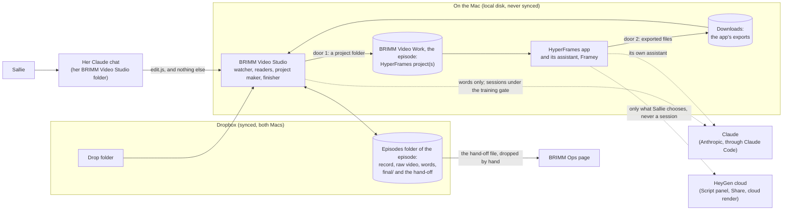
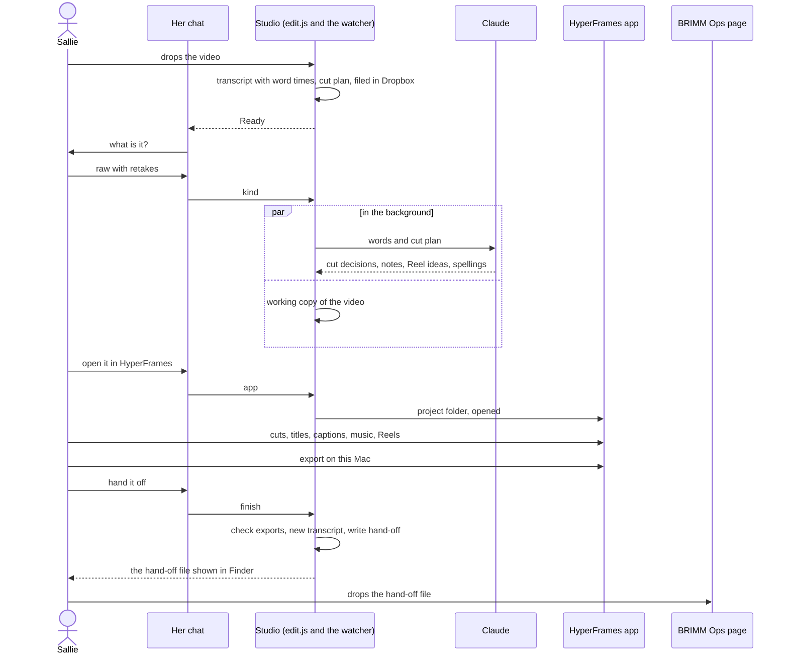
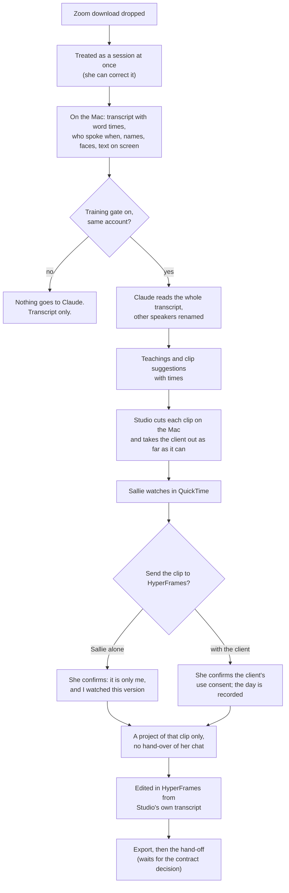

# BRIMM Video Studio: the architecture and the workflows

- **Date:** begun 2026-10-27, in the evening, and finished after midnight on 2026-10-28.
- **Status:** a proposal, for Jason's yes. Plan PRs 1 to 4 are merged, and PR 5 (Reel projects, 4.3) is built on its branch, not yet merged. Nothing else in it is built, and nothing in it is installed or turned on.
- **It rests on:**
  - the design accepted on 2026-10-27, `2026-10-27-brimm-video-with-the-hyperframes-app.md` (until it is merged, on the branch `claude/zealous-bell-esuqck` of brimm-video, or `claude/design-2026-10-27` of brimm-video-studio);
  - Jason's decisions in `docs/requirements.md`;
  - the full handoff, `docs/handoffs/2026-10-27-brimm-video-studio-full-handoff.md`;
  - the code of `main` at c666508;
  - the HyperFrames command line, version 0.8.208, read and run in a scratch folder on a Linux machine: no Mac, no app, install scripts off, telemetry off. "Sources" at the end says exactly what was read.
- **It does not reopen** a decision of the accepted design. Where a fact in the code or in the command line makes a sentence of that design unworkable as worded, "Findings" says so and proposes a rule that keeps its intent.
- **Not covered, because only A0 can answer it:** what the app's Script panel does with `transcript.json`; where the app puts its exports and what it names them; where "make Reel 2" puts the new project (A0 of 2026-10-28 answered it: in a folder of the app's own, outside `~/BRIMM Video Work`, with a copy of the whole recording, which is why Studio makes every Reel, 4.3); whether the app's assistant keeps a project's rules. Where this document needs one of those, it says so and gives the rule it will use until A0 answers. Section 15 lists what to add to A0 so that one sitting answers all of them.
- **Companion:** the build plan, `docs/superpowers/plans/2026-10-27-brimm-video-studio-build-plan.md`: the pull requests in order, the failing tests of the first ones, the roll-out, and the baseline of the test suite.

**Words used here.** Two ideas have near names, so they are kept apart:

- The **hand-off** is the file BRIMM Ops takes (`*.brimm-ops.json`).
- A **handover** is the HyperFrames command line's word for passing a Claude Code conversation to the app. It is not the hand-off.

Also: a **project** is a HyperFrames project folder. The **working copy** is the constant-frame-rate copy of a video that a project holds. An **export** is a video file the app saves. **The app** is HyperFrames (`HyperFrames.app`); its assistant is called Framey. **Studio** is BRIMM Video Studio, the application this work builds, in the repo `brimm-video-studio`.

---

## 1. In one page

**The idea.** The app edits. Studio does everything around the editing: it takes the video in, reads it, makes the app's project, takes the exports back, and writes BRIMM Ops its file. Studio and the app meet in two places only.

1. **Door 1, a project folder.** Studio writes it on the Mac's own disk and opens it in the app. It holds the working copy, the transcript with word times, Studio's suggestions, the brand and BRIMM's rules. It holds nothing else.
2. **Door 2, exported video files.** The app saves them. Studio finds them, checks them, transcribes them again on the Mac, and writes the hand-off from them.

Nothing else crosses: no shared database, no plug-in, nothing that depends on the app's insides. Where Studio reads a file the app keeps (`.hyperframes/app-history.jsonl`), it only reads it, and does without it when it is not there. **BRIMM Ops sees no difference:** the hand-off is the same file, written by the same code, under the same tests.



**What changes for Sallie.** She drops and answers the card as today. Then she says "open it in HyperFrames", edits there by talking to the app, exports on this Mac, and says "hand it off" in her chat. She drops the hand-off on the BRIMM Ops page as today. She never opens Final Cut, a timeline, a terminal or a command.

**What was found** (section 2): thirteen things in the code and the command line that change how the design is built, though not what it does. The ones that matter most:

- The handoff's list of modules to retire is wrong for five of them, and `edit.js`'s kept commands use others: kept code still imports them (F1).
- Her folder can run `edit.js` and nothing else, so "run `npx hyperframes open` from her chat" has to go through `edit.js` (F2).
- **Opening a project can hand her whole chat to the app**, and the same switch is how a chat that has seen a session's words would reach it (F3).
- `hyperframes init` makes a project that loads code from a CDN and carries a `publish` script, so Studio writes its own (F4).
- The command line has 43 commands, and A0's deny list names 6 of them (F6).
- The v2 hand-off cannot carry a session clip that has no client agreement (F10).

**What is asked of Jason** (section 14): ten decisions, each with a recommendation. None of them blocks starting.

**What can start now.** Only documents until Jason makes the `brimm-video-studio` repo (handoff section 6). Then, with no wait for A0: the pinned-toolchain module, the project's file set, and the working-copy arguments (plan, PR 1 to 3). They are pure code with fixtures, and no test runs the app.

---

## 2. Findings from the code and the app

Each says what was seen, where, and what the architecture does about it.

### F1. Five modules the handoff retires are still used by kept code

**Seen.** The import graph of `tool/*.js` at c666508. First, what other modules import:

| Module | Who still imports it | Symbols |
|---|---|---|
| `clock.js` | `handoff-v2.js` (the contract), `reels.js` | `keptWords`, `lengthOf`, `timelineAt` |
| `reframe.js` | `finish.js`, `notes.js`, `reading.js`, `readings.js`, `reels.js`, `unedited.js` | Reel rules (`REEL_MIN`, `REEL_MAX`, `fitReel`, `stretchesOf`, `storyParts`, `clipNames`, `STORY_MAX`); Story cutting (`storyCuts`, and `clipArgs`, which wraps `verticalArgs`); face-based crops and stills (`cropFor`, `cropsFor`, `stillsArgs`, `needsReframe`). Only `uprightQuality` has no user outside its tests |
| `timeline.js` | `reading.js` | `timelineFor` |
| `recut.js` | `finish.js` | `cutPhrases`, in `expectedWords` (the first-words check) |
| `projects.js` | `unedited.js`, and `timeline.js` | `mainProject` |
| `reels.js` (changed, not retired) | `finish.js`, `reading.js`, `unedited.js` | `REELS_FILE`, `readReels`, `reelsFile`, `reelEntries`, `mergeCandidates`, `reelCandidates`, and the preview functions |

Second, **`edit.js` is a kept module too,** and its kept commands use modules the waves delete:

- `timeline.js`: `newestOf` (in `episodes` and `open`), `newestIsRender` (in `guide`), `clockFor` (in `reels`);
- `layers.js`: `presetOf` (in `spell`);
- `parts.js`: `partsOf`, `lookFor` and `kindOf` (in `finish`), `unkeptParts` (in `release`);
- `portable.js`: `mediaIn` (in `release`), `localMedia`, `retitle`, `withImportOptions`;
- `reels.js`: `REEL_FRAME`, `reelsText`, `uncropped`, `notMadeWords`.

The shared test helper `tests/phase4.js`, which nine test files use (some of them for kept commands), imports `mainProject`, `relativeMedia`, `reelCandidates` and `previewPath`.

`captions.js` is imported only by `layers.js`. `layers.js`, `pictures.js`, `styles.js` and `reel.js` are imported only by `edit.js` and `timeline.js`.

**So.** `clock.js` is kept whole: it is small, pure, tested, and the contract module imports it. `reframe.js` mostly stays, because the Reel rules, Story cutting and face-based crops are all used by kept code; only what the full import's upright version used alone goes. `reels.js` is split, so that the candidates file stays and the previews and Final Cut project retire. `timeline.js` and `projects.js` go together, only after `reading.js`, `unedited.js` and the kept commands of `edit.js` stop using them. `recut.js` goes when `finish.js`'s first-words check and `edit.js`'s `cut` command do. Retiring is therefore not only deleting files: it is also rewriting the kept commands that use them. Section 10 has the table and the order.

### F2. Her folder can run `edit.js` and nothing else

**Seen.** `tool/studio/CLAUDE.md`: "Everything is done through brimm-video's commands. Do not … run any other program." The skill says "Run brimm-video's commands, and only these", and under the strict lock the guard hook answers yes to `edit.js` and no to everything else (`tool/studio.js`, `tool/studio/guard.mjs`). The design's section 2 says `npx hyperframes open` is "run from her chat's session".

**So.** Her chat cannot run the command line. A new `edit.js` command, `app`, runs the pinned command line itself, by absolute path, with a fixed argument list and a scrubbed environment (5.6). Her lock does not change, and the allowlist the handoff says "gains `npx hyperframes open` and `catch-up`" gains nothing: the commands are inside `edit.js`.

### F3. Opening a project can hand the whole chat to the app

**Seen.** In the command line's own code (`dist/chunk-43MW4SY7.js`, `dist/catch-up-*.js`):

- `open` reads `CLAUDE_CODE_SESSION_ID` from its environment. When it is there, `open` writes `.hyperframes/agent-handoff.json` (`{engine, sessionId}`) into the project and a "seen" mark under `~/.hyperframes/catch-up/`. The app then "picks up this Claude Code conversation".
- When it is not there, nothing is written, and `catch-up` answers "wasn't handed to the desktop app from here, so there's nothing to catch up on".
- On a Mac, `open` runs `open -b dev.hyperframes.desktop <folder>`. If the app is missing it answers `{opened: false, reason: "not-installed", downloadUrl}` and exits 1.
- `CLAUDE_CODE_SESSION_ID` is also what `tool/held.js` uses as a chat's id, to know which chats have been shown a session's words.
- `open` also reads `CODEX_THREAD_ID` and `GROK_SESSION_ID` for other agents. The scrubbed environment of 5.6 carries none of the three unless the handover is allowed.

**So.** A handover is a privacy decision, not a convenience. A chat that has been shown a session's words must never hand over, or those words would be the app's assistant's context, which breaks "nothing of a session goes to HyperFrames by default". The rule (5.6): the handover is off by default; when switched on it happens only from a chat `chatHeld` does not hold, and never for a session clip. A0 shows whether the handover adds anything (15). The project's files carry what the app's assistant needs either way. What happened in the app is read from `.hyperframes/app-history.jsonl`, which needs no handover: the command line's code reads it as a plain list, one turn per line (`{at, engine, asked, did, files}`, each text cut to 2,000 characters).

### F4. `hyperframes init` makes a project BRIMM would have to repair

**Seen.** A project made by `init --video` (0.8.208) has:

- an `index.html` that loads GSAP from `https://cdn.jsdelivr.net/npm/gsap@3.14.2/dist/gsap.min.js`, so every preview and render fetches code from the network;
- a `publish` script in `package.json`;
- a `hyperframes.json` whose `registry` is `https://raw.githubusercontent.com/heygen-com/hyperframes/main/registry`, a moving branch that `add` and `catalog` read;
- a 109-line `CLAUDE.md`, and an identical `AGENTS.md`, that send the agent to `npx hyperframes skills update` and to `publish`;
- a copy of the video made inside the project (`recording.mp4` at its root), converted to H.264 only when its codec is not one a browser plays and `--keep-original` is not given.

**So.** Studio writes the project's files itself, from a template it owns: GSAP vendored with a checksum, no `publish` script, no registry on a moving branch if the app accepts that (A0b), a link so that `npx hyperframes` runs the pinned version offline (5.3), and BRIMM's rules first in the agent's notes (5.4). A golden fixture of the pinned command line's own `init` output is kept in the tests, so that a change of pin shows what moved.

### F5. `transcript.json` is a plain list

**Seen.** `hyperframes transcribe <word-per-cue.srt> --dir <project>` writes:

```json
[
  { "text": "Hello",     "start": 0,    "end": 0.42, "id": "w0" },
  { "text": "everyone,", "start": 0.42, "end": 0.8,  "id": "w1" }
]
```

Ids are `w0`, `w1` and so on; punctuation stays in `text`.

**So.** Studio writes this file directly from its own word list, with the episode's spellings applied, and uses the same ids in `brimm/cut-suggestions.json` and `brimm/reel-suggestions.json`. No `transcribe` call, no speech recognition inside a project, and nothing for the app to send anywhere to get the words.

### F6. The command line has 43 commands; A0's deny list names 6

**Seen.** `hyperframes --help` (0.8.208) lists 43. A0's `settings.json` denies six of them, `publish`, `cloud`, `lambda`, `cloudrun`, `auth` and `feedback`, and the script `npm run publish`. Not named, and not harmless:

- `tts` writes speech from text with a local model: a generated voice;
- `capture` fetches a website;
- `add` and `catalog` install third-party blocks from the registry branch;
- `skills`, `models` and `browser` download;
- `upgrade` rewrites the version pin;
- `present` shares a slide deck with an audience.

**So.** Every command is classified in code as one the agent may run, one only `edit.js` runs, or one denied. Section 5.5 has the table: 20, 2 and 21. A test fails when the pinned command line has a command nobody classified, so a new pin cannot slip a command in. A deny rule is a prefix match and can be sidestepped (`npx -y …`, `node …/hyperframes.mjs …`), so it is a second line: the first is that the project has no credentials and no `publish` script, and A0 checks the rest.

### F7. `history` is a trial

**Seen.** The command line's own skill (`dist/skills/hyperframes-cli/SKILL.md`) marks the block on `history` "history (trial): remove this block together with the command".

**So.** The design's versions rest on a feature its maker may remove. Nothing in `finish` or the hand-off depends on it. Studio reads `history --json` to answer "what changed", and says so plainly if the command is gone. The version pin protects against a surprise, and a change of pin re-runs the fixtures (11).

### F8. The app is called HyperFrames

**Seen.** The command line looks for the bundle `dev.hyperframes.desktop` (and a Canary build) and the app `HyperFrames.app`, prints "the HyperFrames desktop app", and calls the assistant "Framey". "Studio" is the name of the download page (`hyperframes.dev/studio`), and the command line also uses it for its browser preview ("Start the studio for previewing compositions").

**So.** The name clash the handoff leaves open (Sallie's folder `~/BRIMM Video Studio` against "HyperFrames Studio") goes away if everything Sallie reads says "HyperFrames", never "Studio". Her folder keeps its name (D10).

### F9. A Final Cut finish never gave a raw video its Reel suggestions, and the way to give them exists

**Seen.** `finishNow` in `tool/finish.js`: the hand-off "holds no Reel suggestions: their times are on the raw video's clock, which a Final Cut finish does not know". `inMain` in `tool/handoff.js` already finds a Reel's words in a finished main video by votes of clock offsets between the two, and is tested.

**So.** B2 first keeps parity: no suggestions for a raw video. B2b then places each unmade suggestion in the exported video with `inMain`, from its words: no new matching algorithm, though `inMain` answers with a start and an end only, so a few lines of glue make the rest of a suggestion (8.6). `suggestionsOnClock` and the clock stay for the contract's sake and are not needed for this.

### F10. The v2 hand-off cannot carry a session clip that has no client agreement

**Seen.** `handoffFaultV2` in `tool/handoff-v2.js`: a session's Reel must hold `clientAgreed`, "the day the agreement was noted, never who", and `fromSuggestion` must be `null`. The accepted design allows a "Sallie alone" clip to go to the app with no agreement to note.

**So.** A Sallie-alone clip can be cut, edited and exported, but its hand-off cannot be written under today's contract. Options, in D5: record the day she confirmed "alone" in `clientAgreed` (works today, says something untrue), extend the contract with brimm-operations (right, needs both repos in step), or write no hand-off for such a clip yet (safe). Until Jason picks, no session clip's hand-off is written.

### F11. Sallie's laptop is not on the light import, and Zoom downloads are held at the drop

**Seen.** README: "Sallie's laptop is not switched yet". `tool/filing.js` holds a Zoom download in the drop folder with "Zoom downloads are taken from a later version. Put this one in BRIMM VIDEO Transfer." `tool/kinds.js` gives a Zoom name no guess and the card offers a session, never assumes one.

**So.** Everything here stands on the light import, so her laptop is switched first (`docs/setup/sallies-laptop.md`, "Switching her laptop"). "A Zoom download is a session at the drop" (decision 10) needs what the 2026-10-22 design called phase Z, which therefore becomes part of S1.

### F12. A project cannot live in Dropbox, so a take-over needs a snapshot

**Seen.** The rule: projects live in `~/BRIMM Video Work`, never in Dropbox or a watched folder. `release` hands an episode to the other Mac through Dropbox. The app's history sits in `~/.cache/hyperframes/history/<id>/` on each Mac.

**So.** `release` also writes the project's text files (compositions, `brimm/`, the notes) into the episode as a snapshot, and a take-over rebuilds the project from it, making the working copy again from the raw video. App history does not travel, and Sallie is told so. Section 7.

### F13. Adding the project to the record is a new layout

**Seen.** `tool/episode.js`: `RECORD_VERSION = 3`; a record is written at a higher layout only once it holds a field of it, and a Mac that knows a lower layout refuses it, never changing it.

**So.** The `app` field is layout 4. Both Macs must run the same Studio before the first project is made. The existing `behind` check already tells Sallie when her Mac is behind.

---

## 3. The shape

### 3.1 The parts

| Part | What it is | Modules | Door |
|---|---|---|---|
| Watcher | The launch agent that imports every drop | `unedited.js`, `filing.js`, `importing.js`, `dropbox.js`, `progress.js`: kept | |
| Records | An episode's folder and record in Dropbox | `episode.js` (gains layout 4), `names.js`, `versions.js`, `settings.js`: kept | |
| Readers | Claude's reading of a video once Sallie says what it is | `readings.js`, `reading.js`, `notes.js`: kept, changed | |
| Project maker | The working copy, the project folder, opening the app | `hyperframes.js`, `project.js`, `workcopy.js`, `app.js`: new | 1 |
| Finisher | Takes exports, checks them, transcribes them, writes the hand-off | `exports.js`: new; `finish.js`: changed; `final-transcript.js`, `handoff.js`, `handoff-v2.js`: kept | 2 |
| Sessions | Gated reading, clip suggestions, clips | `sessions.js`, `teachings.js`, `gate.js`, `dialog.js`, `held.js`: kept, changed; `clips.js`: new | 1, for a clip |
| Her chat | Her folder, its lock, its skill | `studio.js`, `studio/` (the guard hook is `studio/guard.mjs`), `edit.js` (slimmed), and the lock's own modules `open-lock.js`, `loosened.js`, `held.js`, `scan.js`, `chain.js`, `never.js`, `places.js`, `fetchable.js`, `receipts.js`, `reveal.js`, `sandboxed.js`: kept, changed where this document says | |
| BRIMM Ops contract | The hand-off, the shared copies, the guide | `handoff.js`, `handoff-v2.js`, `shared/`, `guide.js`, `guide-note.js`: unchanged in what they promise | out |

New commands live in their own module (`app.js`, `clips.js`), not in `edit.js`, which is already 5,900 lines. `edit.js` only wires them.

### 3.2 Where things live

| What | Where | Why |
|---|---|---|
| The raw video, its record, words, `final/`, the hand-off | Dropbox, `Episodes/<episode>/` | Both Macs and BRIMM Ops see them |
| The working copy and the project | `~/BRIMM Video Work/<episode folder>/`, on the Mac's own disk | The app writes a project all day: never in Dropbox or a watched folder (rule) |
| The pinned command line | `~/BRIMM Video Work/.toolchain/hyperframes-0.8.208/` | One copy per Mac, run by absolute path |
| The app's exports | `~/Downloads` (the app's choice; A0 confirms) | Studio takes copies and leaves the originals until the late check |
| The app's history | Inside the project (`.hyperframes/`) and `~/.cache/hyperframes/history/<id>/` | The app's. Studio reads and never writes |
| A project's snapshot for the other Mac | `Episodes/<episode>/app-snapshot/` | Text files only; written by `release` |

### 3.3 What each outside party may see

| Content | Raw video, finished video, iPhone clip (meant for posting) | Client or group session |
|---|---|---|
| The video and its sound, in Dropbox and on the Mac | Yes | Yes |
| The same, in the HyperFrames app on the Mac | Yes | Only a clip, and only after Sallie's confirmation |
| The audio, sent to HeyGen by the app's Script panel | Yes (decision 4) | Never, until HeyGen confirms the training opt-out (decision 6) |
| Sharing an export through the app | Invited people only (decision 7) | Never, until HeyGen confirms |
| Rendering in the cloud | Never | Never |
| Words with times, to Claude through Claude Code | Yes: the transcript and cut plan | The whole transcript with other speakers renamed, only on an account whose training setting is off (the gate) |
| Words, to the app's assistant (Claude Code inside the app) | Yes, in the project | A clip's words only, in a project of that clip |
| Higgsfield, OpenRouter, Zoom's AI features | Prompts only; footage after a yes for that video | Never |
| BRIMM Ops | The final transcript and the Reels' words | Principles with no client names, never the transcript; a clip's words only once D5 is decided |

The controls Studio does not have are the app's own buttons: Share, Render in the cloud, the Script panel, HeyGen's avatars and voices. Studio cannot disable them. It names them in the project's notes, in a line when a project is opened, and in the guide, and A0 looks for settings that turn them off (5.9).

---

## 4. The workflows

Written to the accepted design (its sections 3 to 6). Here each step also says which part of Studio does it, so that the build plan can follow.

### 4.1 A raw video with retakes (the OBSBOT)



| # | Who | What happens | Studio's part |
|---|---|---|---|
| 1 | Sallie | Drops the video in her drop folder | Unchanged |
| 2 | The watcher | The light import: sound read, transcript with word times, cut plan, the video filed in `Episodes/` by the Dropbox rule, a label, "Ready" | Unchanged (`unedited.js`, `filing.js`) |
| 3 | Sallie, in her chat | Answers the card: "Raw with retakes" | Unchanged (`kind`) |
| 4 | Studio, in the background | Two detached jobs: Claude reads the words and the cut plan (cut decisions, notes, Reel suggestions, spelling offers); and the working copy is made (if the video is on this Mac, this Mac is set up for the app, and the episode has no main project in use) | `reading.js` changed: no rough cut, no Final Cut file. `workcopy.js` new |
| 5 | Sallie | Reads what Claude found; answers the spellings card | Unchanged |
| 6 | Sallie | "Open it in HyperFrames" | `app "<episode>"`, new |
| 7 | Studio | Claims the episode for this Mac, brings its files over if they are online-only, asks for the working copy if it is not made, writes the project, opens the app, and says in plain words that it is open. The bring and the copy are detached runs, so `app` does not wait for them: it says what is being made, and tells her to say "open `<name>` in HyperFrames" again when it is done ("how far is it?" shows how far it has got), since a command has two minutes in the Code tab | `app.js`: today's claim and bring from `open`, then `project.js` and `hyperframes.js` |
| 8 | Sallie and Framey, in the app | Cuts (the Script panel's suggestions, and Studio's in `brimm/cut-suggestions.json`), a name, a title card, music, captions, graphics. Each request is an entry in the project's history | Not Studio's |
| 9 | Sallie, in her chat | "What did I do in HyperFrames?" | `app "<episode>" what-happened` reads `.hyperframes/app-history.jsonl` and says it in plain words |
| 10 | Sallie | A Reel: says "Open Reel 2 in HyperFrames" (or "make Reel 2") in her chat. If she asks the app for one, its assistant tells her to say that in her chat: the app never makes a Reel as a project of its own (4.3) | `app "<episode>" reel 2` makes a Reel project from suggestion 2 and opens it |
| 11 | Sallie, in the app | Exports on This Mac: the main video (1080p), each Reel 9:16 | Not Studio's |
| 12 | Sallie, in her chat | "Hand it off" | `finish "<episode>"` (section 8) |
| 13 | Sallie | Drops the hand-off on the BRIMM Ops page; the guide gives her each step | Unchanged |
| 14 | Sallie | "I'm done with it for now" | `release` writes the project snapshot and lets go of the claim |

### 4.2 An iPhone clip, 1 to 5 minutes

The same, with these differences:

- **The card:** "iPhone clip". The tool's guess for an upright or short video is already "clip" (`guessKind`).
- **The reading** asks only for spellings and one line on what the clip is. No cut decisions, no Reels.
- **The working copy** keeps the clip's own shape (usually 9:16), makes the frame rate constant, and converts HDR to standard colour (5.7). The project is made at that shape.
- **The notes** say: tighten it; captions only when she asks, in the BRIMM style; a title card and an end card on request.
- **The hand-off** is kind "short video": `main` only, no `reels`. BRIMM Ops writes its post text.
- **The hand-off waits for the export, which is a change.** Today an answered iPhone clip counts as "not edited in Final Cut" (`hasFinalCut` in `edit.js`): once its spelling card is answered, `saveSpellings` writes its hand-off at once from the import's captions (`handoffOwed`, `importHandoff`, then `finishFinished`'s short-video branch), and `finish` and `push` refuse it ("an iPhone clip is not edited here"). In Studio an iPhone clip is edited in the app, so none of that may write a hand-off from the unedited clip: `handoffOwed` stops owing it, `finish` takes a short video and its export, and `finishFinished`'s short-video branch is used only for a clip she hands off as it is. If she has not opened it in HyperFrames, `finish` asks once: "Hand it off as it is, or open it in HyperFrames first?" Left as it is, the old behaviour would hand off the unedited clip before the app edit, and again on every later spelling.
- **One clip, one project.** "Put these three together" (the design's section 4) would make one video of three episodes, with no single id for the hand-off. It waits (D8).

### 4.3 A finished video from her editor, and Reels from it

- **No app for the hand-off.** As today: drop, card "Finished by your editor", Claude's Reel suggestions and spelling offers, and the hand-off is written when the spelling card is answered, from the import's captions (`finishFinished`). No working copy, no project: `app "<episode>"` for a finished video says "`<name>` was finished by your editor, so it has no HyperFrames project: a finished video is not edited in HyperFrames." and stops.
- **A Reel she wants** goes to the app as a project of its own: `app "<episode>" reel 2`. **Studio makes every Reel** (Jason's ruling, 2026-10-28). A0 found that the app, asked for a Reel, makes it as a project of its own in `~/.hyperframes-studio/<name>/`, outside `~/BRIMM Video Work`, with a copy of the whole recording in its `assets/`: Studio could not find such a project's export for the hand-off, and a second copy of a recording is one nothing keeps track of. So every project's notes (5.4) tell the app's agent never to make a Reel as a new project itself, and, when she asks it for one, to tell her to say "Open Reel 2 in HyperFrames" in her Claude chat. If it is wrong, the cost is a line in the notes, and a way to adopt the app's own Reels later.
  - Studio cuts that suggestion's stretch out of the original as filed, from the suggestion's first moment to its last, into the Reel project's working file, by a detached run (`workcopy --reel 2`) with the working copy's lock, chain and checks (5.7), and writes the project, and opens it. Nothing is cut inside the stretch: the pauses and retakes the cut plan cuts stay, and cutting them is the app's. The Reel's words are its own, on its own clock from 0. The upright crop is the app's job; Studio offers the face positions it already finds in the Reel's video (`brimm/face-track.json`, only when the finder found a face).
  - `app … reel N` also marks the candidate picked, in the same write that records the project, which is what `reel pick` did, and `reel pick` is gone: `reel drop N` stays as the way to drop one (6.1).
- **After the export,** `finish "<episode>" reels` writes the next revision of the hand-off under the same id, with the new Reels added and `main` as it was (section 8.7).
- **OpusClip** is unchanged: it takes the episode's YouTube link, and Studio uploads nothing.

### 4.4 A client or group session (Zoom)

The rules are the design's section 5, word for word. This is how they are built, in three steps that can ship apart.



**S1. At the drop: a session, read.**

1. **A Zoom download is a session.** `kinds.js` already names a download (`isZoomName`, `zoomTimeOf`). The change: it is answered as a session with the mark not cleared (so the gate applies at once), the card is skipped, and `filing.js` stops holding it ("taken from a later version"). She corrects it with today's `kind … --again --clear-session`, which needs her click on a dialog. A download is several files (the recording, the sound alone, Zoom's transcript, its chat and caption text), and the import takes one video per episode today, so taking them together is new work: they are grouped into one episode by the time Zoom puts in their names. `zoomTimeOf` gives that time only for `GMT…_Recording` names; for `audio…` and `video…` files it gives the whole file name, and it knows nothing of a loose `.vtt` or `closed_caption.txt` at the drop (`meetingTranscripts` reads the file list of an episode that already exists). Whether the files arrive loose or in a folder is the first fixture of S1, from a real download of Jason's own made-up call.
2. **Analysed on the Mac first,** with no outside service: the words with times (whisper, as for every video); who spoke when, from Zoom's transcript names or each participant's sound file; the names Studio can see (`visibleNames`); faces in sampled stills (`faces.swift`); and text on screen, because Zoom shows names on tiles (Apple's on-device Vision, added to the Swift side).
3. **Claude reads it** in the same run, under the gate (`teachingsWhy`, `accountWhy`): the whole transcript with every other speaker renamed (`replaceSpeakers`). It writes the teachings as today, and **clip suggestions**: a start and an end on the recording's clock, the point, a working title, and whether the clip is Sallie alone or with the client. Names are taken out of the new fields as they are of principles (`checkNames`).
4. **Her folder turns off** `/feedback` and the transcript-share survey (`DISABLE_FEEDBACK_COMMAND=1`, `CLAUDE_CODE_DISABLE_FEEDBACK_SURVEY=1`), written into her folder's settings by `studio.js`.
5. **In her chat:** the teachings as today; the clips as a list. Printing a clip's point is printing a session's words, so `held.js` marks the chat as before.

**S2. Clips.**

6. `clips "<label>" make` cuts each suggested clip on the Mac into the episode's `clips/` and makes a version with the client taken out as far as it can: spoken client names muted by their word times and shown as `[client]` in captions; names on screen blurred where Vision finds them; the picture from Zoom's active-speaker file, never the gallery; a clip where another face still shows is marked "shows someone else". It writes what it took out beside the clip.
7. `clips "<label>" show 3` opens it in QuickTime Player (`reveal.js`).
8. `clips "<label>" send 3` asks for the confirmation, in a macOS dialog only she can click (`dialog.js`): for a clip that is her alone, that she watched this version and it is only her; for a clip with the client, the client's "use" consent, which records the day and never who. A clip marked "shows someone else" needs a third, plain confirmation. The consent is written to the record (`{clip, basis, day}`) and is never sent anywhere.
9. **The project** holds that clip and its words only: the clip file, a `transcript.json` made on the Mac from the clip (names muted), a neutral name (`Session clip 3 3fa9c1`), session notes, and settings that also deny `WebFetch` and `WebSearch`. It is opened **without a handover**, and with three lines in the answer: no Share, no Render in the cloud, no transcription in the Script panel, until Jason records that HeyGen has confirmed its training opt-out (a setting like the training gate's).
10. **Retention.** `clips "<label>" done 3` removes the project, the app's history folder for it (`~/.cache/hyperframes/history/<id>/`, found from `.hyperframes/history-id`), the "seen" mark, and the export copy Studio took. The export in Downloads goes only if it is unchanged since Studio took it (the rule `finish` already follows for Final Cut's folder).

**S3. A clip in the hand-off.** Waits for D5 (F10).

### 4.5 The hand-off to BRIMM Ops

Section 8. In short: Studio takes the exports, transcribes them again on the Mac, and writes version 2 of the hand-off with the code and tests it has today. The guide's BRIMM Ops steps (`taken`, `kit`, `posted`, `live`, `cascade` for an episode; `taken`, `posttext`, `posted` for an iPhone clip; `taken`, `checked` for a session) do not change. The guide gains three states before them, so that Sallie is told where a video is in HyperFrames, and its Final Cut stages go (plan, PR 10).

### 4.6 Versions, and "what changed"

- **The app's history is the version list** (design section 3.5). Studio does not keep versions.
- `app "<episode>" versions` runs the pinned `history --json --limit 20 --dir <project>` and says each entry in plain words: when, who, the label. "Go back to before the music" is said to the app's assistant, which runs `history restore`; Studio never changes history.
- `history` is a trial (F7). If it fails, Studio says "I can't list the versions right now; HyperFrames shows its history", and nothing else depends on it.
- Versions do not cross Macs (F12).

### 4.7 Two Macs

- **The claim** is today's: one Mac edits an episode at a time, in the record, read again after `CLAIM_WAIT_MS`.
- **The project is local.** `release` writes `Episodes/<episode>/app-snapshot/` (the project's text files and `brimm/`, by the Dropbox rule: new names, never over a file) and copies the newest exports into the episode, as it carries Final Cut's Shares today. `app "<episode>" --take-over` on the other Mac (which does `open`'s claim and bring first, so Sallie only ever says "open it in HyperFrames") rebuilds the project from the snapshot when it has none of its own, makes the working copy again, after asking, and says that the app's history stays behind.
- **Exports** are found on the Mac that holds them. After a release, the other Mac finds what the first one copied into the episode.

### 4.8 Corrections

- **"It's actually finished" (or raw, or an iPhone clip).** Today's `kind … --again`. When it changes the kind, the main project that exists is kept, never deleted by Studio, and marked "kept for an earlier kind", in the record that changes the kind. Nothing on disk changes, and she is told so in one line. `app` makes a new main project the next time she asks, and does not offer it first. The new one is another folder, under the first name that no project of the record has: "main 2", then "main 3" and so on (5.1). Its `key` in the record stays "main"; the kept project keeps its own name, folder and entry.
- **A new version of a video** (`versions.js` fingerprint): a new revision of the episode, made at the drop, with its own project. The old one is untouched. A recording that changed under a project, with no new drop, is not a new version: `app` says that the recording has changed since the project was made, and opens the project as it was, with the recording it was made from. It makes no second project in place.
- **A spelling added later** is not pushed into an open project: the app may be editing it. It applies to the final transcripts at `finish`, and the chat tells her to ask the app's assistant to fix any caption already drawn.
- **Asking Claude again** (`ask`) rewrites `brimm/` only while the project has never been opened. After that it says so and changes nothing in the project.

---

## 5. The project (door 1)

### 5.1 Layout

```
~/BRIMM Video Work/
  .toolchain/hyperframes-0.8.208/        the pinned command line, one per Mac
  .runs/                                  a run's own folder (existing)
  <episode folder name>/                  one per episode, on this Mac only
    <project name>/                       the main video's project, e.g. "Pricing talk main 3fa9c1"
      index.html  meta.json  hyperframes.json  package.json
      transcript.json
      CLAUDE.md  AGENTS.md  .claude/settings.json
      media/recording.mp4                 the working copy
      node_modules/.bin/hyperframes       a link to the toolchain's (5.3)
      vendor/gsap.min.js  assets/fonts/  assets/logos/
      brimm/  facts.json  cut-suggestions.json  reel-suggestions.json  spellings.json  brand.md
      compositions/                       made by the app and its assistant
      .hyperframes/                       the app's own: history, app-history.jsonl
    <project name>/                       a Reel's, e.g. "Pricing talk reel 2 3fa9c1"
    <project name>/                       a session clip's, e.g. "Session clip 3 3fa9c1"
```

The project's folder name, its `meta.json` name and its title in the app are one name, built as `projectName` builds Final Cut's today (`<file-safe name> <part> <short id>`, without the version: versions are the app's). The app names an export after the project, so the record keeps the name and `finish` finds files by it, never by the episode's later name. The main video's later projects, which a correction of the kind makes (4.8), have the part "main 2", "main 3" and so on (`Pricing talk main 2 3fa9c1`): the first name that no project the record keeps has, so that a folder that is there, recorded or not, is never written over; one the record does not know, which a run that could not write its record left, is taken as the project it is. A session's projects are named from its label and a number, never from a file.

### 5.2 What goes in a project

| File | Made from | Notes |
|---|---|---|
| `index.html` | Studio's template | One `<video>` for the working copy; `data-width`, `data-height`, `data-duration` from the working copy's facts; GSAP from `vendor/` |
| `media/recording.mp4` | The raw video | 5.7. For a Reel: its stretch of the recording, cut by `workcopy --reel` (5.7) |
| `transcript.json` | The episode's words, with its spellings | F5. For a session clip: the clip's own words, names muted. For a Reel: the recording's words that end inside its stretch, on the stretch's own clock from 0 (`reelWords`), ids from `w0` |
| `meta.json`, `hyperframes.json`, `package.json` | Studio's template | `package.json` has the scripts `dev`, `check` and `render` (each runs `hyperframes <command>`), and no `publish` |
| `node_modules/.bin/hyperframes` | A link to the toolchain's `bin/hyperframes.mjs` | 5.3. Makes `npx hyperframes …` and `npm run …` run the pinned version with no network |
| `CLAUDE.md`, `AGENTS.md` | 5.4 | The same text in both |
| `.claude/settings.json` | 5.5 | Denied commands, and the environment |
| `brimm/facts.json` | The record | The kind, the name, the length, what the files are. For a Reel: `reel: { n, offset }`, where its stretch starts in the recording, in seconds |
| `brimm/cut-suggestions.json` | The cut plan, as Claude changed it | 5.8. The main video's only |
| `brimm/reel-suggestions.json` | `reels.json` | 5.8. The main video's only: not in a Reel, and not in a session clip |
| `brimm/face-track.json` | The face finder's stills of the Reel's video | A Reel's only, and only when the finder found a face: `{ version: 1, clock: "reel", every, about, stills: [{ at, faces }] }`, each `at` in seconds on the Reel's clock and each face a box as the finder gave it. The upright crop is the app's; this says where the speaker is |
| `brimm/spellings.json` | The house's spellings, then the episode's | So titles and captions are spelled as she says, and the company's name always as BRIMM. The house's are "brim", "Brim" and "BRIM" as BRIMM, since the app makes a transcript of its own that says "Brim". They come first, as `transcript.json` applies them: the name is Jason's rule, and it wins |
| `brimm/brand.md`, `assets/fonts/`, `assets/logos/` | The brand pack (`tool/brand/`) and the Assets folder in Dropbox | D4. Colours, type, rules; Josefin Sans in Light, Regular, Regular Italic and Medium, and Allison for an accent (open licences; Jason's of 2026-10-26 and 2026-10-28); the logos she chose, never a "with Sallie Holder" mark |
| `vendor/gsap.min.js` | `tool/vendor/` | The version `init` uses (3.14.2), with its checksum in the pin file |

Everything in a project is a file Studio chose to put there. The tests assert the whole file list for each kind, so nothing arrives by accident.

### 5.3 The pinned command line

- **Where:** `~/BRIMM Video Work/.toolchain/hyperframes-0.8.208/`, made by `npm install --prefix <that folder> --ignore-scripts --save-exact hyperframes@0.8.208`. Run as `node <that folder>/node_modules/hyperframes/bin/hyperframes.mjs <command>`. Never `npx`, which would run whatever `hyperframes` it finds first, including a planted `node_modules/.bin/hyperframes` in a project.
- **Each project reaches it by a link,** `node_modules/.bin/hyperframes` pointing at the toolchain's `bin/hyperframes.mjs`. The notes, the scripts and the assistant's habits all say `npx hyperframes …`; with the link, `npx` finds the pinned version first and never goes to the network for another. Tested here on Linux with npm offline: `npx hyperframes --version`, `npx --no-install hyperframes --version` and `npm run` all answered 0.8.208. Whether the app and its assistant accept a project like that is A0b's question (15, item 8). Studio itself never uses `npx`; it calls the toolchain by absolute path. A snapshot leaves the link out and a take-over makes it again for that Mac's own toolchain.
- **The pin** is `tool/hyperframes.pin.json`: the version, and the registry's integrity string for it (`sha512-a019TOERCx/qj9NtUc7D69gGPguXR97Vbs8CjUUq6KKS+FqlaUBob6CG2KT8ohHhHvHTc1K3mie2hyxZLqt+8w==` on 2026-10-27; 664 files, 23,243,606 bytes unpacked), and GSAP's version and checksum. The installer step checks the download against it. The string covers the `hyperframes` package alone: its dependencies float at install, since it ships no shrinkwrap (the plan's open items ask Jason about a lock file).
- **Installing it** is a step of `install.sh` (shown by `--print`, run only on Jason's yes, as for every install). After the toolchain, the command line's own `browser ensure` finds or fetches the Chrome it renders with: Chrome Headless Shell, from storage.googleapis.com, kept in `~/.cache/hyperframes/chrome`. If it cannot be had, the setup stops before the drop folder, the settings and the launch agent are touched. Then `doctor` runs: its words are shown for Jason and are not read, and it does not stop the setup. The installer's runs of the command line carry the same five `HYPERFRAMES_` variables as 5.6. H0 (the render test of 2026-10-26) already did this by hand on the Mac Studio. On a Mac whose settings turn the app on, `behind` looks at that folder as the installer's check does (the version installed, the integrity string npm's lock file keeps for it, the program), and says in one line, for Jason, when it is not the pin: none, another version, or the pinned version not as the pin has it. It runs and installs nothing.
- **Moving the pin** is a pull request: new version and integrity, the fixtures of the new `--help`, `init` and `--json` outputs, and the classification of any new command (5.5).

### 5.4 The notes for the agent

`CLAUDE.md` and `AGENTS.md` (same text), in this order:

1. **The BRIMM's rules for this project,** first, saying they come before everything below: A0's `brief.md`, plus the commands now denied (5.5), and:
   - the colours, Josefin Sans, the name on screen (Sallie Ogden);
   - a draft only; renders and exports on this Mac only; no Share with "anyone with the link"; no generated people, and never a generated Sallie, face or voice;
   - a wide main video has no captions drawn on it; Reels have captions, with the top 14% and the bottom 35% of an upright frame kept clear;
   - the words and their times are in `transcript.json`: use it, never transcribe again;
   - cut whole phrases at pauses, never inside a word;
   - never make a Reel as a new project: Studio makes every Reel (4.3). When she asks the agent for one, it tells her to say "Open Reel 2 in HyperFrames" in her Claude chat, with the number she wants. (The main video's and a Reel's notes say it; a session clip's rules, below, forbid any new project from the clip);
   - when she asks what has changed, or to go back, `npx hyperframes history`. The notes do not have the agent wrap each request in `history begin` and `history end`: the app records every change on its own, and in A0 its assistant said so and skipped the line;
   - when she is done: export on This Mac, then say "hand it off" in her Claude chat.
2. **This project:** the kind, the name, what each file is; times are on the working copy's clock, which is the raw video's clock, so every time in `brimm/` is true here. A Reel's clock starts where its stretch does: the notes say how far into the episode's recording that is ("which starts at 5:12 (312.4 seconds) into the episode's recording"), and that the Reel is exported upright, 1080 by 1920, so a wide picture is made upright and cropped on the speaker, with `brimm/face-track.json` saying where the faces are when it is there.
3. **HyperFrames' own guidance,** the text the pinned package ships (`dist/templates/_shared/CLAUDE.md`), kept as a fixture, with these lines taken out: `skills update`, `publish`, `npm run publish`, and the links that send the agent to its documentation host; and, since PR 2, any that names a command the agent may not run (5.5), such as `catch-up`, `upgrade` or `init`, and the registry. A paragraph that says one goes whole; in a list or a block of code, its line goes.
4. **For a session clip, first of all:** it is a clip of a private client session; nothing goes anywhere; no Share, no cloud render, no Script panel transcription; no web; no new project made from it (a Reel or any other: a new project would hold a second copy of the clip outside Studio's care).

### 5.5 The command line's 43 commands, classified

| Class | Commands | Why |
|---|---|---|
| **The agent may run (20)** | `preview`, `render`, `lint`, `check`, `validate`, `inspect`, `keyframes`, `snapshot`, `info`, `compositions`, `timeline`, `history`, `docs`, `doctor`, `beats`, `audio`, `media-treatment`, `normalize-audio`, `grade-compare`, `compare` | Local: they read the project, draw frames, render on this Mac or measure sound. `history` includes `undo` and `restore`, because "go back to …" is something she can ask |
| **Only `edit.js` runs (2)** | `open`, `catch-up` | They are the handover's (5.6) |
| **Denied (21)** | `init`, `add`, `catalog`, `capture`, `present`, `publish`, `cloud`, `lambda`, `cloudrun`, `auth`, `feedback`, `telemetry`, `skills`, `models`, `browser`, `upgrade`, `benchmark`, `clean`, `transcribe`, `tts`, `remove-background` | Each uploads, publishes, signs in, fetches or installs from the network, generates a voice, changes the pin, or redoes what Studio did. `clean` is not scoped to one project: the command line's own code sweeps every known project's history and render leftovers, so neither the agent nor Studio runs it (retention deletes named paths instead, 7.4). `remove-background` waits for A0 to say it is wanted (its first use may download a model) |

The classification is data in `tool/hyperframes.js`. `.claude/settings.json` is made from it: for each command the agent may not run (the 21 denied, and the 2 that only `edit.js` runs, by absolute path and outside the project's settings), a `Bash(…:*)` rule for each way the project's scripts and the notes spell it (`npx hyperframes <c>`, `npx --yes hyperframes@0.8.208 <c>`, `hyperframes <c>`), and a rule for `npm run publish`, though the project has no such script. The same file sets `HYPERFRAMES_NO_TELEMETRY=1`, `HYPERFRAMES_SKIP_SKILLS=1`, `HYPERFRAMES_NO_UPDATE_CHECK=1`, `HYPERFRAMES_NO_AUTO_INSTALL=1`, `HYPERFRAMES_NO_OPTIONAL_INSTALL=1`, `DISABLE_FEEDBACK_COMMAND=1` and `CLAUDE_CODE_DISABLE_FEEDBACK_SURVEY=1`. The pinned version, by its own code, otherwise checks npm for a newer version, can install one in the background, and installs an optional package a feature needs. The three new variables stop each, since nothing is installed on a Mac without Jason's yes. They are also in the environment `app` runs the command line in (5.6) and in the installer's runs (5.3).

The same file blanks three more, `HEYGEN_API_KEY=""`, `HYPERFRAMES_API_KEY=""` and `HEYGEN_ACCESS_TOKEN=""`. The pinned version (`resolveCredential`) takes a HeyGen key or token from the first of them that is set, in that order, and then from its own file, `~/.heygen/credentials`; an empty value counts as unset. Whether the app hands its assistant one of them is not known, so a command the assistant runs finds none set. `app` needs no blanks: the environment it runs the command line in is a list of its own and carries no key (5.6).

A prefix rule can be sidestepped, so three things stand behind it: the project has no `publish` script and no credentials of its own; the notes say it in words; and A0 tries each (15). If A0 shows the app's assistant ignores the project's settings, the fallback is the app's own Settings, set by hand once per Mac, written in the guide.

### 5.6 Opening the app

```
node <toolchain>/node_modules/hyperframes/bin/hyperframes.mjs open <project folder> --json
```

- **Only a Mac set up for it.** `app` runs only where this Mac's settings turn it on (`node settings.js set --app hyperframes`; `--app off` turns it off again). It is off unless set. Otherwise `app` says "This Mac isn't set up for HyperFrames yet: ask Jason." and claims nothing.
- **The environment** is a list, not what Studio inherited: `PATH` (node's folder, `/usr/bin`, `/bin`), `HOME`, `LANG`, `HYPERFRAMES_NO_TELEMETRY=1`, `HYPERFRAMES_SKIP_SKILLS=1`, `HYPERFRAMES_NO_UPDATE_CHECK=1`, `HYPERFRAMES_NO_AUTO_INSTALL=1`, `HYPERFRAMES_NO_OPTIONAL_INSTALL=1` (the last three are explained in 5.5), and `CLAUDE_CODE_SESSION_ID` only when the handover is allowed. No key, no `ANTHROPIC_*`, no proxy setting. `app` runs the command line with a spawn of its own, since `run.js` takes no environment and is a copy from brimm-operations that does not change (8.8).
- **The handover is allowed only when all of these hold:** this Mac's setting `appHandover` is on (`--app-handover on`; off unless set); the id is a chat's (`SESSION_ID` in `scan.js`); `chatHeld` says the chat holds no session's words; the episode is not a session whose mark is not cleared (one whose mark was cleared is an ordinary video, 6.2) and not unanswered; the project is not a session clip. Otherwise the variable is left out, and the answer says why (the table below).
- **How `app` knows the chat is not held.** `app` runs inside the chat's own Bash call, so it has `CLAUDE_CODE_SESSION_ID`. It finds the chat's transcript with `transcriptOf` (exported from `loosened.js`) and the `claude` process above it as `markChat` does, and asks `chatHeld({ home, sessionId, transcriptPath, claude })`. `chatHeld` fails closed: with no readable transcript, on a Mac where any session has ever been marked, it answers "held". So when `app` cannot find the transcript the handover is refused, never guessed, and she is told that the chat could not be found.
- **What comes back** (`--json`): `{project, opened, app, handedOver?}` on success; `{project, opened: false, reason, downloadUrl}` and exit 1 otherwise. The reasons and the words Sallie reads:

| `reason` | Words |
|---|---|
| (opened) | "It's open in HyperFrames." |
| (opened, her chat handed over) | "It's open in HyperFrames, and it picks up this conversation." |
| (opened, her chat wanted and not handed over) | "It's open in HyperFrames. It starts a new conversation." Then one line on why: "This chat has held a client or group session's words, so it stays here." (the chat holds a session's words), "This chat could not be found, so it stays here." (no chat of hers is found), or "This video's chat stays here." (the episode is a session or unanswered, or the project is a clip) |
| `not-installed` | "HyperFrames isn't installed on this Mac: ask Jason." |
| `open-failed` | "HyperFrames wouldn't open. Try once more; if it still won't, ask Jason." |
| `unsupported-platform`, `handoff-unavailable` | "HyperFrames can't be opened from here: ask Jason." (not expected on a Mac) |

Whenever the app opened, a last line names the buttons Studio cannot control (3.3, 5.9): "In HyperFrames, share only with people you invite, export on This Mac and never in the cloud, and use no HeyGen avatars or voices without Jason's yes." Nothing of them is said when it did not open.

- **Before it asks the app,** and after the gate and the check above, `app` may stop or have something to say. These are its words:

| When | Words |
|---|---|
| The pinned command line is not on this Mac | "HyperFrames' command line isn't on this Mac yet: ask Jason." Nothing is claimed |
| The main project in use was made on another Mac and is not on this one | "The HyperFrames project for `<name>` is on `<Mac>`, with everything done in it, so it can't be opened on this Mac yet. Ask Jason." Nothing is claimed, brought or made, with or without `--take-over`, until the snapshot and the take-over's rebuild (plan PR 11) |
| Claude's reading of the episode is still at work, and its project is not made yet | "Claude is still reading it. Say "open `<name>` in HyperFrames" again when it has finished; "how far is it?" shows how far it has got." Nothing is made, since the project is written from the reading and nothing writes it again later; the working copy is asked for if it is not there. A project made before is opened as usual |
| The recording has changed since the project was made | "The recording of `<name>` has changed since its HyperFrames project was made: the project is opened as it was, with the recording it was made from." It goes on and opens it |
| Part of a project folder the record does not list cannot be read | "The HyperFrames project for `<name>` is on this Mac, but part of it can't be read, so it wasn't opened. Ask Jason." Nothing is opened |
| The episode's words are not on this Mac | "The words of `<name>` are not on this Mac yet, so there is nothing for HyperFrames to start from. Ask Jason." Nothing is made or started |
| The working copy is not made | "The video for HyperFrames is being made. Say "open `<name>` in HyperFrames" again when it is done; "how far is it?" shows how far it has got." It has asked for the copy, unless one is being made, and it does not wait for it: a command has two minutes in the Code tab |

- **A project folder the record does not list.** A run that made the project and could not write the record leaves a folder at the project's name. The next `app` takes that folder as the project it is, and records it (state `made`, never opened, from the recording as it is now). It makes and starts nothing, and needs neither the episode's words nor a working copy. If part of the folder cannot be read, it says so (above) and opens nothing. A folder the record does list is its own, whatever it is kept for: a project kept for an earlier kind is never taken for the main one (4.8).
- **The record** gets the project and the time of each open. A project that was made is kept and recorded whether or not the app opened: a failed open adds no time to `opened`, and a project just made stays in state `made`.

### 5.7 The working copy

- **Made from** the raw video as filed (whole, checked), by ffmpeg, in the run's own folder first and then moved to `<episode folder>/working copy/<key>.mp4`, with its facts beside it, as a detached job with progress steps (`detached.js`, `progress.js`). "Checked" is the import's late check of its copies, which may put the video in again: the run waits for it as a raw reading does (`importHold`, looking again every minute for half an hour at most), showing "Waiting for the import to check its copies" among what is running, and a late check that found a problem (or an import that failed or stopped) ends the run with the reading's own words. It starts after `kind` when the video is on this Mac, this Mac's settings turn the app on, and the record `kind` wrote has no main project in use (a project kept for the earlier kind in the same answer is not in use, so a change of kind asks for a new copy); `kind` asks for it at once, and the run does the waiting. `app` asks for it if it is not there, says it is being made, and tells her to say "open `<name>` in HyperFrames" again when it is done ("how far is it?" shows how far it has got). It does not wait for it: a command has two minutes in the Code tab. It runs beside the reading, so it holds a lock of its own, `workcopy.lock`, beside the episode's `episode.lock`: `detached.js` keeps one lock for each episode, and under it the copy would wait for the reading (plan, PR 4). The project's writer renames it into `media/recording.mp4` as its last step (the same disk, so nothing is copied), which is why no project ever holds a half-written video.
- **Picture:** H.264 High, 8-bit 4:2:0, tagged BT.709; a constant frame rate; the longer side at most 1920. The rate is the source's when ffprobe's two rates (`r_frame_rate` and `avg_frame_rate`) agree, and 30 when they do not, which marks a variable-rate phone or Zoom file. That check is new code: `roughRate` returns the file's rate, or 30 when it has none, and does not test whether it is constant. 4K exports are a switch (`--4k` makes a 4K working copy) pending the answer to Q1.
- **Sound:** AAC, 48 kHz; the stream `soundStream` picks, so an iPhone's APAC track is handled as it is now.
- **HDR** is recognised from the picture's colour as `colourOf` reads it (BT.2020 primaries with an HLG or PQ transfer) and tone-mapped to standard colour. A clip that cannot be converted is refused in words, never used as it is. None of this exists today: `colourOf` only reads the two names, `fcpxml.js`'s `colorSpaceOf` maps HLG alone, and nothing converts. A0's recording is not HDR, so the converter is checked by eye on a real iPhone clip (risk 3).
- **Under the watchdog.** ffmpeg runs under `runGuarded` (`guard.js`), the guard that exists because an ffmpeg once grew its memory without end: killed past 4 GB of memory (8 GB for a 4K copy) or past five minutes and twenty seconds for each second of video, limits set from measurements in plan PR 3. A Reel preview's 2 GB would be too tight for a 4K HDR copy. The rough cut itself runs unguarded today: only Reel previews have the guard.
- **Not cut.** Its clock is the raw video's clock, so every time Studio and Claude have given stays true in the project.
- **A Reel's video** (plan PR 5, 4.3). The same chain and checks, on a stretch of the recording as filed, from the suggestion's first moment to its last: ffmpeg is given the stretch's start before the input and its length before the output, so that picture and sound start together at 0 and the copy is as long as the stretch, whatever the source's frame rate. A run of its own makes it, `workcopy --now <folder> --reel <n>`, which holds the working copy's lock (so a second `app` while it runs starts none), runs under the same limits for the stretch's seconds, refuses an HDR video on a Mac without the filters in the working copy's own words, holds the end to the video's length, and keeps the copy as `working copy/reel-<n>-<key>.mp4`, with its facts, and the faces the finder found in it, beside it. The key is the raw file's size and time and the stretch's two ends, so a suggestion that moved is another video. It is cut from the recording and not from the working copy, because the working copy is moved into the main project, which the app may hold open, and a finished video has none. Nothing is cut inside the stretch: the Reel's clock starts at its first moment and runs on, and the pauses and retakes the cut plan cuts stay for the app to cut.
- **Idempotent:** keyed by the raw file's size and time, with a key of its own for a 4K copy. A new version of a video is a new revision with its own copy and project (4.8). A project that exists is never changed under the app: a recording that changed under it is said, and the project is opened as it was.
- **Disk:** refused in words when less than twice the raw video's size is free.
- **Said.** `status` ("how far is it?") looks for the copy's run under the copy's own lock. While the copy is made it says "`<name>`: the video for HyperFrames is being made."; a result of it reads "`<name>`: making the video for HyperFrames ended … ago".

### 5.8 What the app is given to start from

`brimm/cut-suggestions.json`, by word ids that match `transcript.json`:

```json
{ "version": 1, "clock": "recording",
  "suggestions": [
    { "n": 1, "from": "w120", "to": "w168", "start": 41.2, "end": 47.9,
      "kind": "retake", "why": "said again at 0:48, better", "by": "rules" } ] }
```

`brimm/reel-suggestions.json` has each candidate's stretches (seconds and word ids), its title, its first and last words, and why Claude picked it. The notes say: when she asks to clean up retakes, propose these first, by word ids, whole phrases at pauses. Whether the assistant does this is A0 step 5's neighbour (15, item 6). The app's own Script panel suggests cuts too; the two may differ, and that is fine.

### 5.9 What Studio cannot control

The app's buttons: Share, Render in the cloud, the Script panel's transcription, HeyGen avatars and voices, and whatever the app sends on its own. Studio's answers are three: the project's notes say what is allowed; `app` says it in a line when it opens a project (and three lines for a session clip); and A0 looks for settings that turn them off. A session clip's reminder stays until Jason records HeyGen's confirmation.

---

## 6. Her chat

### 6.1 Commands

`edit.js` has 32 commands today (`read` is a detached run's alone). In Studio, and counting the work that is not only deletion:

| Command | In Studio |
|---|---|
| `episodes`, `guide`, `kind`, `leave`, `which`, `read`, `status`, `retry`, `name`, `ask`, `release`, `behind`, `resolve`, `spell`, `bring` | Kept. `kind` also starts the working copy, on a Mac set up for the app and for an episode with no main project in use; and when `--again` changes the kind, it marks the main project "kept for an earlier kind" (4.8). `release` writes the snapshot, and stops using Final Cut's `unkeptParts` and `mediaIn`. `guide` gains states and stops using `newestIsRender`. `episodes` stops using `newestOf`. `spell` stops using `presetOf`. `behind`, on a Mac set up for the app, also says when the toolchain is not the pin: "HyperFrames' command line on this Mac is not the one Studio needs. Ask Jason to update it when it suits.", with a line for Jason in brackets that names the pin and what the Mac has (the plan has the words) |
| `open` | Claim and bring. The lines it prints about showing the timeline in Final Cut go. `app` does the same claim and bring first. A bring that `app` started ends by telling her to say "open `<name>` in HyperFrames"; `open`'s own words are unchanged |
| `finish` | From the app's exports (section 8). Accepts an iPhone clip (4.2) |
| `title` | Kept and changed. Today `title <episode> reel N` refuses a Reel nobody made in Final Cut (`notMade`, `notMadeWords`), so it accepts a Reel that `app … reel N` made (plan PR 5). A Reel nobody made is still refused, with how to make it: on a Mac set up for the app, "Reel 3 isn't made yet. Say "open Reel 3 of `<name>` in HyperFrames" to make it."; on any other, `notMadeWords` |
| `reels` | The candidates as text, with no previews. It stops using `clockFor`, and stops ending with "cut it in OpusClip" (`notMadeWords`) for a candidate `app` can make: on a Mac set up for the app (plan PR 5) it ends with "To make it, say "open Reel 3 of `<name>` in HyperFrames"." (or "To make one, say "open Reel 1 of `<name>` in HyperFrames", with the number of the one you want."), and with nothing once she has dropped every suggestion; on a Mac not set up it ends as before |
| `show` | Kept. `show transcript` of a raw video prints `<stem>.rough-cut.transcript.txt`, which a reading with no rough cut does not make: it prints the transcript the reading kept |
| `teachings`, `principles`, `ideas` | `teachings` runs at the drop for a session (S1); the others are kept |
| `reel` | Reduced to `reel drop N`. `reel pick` becomes `app … reel N`, which also marks the candidate picked (`parts.js` and the hand-off read "picked" and "dropped"); `reel pick` is gone as of plan PR 5: it is the help and 2. The client's agreement moves to `clips … send` (until then it is `reel "<label>" <n> --client-agreed`, as before) |
| `free` | Today a stub: it says deleting a library "comes in a later version", and `freeLibrary` and `unkeptParts` are unreachable. Studio builds it (plan, PR 15) to take a project's working copy and `renders/` away |
| `push`, `logo`, `captions`, `text`, `graphic`, `preset`, `cut` | Retire, after the app path works (section 10). `push` and the Final Cut files it uses wait for Jason's call on Final Cut. Until then, for a Reel `app … reel N` made (a project in HyperFrames, with no timeline in Final Cut) `push` and the changes say so and send her back to HyperFrames, and for a Reel not picked they say how it is picked now: by opening it (plan PR 5) |
| **`app`** | New. `app "<episode>"` opens; `… reel N`; `… what-happened`; `… versions`; `--take-over` |
| **`clips`** | New. `clips "<label>"` lists; `… make`; `… show N`; `… send N`; `… done N` |
| **`workcopy`** | New, and a detached run's alone, like `read` (`startDetached` runs `edit.js <command> --now <folder>`), in no help |

### 6.2 The gate, and what a new command needs

`gate.js` (`gateFor`) decides by the record: an answered video that is not a session, and a session whose mark has been cleared, may run every command. The lists matter only for a video not yet answered (`UNANSWERED`) and for a session not cleared (`SESSION`, and `SESSION_TAUGHT` once the training gate is on); a command in none of them is **refused** there. So a new command is safe by default, and `gate.test.js` does not fail for one that is in no list: it pins what each list lets through, and that a command in none is refused. Adding a command to a list is therefore a decision, never a way to make a test pass.

What a new command does need, or the suite fails:

- an entry in `ASKED` (`edit-gate.test.js`), so that the gate is tried on it;
- an entry in `TODAY_ASKED` and in `walkWords` (`edit-labels.test.js`), so that its output is checked for file names;
- a row in the README's command tables, when its usage is in `HELP` (`part-f-fixes.test.js`);
- if the skill runs it, a skill span that names it (`studio.test.js` only checks that every command the skill runs exists; the skill is a subset and never runs `read`, `bring` or `free`).

- **`app`** goes in no list. It runs for an answered raw video or iPhone clip. For a finished video it passes the gate and then says it has no project and stops (4.3). It is refused for a session in the gate's own words ("This is a client or group session: that is not done for one."), which is the rule that nothing of a session reaches the app by default. A session she has corrected (mark cleared) becomes an ordinary video, and `app` goes by its new kind.
- **`clips`** goes in `SESSION_TAUGHT`, so it runs for a session only once the training gate is on, and its `send` is narrowed by its words the way `reel` is (`reelWords`): a clip number, and the consent recorded for it. `agreedTo` (a Reel number and a day in `session.agreed`) is the model; clips get a list of their own so their numbers never meet a Reel idea's.
- **`workcopy`** goes in no list either. It is run only detached, like `read`, and is never started for a session (a session clip's project has its own clip file).
- A video one of whose other versions is a session not cleared is held (`heldGateFor`), so `app` is refused for it too, without any new code.

### 6.3 What she says

| She says | Run |
|---|---|
| "Open it in HyperFrames" / "Let's edit it" | `app "<episode>"` |
| "Make Reel 2" / "Open Reel 2 in HyperFrames" | `app "<episode>" reel 2` (the phrase the project's notes tell the app's agent to give her, 4.3) |
| "Drop 2" | `reel drop "<episode>" 2` |
| "What did I do in HyperFrames?" | `app "<episode>" what-happened` |
| "What versions are there?" | `app "<episode>" versions` |
| "Hand it off" / "Finish it" | `finish "<episode>"`, and its questions |
| "Show me clip 3" | `clips "<label>" show 3` |
| "Send clip 3 to HyperFrames" | `clips "<label>" send 3`, after telling her a dialog will open on her Mac |
| "I'm done with clip 3" | `clips "<label>" done 3` |
| "I'm done with it for now" | `release "<episode>"` |

Gone from the skill: every Final Cut row, "By hand in Final Cut, in this order", "The guard, before showing a timeline again" and the release question about Final Cut. Added: a short "In HyperFrames" section (how to export: This Mac, MP4, and then "hand it off"). The skill never shows her a command name, a path or a flag, and says "HyperFrames", never "Studio".

### 6.4 The tests that pin this

- `tests/edit-gate.test.js`: every command that names an episode has an `ASKED` entry, and the gate is tried on it. `tests/gate.test.js` pins the lists themselves.
- `tests/edit-labels.test.js`: every command is in `TODAY_ASKED` and in `walkWords`.
- `tests/part-f-fixes.test.js`: every command whose usage the help gives has a README row.
- `tests/studio.test.js`: every command the skill runs exists in `COMMAND_NAMES`.
- The skill's sentences, in `SKILL.md` and its twin `SKILL-open.md`, are read by `studio.test.js`, `studio-open.test.js`, `studio-ready.test.js`, `edit-show.test.js`, `edit-graphic-ideas.test.js`, `behind-open.test.js`, `guard-open.test.js` and `receipts.test.js`.
- The arguments `read` is started with are pinned in `edit-kind.test.js` and `edit-corrections.test.js`.

They fail on purpose when a command or a sentence changes without the others, so each PR that adds or changes a command updates them in the same commit.

---

## 7. The record, and two Macs

### 7.1 Layout 4

A record gains `app` once a project is made (F13). It holds numbers, names, states and times, never a session's words. A record of layout 4 is a switched record still: the three checks of the switch's layout (`gateOf` and `findEpisode` in `edit.js`, `--from-plan` in `unedited.js`) take layout 3 or later (`ofTheSwitch`).

```json
"app": {
  "toolchain": "0.8.208",
  "projects": [
    { "key": "main", "name": "Pricing talk main 3fa9c1", "madeAt": "2026-10-27T15:42:00-04:00", "on": "Sallie's laptop",
      "from": { "file": "raw.mp4", "bytes": 3300000000, "modified": "2026-10-27T09:12:00-04:00" },
      "workingCopy": { "bytes": 2100000000, "seconds": 2412.6, "fps": "30/1" },
      "opened": ["2026-10-27T15:43:10-04:00"], "handover": false,
      "fromSuggestion": null, "state": "opened" } ]
}
```

- `key` is `main`, `reel N` or `clip N`, the keys `parts.js` uses today for `main` and `reel N`.
- `from` is what the working copy was made from: the raw file's name, size and modified time (5.7). If the file is different now, `app` says so and opens the project as it was (4.8).
- `workingCopy.fps` is a number, as `workcopy.js` writes it in its facts, or a fraction written n/d, as the example has it.
- `state`: `made`, `opened`, `exported`, `finished`, or `kept for an earlier kind`.
- A Reel project's `fromSuggestion` is the suggestion's number, or `null` for a Reel made from times she gave: the rule `fromSuggestionOf` already follows. `app … reel N` writes the project (`key` "reel N", `fromSuggestion` N, `workingCopy` the Reel's own video) and the candidate marked picked in one record write; a Reel from times she gave is not built (no command gives times).
- A session's clips: `clips: [{ n, state, consent: { basis: "alone" | "client", day } }]`. The consent is a basis and a day, never who. A clip's title and point stay in its file beside the teachings, under the gate.

### 7.2 The claim

Unchanged. `app` refuses while the other Mac holds the episode, in the words `open` uses, and `--take-over` works as it does.

### 7.3 The snapshot

`release` writes `Episodes/<episode>/app-snapshot/<time>/<project name>/`: the project's text files and `brimm/`, and `assets/` while it is small. Not `media/`, `node_modules/`, `renders/`, `snapshots/` or `.hyperframes/`. Each file goes in by the Dropbox rule: a new name, never over a file. The two newest snapshots are kept. A size cap is set once A0 shows what a real project weighs, and a project over it is refused in words rather than half copied. `release` also copies the newest exports into the episode, as it carries Final Cut's Shares today.

### 7.4 Retention

- A **session clip** is removed whole by `clips … done N` (4.4, step 10), by deleting named paths: the project's folder, the app's history folder for it (found from `.hyperframes/history-id`) and the "seen" mark (named by the hash of the project's real path).
- Any other project stays until `free` takes its working copy and `renders/` away. `free` is a stub today (6.1), so it is built (plan, PR 15). Both can be made again, and the project's text files stay.
- Nobody runs the command line's `clean`: it is not scoped to one project (5.5).

---

## 8. The exports and the hand-off (door 2)

`finish "<episode>"` keeps its shape (`finishNow`): wait for the files to be whole, check their shape, transcribe them again, cut Story parts, copy into `final/` by the Dropbox rule with the hand-off last, write the record, show the hand-off in Finder, and at least 15 minutes after the last copy check the copies again. What changes is where the files come from.

### 8.1 Finding the exports

`exports.js` replaces `parts.js` for app projects and keeps its manner:

- It looks in the app's export folder (`~/Downloads`, to be confirmed by A0) and in what the other Mac released into the episode, for `.mp4` and `.mov` files whose name, up to the date and time the app adds, is the name of a project the record lists. Names are compared composed (NFC), since macOS writes them decomposed.
- For each part it takes the newest export made after the project's last change in the app: its newest file change, skipping the folders the command line's own `catch-up` skips (names that start with a dot, `node_modules`, `renders` and `snapshots`, so that the agent's own `render`, `snapshot` and `check` do not look like edits), or its last turn in `app-history.jsonl`. If the newest export is older than that, it asks: export again, or say it is final.
- It asks, as `lookFor` does, when two exports of one project are equally new ("which is the final one?"), when a Reel project has no export ("leave it out?"), and it stops when the main video has none.
- A file in the project's own `renders/` folder is not an export. It is mentioned and never taken without her yes.
- The date-and-time format of the app's names is not known. Until A0 gives it, the order is the file's modification time, and she can name a file (`answers.take`).

### 8.2 The checks

Before anything is transcribed: the file is whole (its size stopped changing, as `whole` waits for); ffprobe reads it; its shape is right (`shapeFault` compares the main video with the raw video's facts, so a wide video's main is wide and an upright clip's is upright; a Reel is upright); its length is more than nothing; it has sound. Its colour tags are read and reported, and a missing tag is mentioned and not refused. The check of the first words (`firstWordsMatch`) stays for a Reel made from a suggestion and goes for the main video, which she may start anywhere.

### 8.3 The final transcript

`finalTranscript` on the Mac, with the episode's spellings, writes the captions, the plain text and the word times of each export. Nothing leaves the Mac for it.

### 8.4 What goes in the hand-off, and from where

The hand-off is `buildHandoffV2`, `handoffTarget` and `handoffFaultV2` as they are.

| Field | Source in Studio | Code |
|---|---|---|
| `format`, `version`, `revision`, `made`, `madeOn`, `madeBy` | `finish` | Unchanged |
| `video.id`, `kind`, `name`, `recorded`, `recordedFrom` | The record | Unchanged |
| `main.file`, `main.seconds` | The main export, as copied into `final/` | Unchanged; the file is the app's export |
| `main.srt` | `finalTranscript` of that export | Unchanged |
| `main.onPicture` | 8.5 | New source |
| `suggestions` | Absent in B2, as in a Final Cut finish today; 8.6 adds them | New for a raw video |
| `reels[].n`, `file`, `seconds`, `srt` | Each Reel's export | Unchanged |
| `reels[].title` | 8.5 | New source |
| `reels[].inMain` | `inMain` of the Reel's words in the main video's words | Unchanged |
| `reels[].fromSuggestion` | The Reel project's `fromSuggestion` | Same rule, new source |
| `session` | `null` except for a session | Unchanged |

### 8.5 The words on the picture

BRIMM Ops writes hooks and posts from "the words in the picture": `main.onPicture` and a Reel's `title`. Studio used to draw them; the app does now. Studio reads the project's `index.html` and `compositions/*.html` for timed text elements that are not captions (an element with `data-start` and a duration, outside the captions composition), lists them in the order they appear, and asks: "On screen I found 'Three pricing mistakes' at 0:03 and 'Sallie Ogden' at 0:10. Right?" She confirms, changes or drops each. A Reel's title is asked as it is today (`title "<episode>" reel 2 --words`), with the first line found as the proposal; `title` is changed to accept a Reel that `app` made, which it refuses today (6.1). Nothing is guessed silently, and if nothing is found it asks. Reading text out of agent-written HTML is fragile, so the list is only ever a proposal, and fixtures from A0's projects decide how good it is. Reading frames with Vision on the Mac could check it later.

### 8.6 Suggestions on the exported video (B2b)

For each unmade Reel suggestion, `inMain(suggestionWords, exportWords, seconds, mainSeconds)` finds where the suggestion's words fall in the exported main video. It takes word objects `{w, start, end}` and returns one `{start, end}`, or null. It needs 90 in 100 of the words in order, inside one stretch of no more than one and a half times the suggestion, and it deliberately spans what lies between a suggestion's parts. When it finds a stretch, the suggestion becomes `{n, start, end, stretches: [{start, end}], first, last, why, point}` on the export's clock: `first` and `last` are the suggestion's own opening and closing words (as many as it held, spelled), and `why` and `point` are as they were. When it does not, the suggestion is left out. `suggestionsOnClock` builds the page's `stretches` another way (runs of kept words, with a 70-in-100 threshold) and is not used here. There is no new matching algorithm, but the glue that turns `inMain`'s answer into a suggestion is a few lines of new code, with tests.

### 8.7 Reels of a finished video

`finish "<episode>" reels` reads the Reel projects' exports, transcribes them, and writes the next revision of the hand-off under the same id: `main` as it was, `reels` with the new ones added (`finishFinished` already keeps the Reels a hand-off on file holds). Numbers are never reused under one id (`numbersTakenWords`).

### 8.8 What must not change

- `handoff.js`, `handoff-v2.js` and the five fixtures in `tests/fixtures/`. `tests/contract.test.js` pins their SHA-256 and checks they are what `make-handoff-v2.mjs` writes from the builder, byte for byte. A change there is a change to the contract: brimm-operations copies the fixtures first, and only then are the hashes set here.
- `tool/shared/` (`text.js`, `answers.js`, `transcript.js`, `show.js`), `tool/lib.js` and `tool/run.js`, copies from brimm-operations at 84a2f61, each named in its first line and kept in step by hand.
- The guide's BRIMM Ops steps.

The new `finish` has one test the old one did not need: it runs on a project built from a fixture export and the written hand-off must pass `handoffFaultV2` and be accepted by the page's reader, `tidyTranscript`, as the contract test already does for the five fixtures.

---

## 9. Sessions: each rule, and what enforces it

| Rule (design section 5, and the handoff's section 7) | Enforced by | Proved by (a test that fails if it breaks) |
|---|---|---|
| Claude reads a session only on an account whose training setting is off | `reading.js` calls `teachingsWhy` and `accountWhy` before the call | Gate off, lapsed, or another account: no `claude` call is made |
| It reads the whole transcript, other speakers renamed | `replaceSpeakers` before the call | The request holds no speaker label but Sallie's and "Participant N" |
| A Zoom download is a session at the drop, until she corrects it | `kinds.js`, `filing.js`, `gate.js` | A Zoom-named file is answered as a session, never asked, and no reading of another kind starts for it |
| No client permission is asked for teachings | Nothing to enforce (decision 5); the code must not ask | Teachings run with no consent record |
| Her folder turns off `/feedback` and the transcript-share survey | `studio.js` | Her folder's settings hold both variables |
| Nothing of a session goes to HyperFrames by default | `app` refuses a session; only `clips send` makes a clip project | `app` on a session not cleared is refused by the gate; `clips send` without a confirmation writes no project |
| A clip goes only after her confirmation, by a dialog only she can click | `dialog.js` | Cancel, no answer or a timeout makes no project |
| The consent is recorded on the Mac, as a basis and a day, and never sent | The record's `clips[].consent` | The hand-off, every log line and every status hold no consent beyond the day |
| The client's identity is taken out of a clip as far as it can be | `clips.js` | Fixtures: names muted by word times, text blurred, active-speaker picture, other faces flagged |
| The chat is never handed over for a session clip or from a held chat | `childEnv` in `hyperframes.js` | `CLAUDE_CODE_SESSION_ID` is in the environment only when all of 5.6 holds |
| No Share, cloud render or Script panel for a session clip until HeyGen confirms | The setting `heygenOptOut`, and the lines `app` prints | The lines are there until the setting is, and gone after |
| Higgsfield never gets a session | No code path; her folder's allowlist has no such tool | The existing allowlist tests; `clips.js` and `app.js` import no connector |
| A session clip leaves nothing behind | `clips … done N` | The project, the history folder and the "seen" mark are gone; an export that changed is left |
| A session's names are not in a project's name, or a log | `projectName` for a session uses its label; `withoutNames` | A clip project's folder, `meta.json` name and log hold no part of the file's name |

---

## 10. The modules: keep, change, retire

The handoff's table (its section 5), corrected by the import graph (F1). "Retire" waits for the app path to work and for Jason's yes, one pull request at a time. This is a first cut: each wave starts by re-deriving what is left with the scratch scripts of the plan, since the code will have moved.

| Area | Modules | In Studio |
|---|---|---|
| Intake and records | `unedited.js`, `filing.js`, `importing.js`, `dropbox.js`, `episode.js`, `names.js`, `kinds.js`, `versions.js`, `settings.js`, `switch.js`, `install.sh`, `detached.js`, `progress.js`, `progress.swift` | **Kept.** `unedited.js` loses the full import's rough cut, upright version, clips and Final Cut file. `kinds.js` and `filing.js` take a Zoom download as a session. `episode.js` gains layout 4. `settings.js` gains `app`, `appHandover` and `heygenOptOut`. `install.sh` gains the toolchain, Chrome and doctor steps (5.3) and treats Final Cut as optional |
| Transcript | `cuts.js`, `spelling.js`, `final-transcript.js`, `lib.js`, `run.js` | **Kept.** `cuts.js` loses the rough-cut functions only the rough cut used (`roughCutArgs`, `roughCaptions` and what only they call), in the last wave. `encodeArgs` stays while Story parts do |
| Readings | `readings.js`, `reading.js`, `notes.js` | **Kept, changed.** `reading.js` loses `timelineFor`, the rough cut and the Final Cut file. `readings.js` gains clip suggestions for a session. `notes.js` loses Story parts if Q2 says so |
| Sessions | `sessions.js`, `teachings.js`, `gate.js`, `dialog.js`, `held.js` | **Kept, changed** (4.4) |
| BRIMM Ops | `handoff.js`, `handoff-v2.js`, `shared/`, `guide.js`, `guide-note.js` | **Kept, unchanged in what they promise.** `guide.js` gains states, loses its Final Cut stages and its rough-cut estimate |
| Finishing | `finish.js`, `parts.js` | **Changed.** `exports.js` is new and does `parts.js`'s job for app projects, with `firstWordsMatch`. `finish.js` loses the Final Cut half once the app path is in daily use. `parts.js` goes after `edit.js`'s `finish`, `release` and `episodes` have stopped using it |
| Her folder | `studio.js`, `studio/`, `edit.js`, `gate.js`, and the lock's modules `open-lock.js`, `loosened.js`, `held.js`, `scan.js`, `chain.js`, `never.js`, `places.js`, `fetchable.js`, `receipts.js`, `reveal.js`, `sandboxed.js` | **Kept, changed** (section 6) |
| Watchdog | `guard.js` | **Kept.** It is `runGuarded`, the memory and time watchdog for ffmpeg, and not her folder's guard (that is `studio/guard.mjs`). The working copy runs under it |
| Reel rules, Story cutting, face crops | `reframe.js` | **Kept, mostly.** Kept code uses the Reel rules (`notes.js`, `readings.js`, `reading.js`, `reels.js`), Story cutting (`finish.js`) and the face-based crops. Only `needsReframe` and `uprightQuality` go, with the full import, in wave 3 |
| Reel candidates | `reels.js` | **Split.** The candidates file and its text stay in `reel-candidates.js` (`REELS_FILE`, `readReels`, `reelsFile`, `reelEntries`, `mergeCandidates`, `reelCandidates`, `reelsText`, `uncropped`, `notMadeWords` as changed). The previews, `reelProject` and `REEL_FRAME` retire |
| Clock | `clock.js` | **Kept whole** (F1) |
| Picture checks | `faces.swift`, with `reframe.js`'s `stillsArgs`, `cropFor` and `cropsFor` | **Kept, grows:** Vision's text reading, and the face positions that feed `brimm/face-track.json` |
| New | `hyperframes.js`, `project.js`, `workcopy.js`, `app.js`, `exports.js`, `clips.js`, `tool/brand/`, `tool/vendor/`, `tool/hyperframes.pin.json` | |
| Editing the app now does | `captions.js`, `layers.js`, `pictures.js`, `styles.js`, `timeline.js`, `recut.js`, `reel.js`, `projects.js` | **Retire** (order below) |
| Final Cut | `fcpxml.js`, `portable.js`, the push | **Unsure, Jason's call.** `fcpxml.js` is imported by `layers.js`, `portable.js`, `projects.js`, `reel.js`, `reels.js`, `timeline.js` and `unedited.js`; `portable.js` by `edit.js` (`release`), `reel.js` and `timeline.js` |

**The order of retirement.** Each wave leaves `main` green and no kept module importing a deleted file. Each pull request runs the scratch scripts that list the imports of deleted files and the exports nobody imports any more.

| Wave | Retires | Needs first |
|---|---|---|
| 1 | Nothing is deleted. `reel-candidates.js` moves out of `reels.js`. The tests that import both halves (`reels.test.js`, `reading.test.js`, `notes.test.js`) change their imports; no assertion changes | Studio exists as a repo |
| 2 | In `reading.js`: the rough cut, the Final Cut file, `timelineFor`. In `edit.js`: the kept commands stop using `newestOf`, `newestIsRender`, `clockFor` and `presetOf` | Wave 1; B1 working by hand |
| 3 | In `unedited.js`: the full import's rough cut, upright version, clips and Final Cut file, with `needsReframe` and `uprightQuality` | Sallie's laptop on the light import (F11) |
| 4 | In `finish.js`: the Final Cut half (`finishNow`'s Shares and exports) and `expectedWords` (a Reel's first words come from its suggestion; the main video's first-words check is dropped, 8.2). Then `parts.js` | B2 in daily use; `edit.js`'s `finish`, `release` and `episodes` rewritten first |
| 5 | In `edit.js`: `text`, `graphic`, `logo`, `captions`, `preset`, `cut`, and `reel` but for `drop`. Then `layers.js`, `captions.js`, `pictures.js`, `styles.js`, `timeline.js`, `projects.js` (which `timeline.js` imports), `recut.js` and `reel.js`. The shared test helper `tests/phase4.js` is rewritten to need none of them. The skill's rows for all of it | Waves 2 to 4 |
| 6 | What is left, each on Jason's call: `push`, `portable.js`, `fcpxml.js` and the Final Cut files; `cuts.js`'s rough-cut functions; the installer's Final Cut checks; the README and the skill | Wave 5; Jason's call on Final Cut |

---

## 11. How it is tested

The build plan has the detail. The rules:

- **No test calls the app, HeyGen, the real command line or `claude`.** A stand-in command line (a small node script) answers `--version`, `open --json`, `catch-up --json` and `history --json` with the shapes in this document, from fixtures captured from the pinned version. It is run in the environment of 5.6, which carries none of a test's variables, so it reads how to answer `open` (opened, not installed, failed) from a file in its HOME.
- **The classification is walked:** a test reads the pinned version's `--help` (kept as a fixture) and fails for any command in none of the three classes (5.5), as `edit-labels.test.js` does for `edit.js`'s commands (every name must be in `TODAY_ASKED`).
- **A golden project:** a fixture of the pinned command line's own `init --video` output, and a test that Studio's project has the same keys in `hyperframes.json`, `meta.json` and `package.json`, and the same structure in `index.html`. A change of pin makes it fail on purpose.
- **The whole file list of a project is asserted** for each kind (main, Reel, session clip), so nothing arrives by accident.
- **The contract tests are untouched** (8.8).
- **What no test can show** (the app opening, the assistant keeping the rules, an export's name) is a by-hand line in the pull request, done on a Mac by Jason or a session on the Mac Studio.

## 12. The roll-out, in one line each

1. A0 and A0b (Jason, by hand). 2. Save brimm-video and make the Studio repo (handoff sections 3 and 6; both are done, but for the Studio repo's `main` and its copy of the tag). 3. Sallie's laptop to the light import. 4. B1 on the Mac Studio only, on Jason's own recordings. 5. B2, and one real hand-off into BRIMM Ops by hand. 6. Sallie's laptop gets the toolchain, the app and Studio. 7. S1, then S2, on Jason's own made-up call before Sallie's. 8. The retirement waves. brimm-video keeps running for her, from its own `main`, until Jason switches each Mac, and its tag `brimm-video-v1` (what ran on the Mac Studio on 2026-10-27) is the way back.

---

## 13. Risks and unknowns

| # | Risk or unknown | What settles it | If it goes wrong |
|---|---|---|---|
| 1 | The app's assistant ignores a project's rules and settings | A0 step 10 and 15.5 | The app's own Settings, set by hand once per Mac; the Claude Code sandbox in the project's settings, if the app honours it |
| 2 | The Script panel sends public-bound audio to HeyGen (allowed) and would for a session clip (not) | A0 step 5 | A session clip's `transcript.json` is supplied; the reminder lines; no clip until the opt-out is recorded |
| 3 | HDR iPhone clips look wrong in the app | A real clip, by eye (plan, PR 3) | Refuse in words; Sallie records an SDR clip, or Jason converts it |
| 4 | Export names and folder are not what 8.1 assumes | A0 step 11 and 15.3 | She names the file (`answers.take`) |
| 5 | An app update changes `app-history.jsonl` or the project's files | The pin; a tolerant reader | `what-happened` says nothing rather than something wrong |
| 6 | `history` is removed or changes (F7) | The pin | Versions are the app's own screen; nothing else depends on it |
| 7 | HeyGen has not confirmed its training opt-out | Jason's email (decision 6) | Session clips stay out of its features |
| 8 | A project stranded on one Mac (F12) | The snapshot | Rebuild from the snapshot; history lost |
| 9 | A Mac behind on layout 4 refuses an episode | `behind`, one version on both Macs | Update that Mac |
| 10 | Disk: working copies and the app's caches | `free` (a stub today; built in plan PR 15); the size check in 5.7 | `free`; deleting a project's named paths (7.4) |
| 11 | The contract has no place for a clip without a client (F10) | D5 | No hand-off for such clips |
| 12 | Text read out of the app's HTML is wrong (8.5) | A0's project fixtures | She types the words, as for a Reel title now |
| 13 | The cloud box cannot run the suite cleanly | The plan's baseline: as a normal user four tests about signals and process groups fail on it, and twenty-six more fail as root | Run on the Mac or in CI, which pass |
| 14 | The app's agent makes a Reel as a project of its own anyway (A0: it did, in `~/.hyperframes-studio/`, with a copy of the whole recording; and it suggested Reels unasked) | The project's notes forbid it and say what to tell her (5.4); Jason's by-hand check of PR 5 asks the app for a Reel | Studio does not see that project or its export for the hand-off; adopting the app's own Reels is a later step |

---

## 14. Decisions for Jason

Each has a recommendation. None blocks starting.

| # | Decision | Recommendation | Why |
|---|---|---|---|
| D1 | Studio writes its own project template instead of calling `hyperframes init` | Yes | F4: no CDN script, no `publish`, no moving registry, no network at project-making time |
| D2 | `edit.js` runs the pinned command line for her; her lock does not change | Yes | F2 |
| D3 | The handover of her chat to the app | Off by default; on only from a chat that holds no session's words and never for a session clip; A0 compares with and without, and Jason decides after | F3: it can carry a session's words, and the files carry what the assistant needs |
| D4 | The brand travels in each project as files (rules, Josefin Sans, the logos), and the app's brand kit is picked by hand on top only if A0 shows it adds something | Yes | Offline, exact, and it works for a project made with no HeyGen sign-in |
| D5 | A session clip in the hand-off (F10) | Extend the contract with brimm-operations later (a basis for the consent, not only a client's agreement); until then write no hand-off for such a clip. Not the day she said "alone" written as `clientAgreed` | That would say something untrue to the page |
| D6 | Skills for the app's assistant | Wait for A0: if the assistant does well without HyperFrames' skills, do without; if not, vendor the pinned skills, read by Jason, into each project instead of `skills update` | Skills install from the network |
| D7 | Suggestions for a raw video in the hand-off | Yes, as B2b, after B2 matches today | F9 |
| D8 | One clip, one project; "put these three together" waits | Yes | No single id for three episodes |
| D9 | Retire by deleting, wave by wave (section 10) | Yes | The tag `brimm-video-v1` is the way back |
| D10 | Say "HyperFrames" in everything Sallie reads; her folder keeps its name | Yes | F8 |

Smaller questions, with the answer assumed until Jason says:

- **Q1.** Does Sallie want 4K exports of raw videos? *Assumed no: 1080p working copies and exports; `--4k` is there.*
- **Q2.** Are Story parts (a Reel over a minute cut into parts for Stories, by `finish`) still wanted? *Assumed yes, as an ffmpeg step on the exports.*
- **Q3.** Where should the app save exports, if it lets a folder be chosen per project? *Assumed: a folder `exports/` in the episode's work folder, if A0 shows it can; otherwise Downloads.*

---

## 15. Additions to A0

A0 (`docs/phase-a0/checklist.md`, on the design branch) is one sitting by hand. These add little time and answer what this document needs. **Must have** are marked.

| # | Add | Answers |
|---|---|---|
| 1 | **Must.** Open the project from a plain Terminal, not from Claude Code (`node …/hyperframes.mjs open <folder>`, no `CLAUDE_CODE_SESSION_ID`). Does the app open it and start a fresh chat? Is `.hyperframes/app-history.jsonl` written as you use it? | D3, 4.1 step 9 |
| 2 | Open it again from a Claude Code session (A0 step 4). What does the app show of the earlier conversation? Does the assistant follow the project's `CLAUDE.md`, or the old chat's folder rules? | D3, F3 |
| 3 | **Must.** Export a main video and a Reel. Write down the folder, the exact file names (with the date and time), whether the folder can be chosen per project, and whether `~/Downloads` is a plain local folder on this Mac (`~/Movies` there is a link into Dropbox) | 8.1, Q3 |
| 4 | **Must.** Ask for "Make Reel 2 from … to …". Where does the new project go: inside this folder, beside it, or as a part of this project? *Answered by A0 (2026-10-28): as a project of its own in `~/.hyperframes-studio/<name>/`, outside `~/BRIMM Video Work`, with a copy of the whole recording in its `assets/`, and its Reel export an H.264 1080 by 1920 file at 30 pictures a second in `~/Downloads`. Hence Jason's ruling that Studio makes every Reel (4.3)* | 4.1 step 10, 8.1 |
| 5 | Ask the assistant to run `tts`, `capture`, `add` and `skills update`. Are they blocked? Does it honour `.claude/settings.json` `sandbox` settings if they are added? | F6, risk 1 |
| 6 | Put `brimm/cut-suggestions.json` and `brimm/brand.md` in the project, without picking the brand kit. Ask: "cut the retakes", then "a title in the brand". Does it use them? | 5.8, D4 |
| 7 | With `HYPERFRAMES_SKIP_SKILLS=1`, are the graphics and captions good, or does the assistant need the skills? | D6 |
| 8 | **Must (A0b, a short second sitting).** Open a project written by this repo's template (the project maker's first output) with no `init`. Does the app open it, show the Script panel from `transcript.json`, preview and export? | D1 |
| 9 | After the test, how big is `~/.cache/hyperframes/history/`? Does it hold the video? (A six-second test held only the project's text files.) | 7.4, risk 10 |
| 10 | Where does the app keep the HeyGen sign-in, and can the command line's `publish` use it? | F6 |
| 11 | A real iPhone HDR clip, converted by the working-copy rule: do its colours look right in the app and in the export? | risk 3 |
| 12 | `hyperframes doctor` on each Mac | 5.3 |
| 13 | While the app has the project open, from Terminal run `npx hyperframes history --json`, then `npx hyperframes history begin --who Test --label x`. Does the command line answer, or refuse because the project is open in another app? | 4.6, F7 |

---

## Sources

- **The design documents,** read with `git show` from `origin/claude/zealous-bell-esuqck` in brimm-video (the same files are on `claude/design-2026-10-27` in brimm-video-studio): the design of 2026-10-27, the architecture of 2026-10-26, `docs/requirements.md`, `docs/phase-a0/` (checklist, brief, settings).
- **The repo at c666508:** the modules named in this document, the import graph of `tool/*.js` (a scratch script, run again in the plan), `tool/tests/contract.test.js`, `tool/studio/SKILL.md`, `README.md`. GitHub Actions run 488 (Ubuntu, Node 24) on that commit passed.
- **HyperFrames 0.8.208,** from the npm registry (integrity in 5.3), installed with `--ignore-scripts` into a scratch folder, run with a scrubbed environment, telemetry and skills off, on Linux: `--help` (43 commands), `init`, `transcribe`, `history`, `catch-up`, `open` (`--json`, "not-installed" on Linux), and the package's own source for `open`, `catch-up`, the app-history reader and the shipped skills. **Not read:** the documentation site (`hyperframes.heygen.com` is not on this session's allowed network list; to read it, add it in the session's network settings) and the app, which cannot run here. Facts about the app's windows, Script panel, exports and brand kits are therefore those of the design document, taken from HyperFrames' docs on 2026-10-26, and A0 is what checks them.
- **Test baseline,** run on this Linux box: see the plan.
- **An independent check.** An earlier draft of this document and the plan was checked against the code by a separate reader, who was given the repo, the installed command line and questions but none of the conclusions. What it found wrong or misleading is corrected here, and said where it changed a rule (the gate and its tests, the retirement order, the iPhone clip's hand-off, `history begin`, `clean`).


